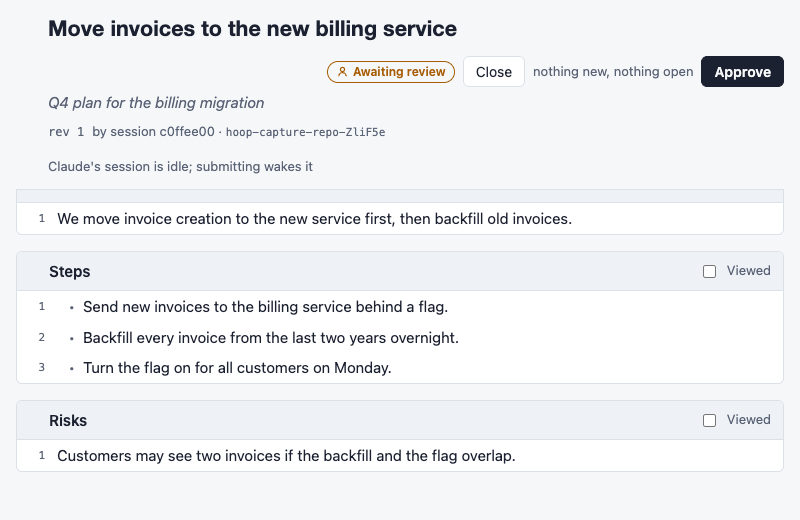

# hoop

Review what Claude writes the way you review code, before it acts on it.



- **Without hoop**, a plan Claude writes scrolls past in chat. You retype your feedback as a
  message, and nobody can see what changed between versions or what you approved.
- **With hoop**, the plan opens on a local page. You comment on its lines and answer its questions
  there, Claude revises, the page shows what changed, and your approval is recorded. Claude goes on
  only after you approve.

A plan, a design, a decision or any document works the same way: comment on lines or words, suggest
changes, answer its questions, then approve or ask for changes. [What hoop touches](#what-hoop-touches)
lists everything it does on your machine.

Every Claude session on your machine uses the same hoop, at `http://localhost:4747`.

> **Status: before 1.0.** Tool names, commands and stored files may still change. This README
> describes `main`; hoop releases every two weeks when `main` has changes, and `CHANGELOG.md`'s
> Unreleased section lists what isn't released yet ([docs/RELEASING.md](docs/RELEASING.md)).

## Get started

You need Node 22.12 or later (on an older one, hoop says what to install and stops) and Claude
Code. Install hoop's plugin, which holds the MCP server, the plan hook, the pull request hook and
the Work view's hooks:

```sh
claude plugin marketplace add ankurjain-nitrr/hoop
claude plugin install hoop@hoop
```

`hoop init` (or `npx -y @ankurjain-nitrr/hoop init`) runs these two for you, then asks
whether to turn on Claude Code's todo tools for [Work](docs/using/work.md). Then, for each
[other agent tool](docs/using/other-agents.md) it finds (Codex CLI, Cursor, OpenCode, Gemini CLI),
it asks whether to add hoop to that tool's user config (`--agents` answers yes for all,
`--no-agents` no). It ends by opening a sample review in your browser to try the review page on
(`--no-browser` only prints its link). `hoop init --print` only prints what to run and lists the
agents it found. Home offers the sample too while it lists no reviews,
with a prompt to copy that asks Claude to send you one. If you installed the old `hoop-plan@hoop` plugin, run
`claude plugin uninstall hoop-plan@hoop` first, and if you added hoop with `claude mcp add`, run
`claude mcp remove hoop`, so its tools aren't listed twice.

[`newton`](newton/) starts `claude` with hoop, the todo tools and Claude in Chrome always on.

The plugin runs the `hoop` on your PATH, or, without one, the version of
[`@ankurjain-nitrr/hoop`](https://www.npmjs.com/package/@ankurjain-nitrr/hoop) it pins, through
`npx`. For other setups, add the MCP server alone:

```sh
claude mcp add hoop -- npx -y @ankurjain-nitrr/hoop mcp
```

Then ask Claude for something you want to review, for example:

> Draft a plan for moving our invoices to the new billing service, and send it to hoop for my
> review.

Claude replies with a link. Review the document there and send your review. Claude picks it up,
answers your comments, revises, and repeats until you approve.

No skill is needed for this: when a session connects, hoop tells Claude when to ask for a review,
how to write the document and its questions, and to go on only after you approve.

## Using hoop

- [Reviewing a document](docs/using/reviewing.md): comment, answer questions, approve or request
  changes, close; any markdown file.
- [Suggestions and Apply](docs/using/suggestions.md): change Claude's text yourself.
- [Tracked changes](docs/using/tracked-changes.md): accept or reject the edits Claude proposes.
- [Quick questions](docs/using/quick-questions.md): one-click answers to Claude's one-line decisions.
- [Revisions](docs/using/revisions.md): what changed, what shows live, and your drafts across
  revisions.
- [Home](docs/using/home.md): everything waiting on you, across every session.

## Advanced

- **Plans.** The plugin opens each plan as a review before Claude Code leaves plan mode, and Claude
  goes on only after you approve it ([Reviewing](docs/using/reviewing.md#plans-and-files)). It needs
  `perl` on your PATH.
- **Pull requests.** The plugin tracks each pull request a session opens with `gh pr create`, for
  [Home](docs/using/home.md#pull-requests), and never blocks or fails that command.
- [Building a document together](docs/using/building.md): shape a document with Claude, section by
  section.
- [Work](docs/using/work.md): what each Claude Code session is doing, and how to steer it.
- [Other MCP agents](docs/using/other-agents.md): the config for other agent tools, and every MCP
  tool and `hoop` command.
- **Agent evals.** `npm run eval` runs real Claude Code sessions on your own sign-in, scored by
  deterministic checks. They cost money and never run in CI.

## What hoop touches

Everything hoop does on your machine. A part that acts inside a session has a switch of its own in
hoop's off list, `~/.hoop/off` (below); where one has no switch yet, it says so, and the
switches are tracked in [#212](https://github.com/ankurjain-nitrr/hoop/issues/212).

- **The plugin's hooks.**
  - Before Claude Code leaves plan mode, the plan hook opens the plan as a review. Switch:
    `plan_hook`; off, Claude Code asks you to approve the plan itself.
  - Before every tool call, the Work view's gate runs; with no change from you for that session it
    exits at once without starting hoop. While a review Claude sent waits for your review, it also
    refuses Claude's first file write or edit, once for each revision, naming the review. Switch:
    `tool_gate`; off, every call goes ahead, including an agent's you stopped on Work.
  - After a Bash call, a hook records a pull request that `gh pr create` opened.
  - In the background, the Work view's hooks record todos, subagents and permission prompts, and
    `hoop work-hook` runs at the end of every turn; the session-end hook runs as the session ends.
  - When a session starts, resumes, clears or compacts, a hook adds a short note to Claude's
    context listing what waits for it, and one before a compaction saves what is open.
  - Before a turn ends, the Stop gate holds it once for feedback that came during the turn, or for
    a build request Claude hasn't taken; marking a todo done is held once while the review or pull
    request it links to isn't finished (the TaskCompleted gate). Switch: `turn_gates`, for both;
    off, turns end and todos close without hoop holding them.

  A hook that is off exits at once, without starting hoop or Node.js.
  `claude plugin disable hoop@hoop` turns off every hook and hoop's MCP tools; the pages process
  stays up until it has been idle for an hour. The other hooks have no switch of their own.
- **`hoop init`** adds hoop's plugin marketplace and installs the plugin. Then it asks (`--yes`
  answers yes without asking) whether to set `CLAUDE_CODE_ENABLE_TODO_TOOLS=1` under `"env"` in
  Claude Code's `settings.json` (in `~/.claude`, or `CLAUDE_CONFIG_DIR`), and keeps the old file as
  `settings.json.hoop-backup`. Remove that line to turn the todo tools off. For each other agent
  tool whose config folder it finds, it asks (`--agents` answers yes for all) whether to add hoop's
  MCP server to that tool's user config:
  - `[mcp_servers.hoop]` in `~/.codex/config.toml` (or `CODEX_HOME`);
  - `"hoop"` under `mcpServers` in `~/.cursor/mcp.json` and `~/.gemini/settings.json`;
  - `"hoop"` under `mcp` in `~/.config/opencode/opencode.json`.

  It rewrites a JSON file with the same indentation and keeps the original as `<file>.hoop-backup`,
  and appends to Codex's file. It leaves alone a file it can't read with certainty, such as JSON
  with comments. Remove the `hoop` entry to take it out.
- **Messages into a session.** Claude's session gets one message when you submit a review, close or
  reopen one, answer a quick question, send a request on a build, change something on Work, or close
  or reopen an action item, so it reads them even after it stopped waiting. Switch: `messages`; off,
  nothing is sent into a session: Claude reads what you sent when it next calls `hoop_wait` or
  `hoop_feedback`, Work's changes wait for the gate, and the pages say "Not sent: messages into a
  session are off in hoop's off list".
- **What it reads.** Session transcripts, for the Work view, a session's name, and whether Claude read a
  change you sent on Work;
  and `ps` (and `sysctl` on a Mac) to tell which sessions are running.
- **What it writes outside its own files.** Renaming a session on Home adds the name to its
  transcript, as `/rename` does. `hoop`, `hoop open` and `hoop init` open your browser
  (`--no-browser` doesn't).
- **Files.** Reviews live beside each session's transcript, in
  `~/.claude/projects/<folder>/<session-id>/.hoop/`, and the rest under `~/.hoop`
  ([Settings and storage](#settings-and-storage) says what and how to remove it). On its first start,
  the pages process moves each review in `~/.hoop/reviews` into its session's folder, when that
  folder still exists, and records how many moved and stayed in `~/.hoop/migrated.json`.
- **The pages process** on `127.0.0.1:4747`, which serves the pages to this machine only and stops
  after an hour with no session and no page open.
- **The network.**
  - With no `hoop` on your PATH, the plugin fetches its pinned version of hoop through `npx`.
  - Home asks `gh pr view`, with your GitHub sign-in, for the pull requests sessions opened, and
    for an action item that waits on a merge; `npm view` for one that waits on a release.
  - A page with a diagram loads a pinned Mermaid from jsDelivr, checked against its hash
    ([Security](#security)). Switch: `mermaid`; off, no page loads it, and each diagram shows its
    source.
  - The pages process asks `npm view @ankurjain-nitrr/hoop version` for the latest release at most
    once a day, keeps the answer in `~/.hoop/update.json`, and says nothing when it fails. When it
    is newer than the running hoop, Home says so with the command that updates. `HOOP_NO_UPDATE_CHECK=1`
    in the pages process's environment turns this off.

  The others have no switch yet.

## Settings and storage

Each part that acts inside a session is on until hoop's off list names it. The list is the file
`~/.hoop/off` (under `HOOP_HOME` when set), which you write and hoop only reads: one switch name
per line, and any other line, such as a `#` comment, names nothing.

```text
# Turn off the plan hook and the turn gates
plan_hook
turn_gates
```

The plugin's hooks read the file each time they run, so a change applies to the next tool call or
turn, in every session. [What hoop touches](#what-hoop-touches) says what each switch turns off.

From the environment, `HOOP_HOME` moves `~/.hoop`, `HOOP_REPO_DIR` sets the folder a review records
(the current folder by default), `HOOP_PORT` sets the port (4747), `HOOP_SESSION` names the session
for an agent other than Claude Code, `HOOP_NO_BROWSER` stops `hoop`, `hoop open` and `hoop init`
opening a browser, and `HOOP_NO_UPDATE_CHECK` stops the daily check for a newer hoop.

`hoop update` updates hoop: the package with `npm install -g`, when it is installed that way, and
the plugin with `claude plugin marketplace update hoop` and `claude plugin update hoop@hoop`. It
prints the commands first, then runs them (`--print` only prints them). Without a global install,
the plugin runs the package of its own version, so updating the plugin updates both. A hoop linked
from a checkout with `npm link` is left alone: update it there with `git pull && npm run build`.

Each Claude Code session keeps its reviews beside its transcript, in
`~/.claude/projects/<folder>/<session-id>/.hoop/` (or under `CLAUDE_CONFIG_DIR`). Claude Code deletes
a session's folder after `cleanupPeriodDays` (30 days by default), and its reviews go with it;
raise the setting in Claude Code to keep them longer.
Reviews from another agent, or from a terminal outside a session, stay in `~/.hoop/reviews`. hoop
never deletes a review by itself: `hoop clear <review_id>` deletes one, and `hoop clear --session
<id>` every review of one session, after asking. `hoop loop-time` reads them, and the action items,
to print how long you take to answer Claude: the median from each request to your first response,
per kind. It only reads, and those numbers stay on this machine.

One background process on `127.0.0.1:4747` serves the pages for every session and is the only one
that writes hoop's files. A session or command starts it when nothing answers there; it restarts
into new code after an update, and stops after an hour with no session and no page open.

To remove hoop: `claude plugin uninstall hoop@hoop` (or `claude mcp remove hoop` if you added only
the MCP server), `npm rm -g @ankurjain-nitrr/hoop` if you installed it globally, `rm -rf ~/.hoop`
for your settings and the reviews kept there, and `rm -rf ~/.claude/projects/*/*/.hoop` for the
reviews in session folders.

## Security

[`SECURITY.md`](SECURITY.md) says how to report a vulnerability privately and what hoop guards.

## Develop

[`CONTRIBUTING.md`](CONTRIBUTING.md) covers setup, picking an item to work on and what a pull
request needs. `npm install` builds hoop and sets up the commit hooks; `npm run typecheck`, `npm run lint`, `npm run
debt` and `npm test` check a change. `npm test` skips the browser tests unless it finds Chrome
(`HOOP_CHROME` points at it; `HOOP_REQUIRE_BROWSER=1` fails instead of skipping), and `npm run
e2e:local` is the acceptance run. The push hook runs the type check, lint and only the tests that
name what the branch changed, without the browser; `HOOP_FULL_PUSH=1 git push` runs the whole suite
first. CI runs everything and blocks the merge. `npm run bench` times hoop's loop against its
targets, only when you ask. To try a branch's pages, run its hoop on a throwaway `HOOP_HOME`, with
`HOOP_CLAUDE_DIR` set to an empty folder and `CLAUDE_CODE_SESSION_ID` to a made-up ID.
[`docs/DESIGN.md`](docs/DESIGN.md) describes how hoop works,
[`docs/DESIGN-LANGUAGE.md`](docs/DESIGN-LANGUAGE.md) how its pages look and speak, and
[`docs/RELEASING.md`](docs/RELEASING.md) how a release is published.

## License

Apache License, Version 2.0. See [`LICENSE`](LICENSE).
