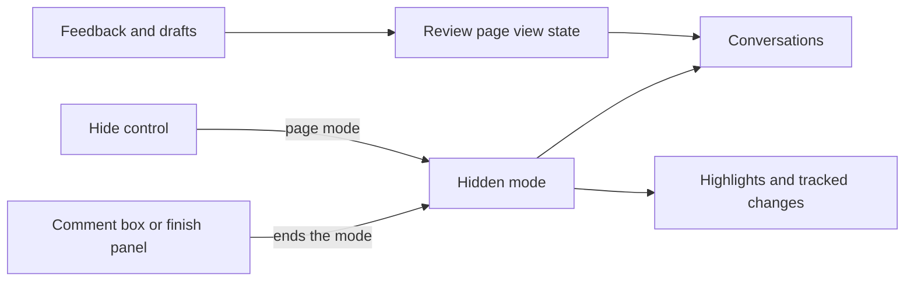

# CR-13: HLD

Status: draft · Revision: 3 · PRD: approved (revision 3)

This document covers components and how they interact. The code-level design goes in the LLD.

## Context

The change lives in the project HLD's Web component only, in the review page. The server, the
local API, the agent tools and the stored files don't change. The page already knows which
conversations are resolved, from the feedback it reads and from the reviewer's pending resolutions.

## Components

All of these are parts of the project HLD's Web component.

| Component | Responsibility | Talks to (how) |
|---|---|---|
| View state (changed) | It holds, for the open page only, which resolved conversations the reviewer opened. Nothing stores it. | The review page reads it when it renders. |
| Conversations (changed) | A resolved conversation shows as a closed summary row, unless the reviewer opened it or a reply came after its resolution. An open one shows in full, as today. The same rows show under tracker table rows. | They read the view state, and use the browser's own disclosure element. |
| Hidden mode (new) | It is one page-level mode that hides every conversation, pending comment, tracked change card and line decoration. | Styles hide what carries a comment marker, so nothing renders again. |
| Hide control (new) | It sits with the page's top actions, counts what it hides, and turns the mode on or off. | It sets the mode on the page. |
| Comment tools (changed) | Opening the comment box or the finish panel ends the mode, so every comment shows again. | They clear the mode. |

## Key interactions

### A reviewer opens a document with resolved threads

1. The page renders each resolved conversation as a closed summary row with its place and count.
2. The reviewer opens one row. It stays open until the page closes, through other actions.
3. A reply added after the resolution reopens the conversation, so it shows in full. A GitHub
   review's thread follows GitHub's own resolved state instead, because hoop has no resolution
   time for it. Someone who replies on GitHub can unresolve the thread there.

### A reviewer hides every comment

1. The reviewer uses the control. The page enters the mode, and its styles hide every comment.
   Focus stays on the control, and the text the reader was on doesn't move.
2. When the reviewer opens the comment box or the finish panel, the mode ends.

## Cross-cutting concerns

- Safety of the verdict: comments can't stay hidden at verdict time, because the finish panel ends
  the mode, and a reload starts with comments shown.
- Security and trust boundaries: nothing new crosses the local API. A summary row shows only its
  place and count, built from escaped text.
- Accessibility: summary rows use the browser's own disclosure element, and the control says
  whether it is pressed. Neither renders the page again, so keyboard focus stays where it was.
  Project NFR-11's page checks cover both.
- Future renderers: the mode hides anything that carries a comment marker. So CR-6's tables and
  diagrams inherit it without a change of their own.
- Compatibility: nothing stored changes, so older drafts and reviews work as before.
- Testing strategy: browser tests cover each requirement, and the page checks run with collapsed
  rows and with comments hidden.

## Alternatives considered

- Doing nothing: resolved agent threads keep crowding each document the requester reads.
- Remembering the hidden choice in the browser: a requester could approve with open threads hidden.
- Collapsing every conversation: open threads that need an answer would be easy to miss.
- Hiding by rendering the page again without comments: it would lose focus and the reader's place,
  and every new renderer would need its own check.

## Decisions

- D-1 (2026-10-19): The page holds the view state in memory only. Context: the verdict must always
  see every comment. Consequences: each visit starts with comments shown and resolved rows closed.
- D-2 (2026-10-19): Hiding comments is one page-level mode applied by styles. Context: focus and the
  reader's place must stay, and later renderers must not need changes. Consequences: every comment
  element carries a marker that the mode hides.

## Requirements traceability

| Requirement | Components |
|---|---|
| FR-1, FR-2, FR-3 | View state, conversations |
| FR-4 | Hidden mode, hide control |
| FR-5 | Hidden mode, comment tools |
| NFR-1 | Conversations, hide control |

## Risks

- A reviewer misses a resolved thread that matters. The summary row names its place and count, and
  one click opens it.
- A new kind of comment element lacks the marker, so the mode doesn't hide it. The page checks run
  with comments hidden, and a browser test looks for any comment text left visible.
