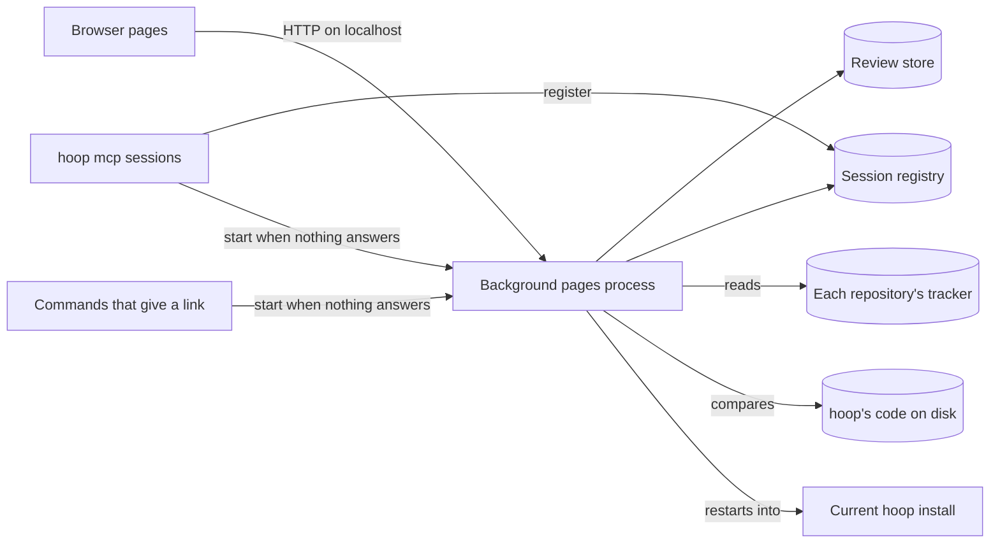
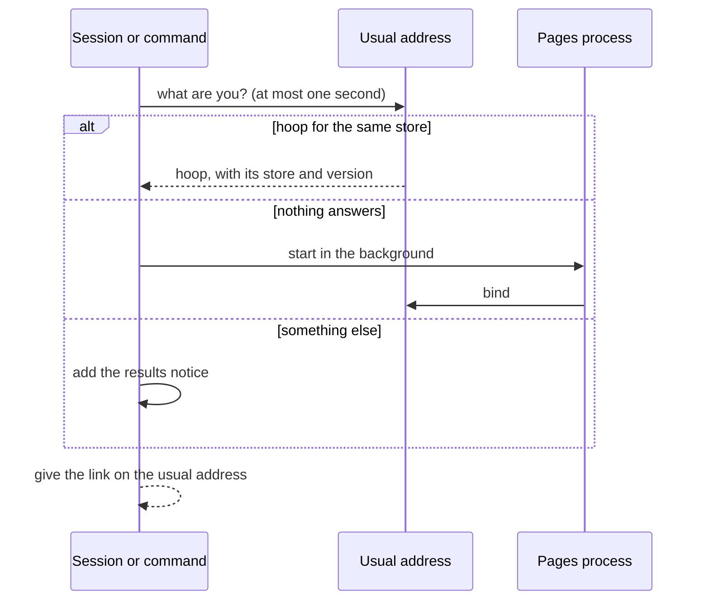
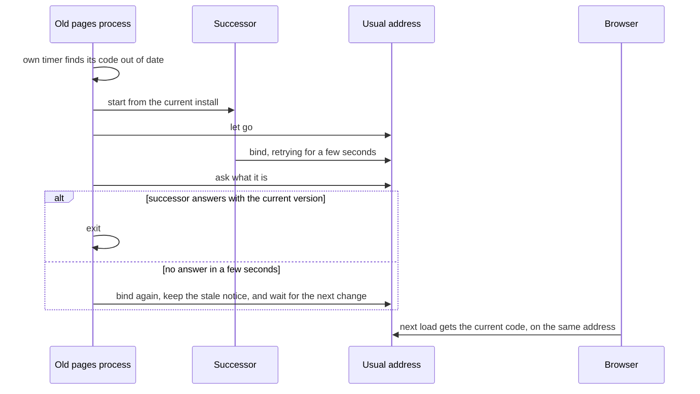

# CR-22: HLD

Status: in review · Revision: 3 · PRD: approved (revision 5)

This document covers components and how they interact. The code-level design goes in the LLD.

## Context

Today each `hoop mcp` session tries to serve the pages on the usual address, and the first one
wins. When it ends, the pages stop. Reviews already live in one store on the machine, so any
server can show every review. Only the tracker and the repository name come from the serving
process.

This change moves the pages into one background process that no session owns. Sessions start it
when nothing answers, and it outlives them. It restarts itself when its code is out of date, and
it stops when nothing has used it for an hour. Short commands such as `hoop submit` start it too
when they give a link, but they never register.

## Components

The registry sits next to the review store. The others are parts of the project HLD's web server
and core components.

| Component | Responsibility | Talks to (how) |
|---|---|---|
| Starter (new) | Before it gives a link, a session or command asks the address what it is, waiting at most a second. It uses a hoop server for the same store, and starts the pages process when nothing answers. Anything else leads to the results notice. | HTTP on localhost, and the operating system to start a process. |
| Pages process (new) | It serves the pages on the usual address, apart from every session. It stops after an hour with no live session and no open page. An open page tells the server it is still open. | The operating system, the store and the registry. |
| Registry (new) | It lists each live `hoop mcp` session with its repository, its hoop release and its install. It has a format version, and readers skip what they don't know. | Files in the store's folder, which only the user's own programs can write. |
| Versions (new) | It names the code the pages process started with, and the current code. Current code is the newest release a live session uses, even when it is older than the server's. With no live session, it is the server's own install. | Files on disk and the registry. |
| Self restart (new) | When the pages process is out of date, it starts a successor from the current install and lets go of the address. When its own install is gone and no live session runs, it exits. If the successor doesn't answer in a few seconds, the old process serves again. It tries once for each change of the current code. | The operating system, the address and the audit log. Only its own timer starts it. |
| Pages server (changed) | It serves the page files it started with, so its pages match its routes. It reports its version, its store, whether it is out of date, and the open repositories. | HTTP on localhost, with today's host and origin checks. |
| Picker (changed) | A review page names its review's repository. The tracker page shows the tracker of a chosen open repository. | It asks the pages server for the open repositories. |
| Page start (changed) | When the page's code fails to load, or the server stops answering, the page says what went wrong and how to bring the pages back. | The browser only. |
| Stale notice (new) | The menu shows the serving version. Every page warns while the server is out of date. | It reads the server's report. |
| Results notice (new) | When no hoop server for this store can serve the address, each result with a link says so. It waits for the requester's approval. | The core's results. |

## Key interactions

### A session gives a link

The session's tools never wait on the pages, except for the one second check.

### hoop's code changes

The browser keeps its drafts, because the address doesn't change. Pages servers from before this
change can't restart themselves, so the first update needs one restart of the session that serves.

### The pages show another repository

1. The tracker page asks the server for the open repositories, and gets each one's name and key.
2. The reviewer picks one. The server finds its folder in the registry and reads its tracker.
3. A review page names the repository recorded with the review, whichever repository started the
   server.

### Nothing uses the pages

After an hour with no live session and no open page, the pages process exits. The next
session or link starts it again. A page left open then says the pages stopped, and names the step
that brings them back.

## Cross-cutting concerns

- Security and trust boundaries: the pages stay on this machine, with today's host and origin
  checks. No request can make the pages process stop or restart. Only its own timer does, from the
  user's own files. A page names a repository only by its name and a key that hides the folder.
  So project NFR-13 still holds. A program on this machine that answers like hoop is trusted, as
  the PRD assumes.
- Settings: the pages process takes its store, its address and its audit setting from the process
  that started it. A successor takes the same ones. The repository comes with each request, from the
  registry, so no session's folder holds for every repository.
- Trust in the registry: an entry names the install a restart may run. Only the user's own programs
  can write it, and a session the user's Claude runs already runs code as the user. The audit log
  records each install the pages process restarts into.
- Removal and rollback: a rollback makes an older release the newest one that live sessions use,
  so the pages process restarts into it. An uninstall removes its install, so the process exits
  once no live session runs. CR-28's removal steps say how to stop it sooner.
- Version skew: an old pages process now lives only until its timer sees newer code. Until then
  every page shows the warning. Writes during that window use the old code, as they do today.
- Several stores: the server reports a key for its store. A session with another store treats it
  as something else, so its results say that the pages aren't available.
- Compatibility between releases: the registry has a format version. A reader skips entries of a
  newer format and fields it doesn't know. Nothing already stored changes.
- Observability: the menu shows the serving version, and every page shows when it is out of date.
  Starts, restarts and stops are written to the audit log.
- Performance: the current code is worked out at most once per page load, within NFR-3.
- Testing strategy: tests start real hoop processes, each on a free address with its own store.
  They cover a start, a reuse, a holder that isn't hoop, another store and a self restart. They
  also cover a successor that can't start, the idle stop, and restart attempts by request. Browser
  tests cover the picker, the warning and the page start error. An acceptance script runs two
  sessions in two repositories and ends them.

## What changes in the project design

- Project NFR-1 and the project HLD's context say one process serves MCP and the pages. Now the
  pages run in their own background process, which sessions start.
- The server's information request named the served folder's repository. Now it names the server's
  version, store and state, and lists the open repositories. Project FR-32's frame names the
  document's repository.
- `hoop serve` in a terminal works as today. It serves in the foreground, and says so and exits
  when hoop for the same store already answers.

## Alternatives considered

- Doing nothing: every second session keeps showing the first repository, the pages stop with the
  first session, and each stale server is found by hand.
- A free port for each session: drafts in the browser belong to an address, so moving port loses
  them. The PRD reviews ruled it out.
- Every session standing by and handing the address over: each session needs a retry loop. A hand
  over that fails needs a fallback too. It still stops the pages with the last session. The
  first HLD review found the background process simpler.
- Serving page files fresh from disk: an old server would send new pages that call routes it lacks.

## Decisions

- D-1 (2026-10-19): The pages run in one background process that no session owns. Context: drafts,
  links and the guide depend on one address, and reviews outlive sessions. Consequences: sessions
  only start it, and the restart logic lives in one place.
- D-2 (2026-10-19): Only the pages process's own timer can stop or restart it. Context: a web page
  can send plain requests to the address. Consequences: no route is added to defend.
- D-3 (2026-10-19): A server serves the page files it started with. Context: a server's pages must
  match its routes. Consequences: new page files appear after a restart, not before.
- D-4 (2026-10-19): Out of date means the server's release differs from the newest one a live
  session uses, or its own files changed. Context: installs can live in separate folders, rollbacks
  happen, and two current checkouts must not switch back and forth. Consequences: two installs of
  one release don't restart each other.

## Requirements traceability

| Requirement | Components |
|---|---|
| FR-1 | Starter, pages server |
| FR-2 | Starter, pages process |
| FR-3 | Starter |
| FR-4 | Self restart, versions |
| FR-5 | Versions, stale notice |
| FR-6 | Picker, registry, pages server |
| FR-7 | Stale notice |
| FR-8 | Page start |
| FR-9 | Results notice |
| FR-10 | Pages process, page start |
| NFR-1 | Pages server, self restart |
| NFR-2 | Pages server, picker |
| NFR-3 | Versions |

## Risks

- A crashed session leaves its registry entry. An entry counts only while its process still runs,
  so a dead one never picks the install to restart into.
- Two sessions start the pages process at the same moment. The operating system lets only one bind,
  and the other exits.
- The code on disk is read while an update is half written. The successor may fail to start, so
  the old process serves again and retries on a later check.
