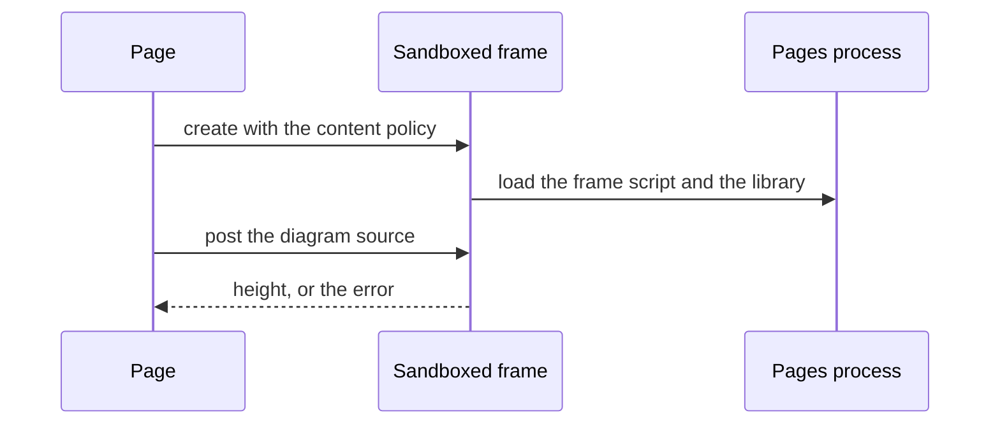
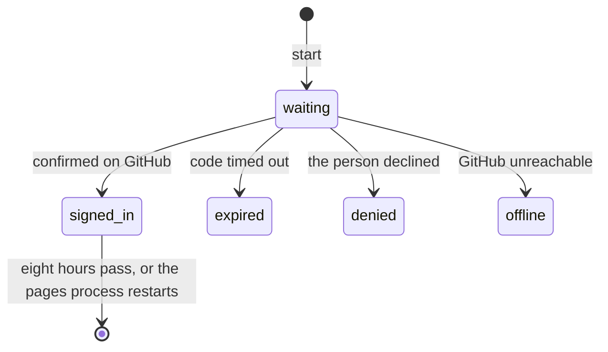
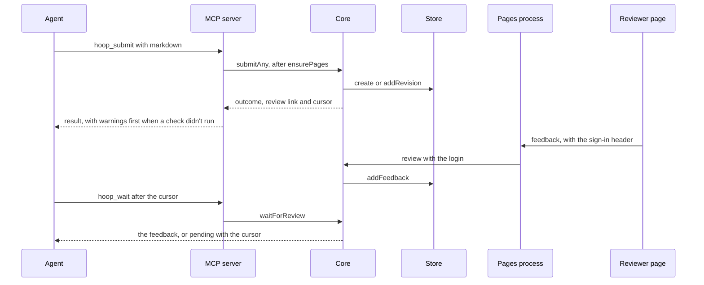

# hoop LLD

Status: approved · Revision: 9 · Describes `main`

This document says how each component of the HLD is built, at the level a team agrees on before
coding. Code-level detail is limited to files, design patterns and the public interfaces between
layers and packages. Logic inside a file is left to code review. Diagrams are in Mermaid. The text
points only to requirements, by their IDs.

## Contract (`src/contract.ts`)

- Responsibility: it defines the shape of everything exchanged, and validates it with field paths
  (FR-1, FR-2, NFR-4).
- Data model: the zod types are `ReviewDoc`, `Item`, `Choice`, `Feedback`, `Comment` and `Range`. A `Comment`
  holds `item`, `line >= 0`, an optional `range {start, end, quote}`, and a `body` or a
  `suggestion`.
- `Feedback` has four optional fields for the sign-in: `signed_in: { login }`, `unverified`,
  `agent_approval` and `changes_requested_by_agent` (FR-81 to FR-84). Without them in the schema,
  validation would drop them. Older readers ignore them, so the format keeps its version (NFR-4).
- Interface: `validateReview(input)` and `validateFeedback(input, doc?)` return `{ok, value}` or
  `{ok: false, errors: [{path, message}]}`.
- `itemLines(item)` gives an item's lines: non-empty body lines, then question choices as
  `a) label`, then `Check: …`. `itemBlocks(item)` gives each line's block. `anchorText(doc, item,
  line)` gives an anchor's text, and `DOC` is reserved.
- Scopes: `scopeOf(anchor)` gives a line, section or document scope (FR-19).
  `sectionItems(doc, item)` gives the item and every later item with a deeper level, up to the next
  heading at its level or above (FR-77).
- `inScope(scope, target, doc?)` uses `sectionItems` for a section scope, so an edit's scope widens
  with it (FR-20). `commentScope(doc, anchor)` gives the scope that feedback states (FR-72).
- Errors: validation refuses duplicate IDs, questions without choices, unknown dependencies, anchors
  that don't exist, and a range whose quote doesn't match.
- The published JSON Schemas come from these zod types, as "Schemas and the README" says.

## Edit engine (`src/edit.ts`)

- Responsibility: it changes exactly one span in exactly one field (FR-18, FR-20 to FR-22, FR-73).
- Interface: `locate(doc, {item, line, find, replace, start?})` finds the span at `start`, or the
  single occurrence. `applyEdit(doc, edit)` returns a new document.
- `wordStats(find, replace, line)` counts changed words and marks a large rewrite. `narrow(text,
  replacement)` shrinks a whole-line suggestion to the differing words.
- Behavior: `setter` maps an anchor to its field. The fields are the title, the TL;DR, a heading,
  the n-th non-empty body line with its indentation, a choice's label and the check. The result is
  read again and compared.
- `RULES` is one table of every edit rule, with its name and its sentence (FR-73). The propose
  tool's description is built from it, so it lists every rule. The rules are these.
  - `line_exists`: the item and line exist.
  - `find_given`: the words to replace are given.
  - `found`: the words occur in the line.
  - `once_in_line`: the words occur once in the line.
  - `changes_text`: the replacement differs from the words.
  - `no_line_breaks`: the replacement holds no line break.
  - `not_tldr`: an automatic TL;DR isn't edited, since it repeats the first paragraph.
  - `not_empty`: a line keeps some text.
  - `option_label`: an option keeps its letter and marker.
  - `editable_in_place`: the line is text that can be edited in place.
  - `keeps_markup`: a document's line keeps its markdown structure.
  - `in_scope`: an edit stays on its comment's line, section and nested sections, or document.
  - `no_overlap`: two edits in one call don't touch the same text.
  - `line_unchanged`: the line reads as it did when the edit was proposed.
- Errors: `EditError` holds the `rule` it broke, a field and a message that starts with the rule.
  The materializer and the apply path refuse with the same names. A large rewrite stays a mark on
  the proposal, not a refusal.
- Audit: a refused edit records `edit_refused` with its rule. `hoop audit` reports the share of proposed edits refused, by
  rule.

## Quotes (`src/quote.ts`)

- Responsibility: it anchors a comment, a reply or a proposed edit by its words (FR-71, FR-136).
- Interface: `placesOf(doc, words, item?)` lists every place the words occur. `resolveQuote(doc,
  { item?, words }, ctx)` returns `{ item, line, range }`.
- It searches each line's text as `itemLines` gives it, and the title and the TL;DR. An item
  narrows the search.
- Errors: a `HoopError` that lists every place the words occur, or says they occur nowhere. Its
  field path names the input, such as `comments.0.words`.
- Input only: a comment or a reply sent to `Hoop.review` may hold `words` in place of `line`, and
  `item` is then optional. `Hoop.review` resolves `words` before it validates.
- The stored `Comment` keeps `line` required, so the stored and published format doesn't change.
  The name `words` keeps it apart from `range.quote`.
- A proposed edit may leave out `item` and `line`, and its `find` then picks the line in the same
  way.
- Audit: a refused quote records `quote_refused`.

## Markdown (`src/markdown.ts`)

- Interface: the module exports `parseMarkdown(md, {title, tldr, slug, channel, review_id})`,
  `exportMarkdown(doc)`, `keepIds(prior, next)`, `matchSections(prior, next)`, `linePlaces(markdown,
  options)` and `JOIN` (U+2028).
- Behavior: the first `#` heading is the title. ATX and setext headings start sections, with their
  `level`.
- Blocks are paragraphs, list items with continuations, quote lines, table rows, fenced and
  indented code, and thematic breaks. Each block is one line, with its source lines joined by
  U+2028.
- Blank lines between blocks and around headings stay as empty body lines. They take no comments,
  so anchors don't move.
- The intro is section `S-0` at level 0. The TL;DR defaults to the first paragraph (`tldr_auto`).
- With `spacing: "exact"` (a document with a `#` title), export writes headings and bodies
  verbatim. Without it, export puts one blank line around headings (FR-17).
- Section matching (FR-78, FR-142): `matchSections` runs in two passes. The first matches by
  heading. The second matches the sections left over by level, parent and place among siblings.
- It returns the document and `renamed`, a map from each section matched by place to its old
  heading. `keepIds` returns only the document. Two sections with the same heading keep their own
  IDs.
- Matching runs only when a new revision arrives, so stored revisions keep their IDs. The
  contract's `Item` doesn't change, so the format agents submit stays the same.

## Store (`src/store.ts`)

- Data model: `ReviewMeta` holds id, slug, title, channel, status (open, approved or closed),
  revisions, `repo_dir`, `github` (a `PrRef`), `supersedes`, `decision_files` and `pr_answers`.
- It also holds `superseded_by` (FR-64), `approved_at`, `change`, and `decisions: false` for a
  review whose approval writes no files (FR-87).
- `decision_files` holds names in the repository (FR-65). Reviews stored before that keep absolute
  paths, and `decisionNames` in the core turns them into names.
- The other records are `Reply`, `Proposal` (id, thread, revision, item, line, find, replace, start,
  line_text, words, status) and `Applied`.
- Interface: the store has `create`, `addRevision`, `update`, `meta`, `revision`, `feedback`, `allFeedback`,
  `addFeedback`, `setFeedback`, `replies`, `addReply`, `proposals` and `writeProposals`. It also
  has `applied`, `addApplied`, `findThread` and `list`.
- `addFeedback` assigns `th_<review>_<n>` thread IDs.
- Each revision may have two more files. `saveCheck` and `latestCheck` keep
  `checks-<revision>.json`, and `saveRenamed` and `renamed` keep `renamed-<revision>.json`.
- Behavior: writes are atomic, through a temp file and a rename. Review IDs are validated before
  paths are built.

## Core (`src/hoop.ts`)

- Interface: the core has `submit`, `submitAny` (both channels), `feedback`, `feedbackAny` (refreshes GitHub),
  `review`, `applySuggestion`, `proposeEdits`, `editPosition` and `decideEdit`. It also has
  `reply`, `replyAny`, `refresh` and `writeDecision`.
- Submit results (FR-63): `submitAny` returns `outcome` (`created`, `revised` or `superseded`) and
  `next_review_id`. A result leads with `warnings` when its check didn't run (FR-68).
- A submit that supersedes an approved review sets `superseded_by` on it, and `feedback` returns
  that field (FR-64).
- `review(reviewId, input, auth?)` validates new comments against the current revision, and
  replies keep their anchor. It resolves `words` first (FR-71).
- `review` takes the login and the sign-in setting in `auth`, and applies `verdictFor` from the
  review rules (FR-81 to FR-84). Only a final approval freezes the review and writes the decision.
- `feedback` adds `scope` to each comment: `line`, `section` with the covered item IDs, or
  `document` (FR-72).
- Behavior: documents keep section IDs across revisions through `matchSections`. A final approval
  writes decisions, as clean markdown for `kind: "doc"`, unless `decisions` is false.
- The decision record holds `approved.login`, `approved.notes` from the summary, and
  `approved.unverified` (FR-83 to FR-85). Its files are stored as names in the repository.
- Accepted spans rebase other proposals on the line. Every action is audited.
- `applySuggestion`, `proposeEdits`, `editPosition` and `decideEdit` delegate to the materializer,
  and every refusal comes from the review rules.
- Errors: the core throws `HoopError(message, fieldErrors)`. Approved, closed and GitHub reviews refuse local edits.

## Review rules (`src/rules.ts`)

- Responsibility: it writes once each rule about whether a review can change, the thread lookup and
  whose verdict counts (FR-7, FR-31, FR-81).
- `editable(store, id, { open, frozen, github })` returns the review or throws. Each caller passes
  its own wording for a GitHub review.
- `thread(store, id, threadId)` returns the first comment, its revision and every entry.
  `threadIds` and `existing` sit alongside them.
- `reviewStatus(store, meta)` gives a review's status key (FR-33). The keys are awaiting_review,
  commented, changes_requested, approved and closed.
- A GitHub review that is approved but not merged is awaiting_review, with a note.
- `verdictFor(verdict, login, signin)` returns the verdict that counts, its marks and a note
  (FR-81 to FR-84). With a login, the verdict stays and gains `signed_in`.
- With the sign-in off in the person's own settings, the verdict stays and gains `unverified`.
- Otherwise an approve becomes a comment with `agent_approval`, and a request for changes becomes a
  comment with `changes_requested_by_agent`. The note says so in the result.

## Materializer (`src/materialize.ts`)

- The `Materializer` holds apply, propose, decide, edit positions and the rebase of other proposals
  on a line (FR-18, FR-20, FR-21). It uses the review rules, the edit engine, the quotes and the
  store.
- Its scope checks use `inScope` with the document, so a heading comment's edits may touch its
  nested sections (FR-20).

## GitHub (`src/github.ts`, `src/render.ts`)

- Interface: `GitHub(gh)` has `open(dir, doc)`, `revise(ref, doc, n)`, `sync(ref, id, revisions)`
  and `reply(ref, rootCommentId, body)` (FR-12 to FR-15).
- `PrRef` keeps `commits` (each commit's revision) and `own_comments`.
- `src/render.ts` holds `renderMarkdown(doc, revision)`, which gives the rendered markdown and its
  line map. `renderPrBody` and `readCheckboxAnswers` write and read the question checkboxes.
- Behavior: commits go through the git trees API, so the checkout is untouched. Comment lines map
  through the line map of the revision they were made on.
- Resolved threads come through GraphQL. A response without a field hoop reads fails, naming the
  endpoint and the field.

## Operations, project settings and the MCP server (`src/ops.ts`, `src/project.ts`, `src/mcp.ts`)

- Responsibility: one registry holds every agent tool and terminal command, and each project gets
  the right tools (FR-31, FR-58 to FR-62, FR-141).
- `OPS` holds each `Op`: `{name, layer, title, description, input (zod), run(hoop, input,
  {actor}), link?, old?, cli?}`. The `layer` is `core` or `devloop`.
- `link: true` marks an operation whose result holds a link, so the MCP server and the CLI call
  `ensurePages` before it (FR-49).
- `old: { tools?, commands? }` lists the old names an operation still answers to (FR-62). Every use
  of an old name adds `notice` to the result, which names the new one.
- `cli` is optional, for an operation with no command of its own, such as `wait`.
- The core operations are `submit` (markdown, or a decision `document` from old callers), `submit_decision`,
  `feedback`, `wait`, `propose_edits`, `reply` and `export`. The old tool name
  `submit_markdown` maps to `submit`.
- The devloop operations are `cr_create`, `cr_classify`, `cr_step`, `cr_get`, `cr_link_pr`, `tracker_get`
  and `tracker_set`.
- Commands: `hoop submit` takes markdown, and `hoop submit-decision` takes a decision document. The
  old command `hoop submit-json` maps to `submit_decision` (FR-61).
- `src/project.ts` holds `projectSettings(repo)`, which returns `{ devloop }`. It is true when
  `hoop.config.json` holds `"devloop": true`, or `docs/changes/` holds a change folder (FR-59,
  FR-141).
- `createServer(hoop, settings)` registers `hoop_<name>` for each core operation, and each devloop
  one only when `settings.devloop` is true. It also registers each old tool name with the same input.
- Without devloop, the server drops the `change` field from the submit tools' input. A session
  reads the setting once, when it starts.
- There are eight core tool names, counting the old one, and seven devloop tools, which make
  fifteen (FR-58, FR-59).
- `failure()` returns errors as tool errors and audits them.
- The CLI matches the longest command words, and takes the `--name <value>` flags in the usage line.
  It refuses unknown flags and validates with the same schema.
- The CLI prints text or `--json`, and exits 1 with field errors. It acts on the git repository
  root.
- `hoop help` prints two groups, core and devloop, from `layer` (FR-60). Every command runs
  whatever the setting, so the CLI never reads it.
- The commands outside `OPS` are `mcp`, `serve`, `audit`, `wait`, `plan-review` and `allow-check`.
- The interface snapshot in `test/interface.test.ts` records two tool lists, without devloop and
  with it, so every schema stays recorded (FR-31, NFR-4).

## Waiting (`src/wait.ts`)

- Responsibility: it waits for a review from the background or through MCP (FR-8, FR-66, FR-67,
  FR-139).
- A cursor names what a caller has seen. It is the latest revision and the count of feedback on
  it, written as `"<revision>.<count>"`.
- Results of `submit`, `feedback` and `wait` carry `cursor`. `cursorOf(hoop, id)` computes it.
- `waitForReview(hoop, id, { after?, timeoutMs?, intervalMs? })` polls the store, and GitHub every
  15 seconds. It returns on a new review, an approval or a close.
- With `after`, feedback beyond the cursor, or a newer revision's feedback, returns at once. So a
  review that lands between two calls is never missed.
- The operation `wait` takes `{ review_id, after?, seconds? }`, with at most 45 seconds. It has no
  command of its own.
- On a timeout it returns `{ status: "pending", again: true, review_id, cursor, message }`. The
  message says to call again with that cursor (FR-139).
- `hoop wait` keeps its own command, its timeout and its behavior (FR-67). It retries transient
  errors.
- Audit: each wait through MCP records `wait`, with the outcome `reviewed` or `pending`.

## Web server and audit (`src/web.ts`, `src/audit.ts`)

- `src/web.ts` holds a route table behind Host, Origin and JSON checks (NFR-1). The page files in
  `STATIC` are read once, at start.
- `reviewView` adds item lines, history per revision, replies, applied edits and proposal
  positions. It also adds `renamed`, `trail`, `checks`, `status_key` and `repo`.
- `web/app.js` renders. `review.js` adds comments, threads, Apply, tracked-change cards and Finish.
  `select.js` handles selection (ignoring inserted text) and decorations.
- In `src/audit.ts`, `audit(event, data)` appends to the audit log. `readAudit` and `summarize` serve
  `hoop audit` (FR-23, FR-24).

## Pages and line rendering (`web/*`)

- `web/blocks.js` holds the line rules (FR-35). `blockKinds(rawLines)` gives each body line a
  block, `{ kind, indent }`.
- The kinds are paragraph, list, quote, code, break and table, and a kind the pages don't know shows
  as written. It replays the parser's open block between lines.
- `pieceMarker(piece)` gives the structure markers that an edit must keep. The parser, `itemBlocks`
  in `src/contract.ts` and the edit engine import it, and so do the pages.
- `TABLE_DELIM` and `splitRow` live in `web/blocks.js`, and `src/util.ts` re-exports them. A row's
  cells keep their source offsets, and the tracker uses the cell text.
- `web/inline.js` renders a line. `renderLine(text, decorations, block)` puts every shown source
  character in a span that records its offset (FR-36).
- `widen` grows a selection to whole formatted runs. `findTyped` matches typed words in the shown
  text (FR-37). `sourceOffset` maps a DOM position back.
- Only escaped text and a fixed set of tags reach the page, and links open only http and https.
- `web/frame.js`, `web/status.js`, `web/icons.js` and `web/esc.js` hold the frame, the status
  labels, the icons and escaping (FR-32, FR-33).
- API: each review in `GET /api/reviews` and the view in `GET /api/reviews/<id>` carry
  `status_key`, `status_note` when there is one, and `repo`, which is `{ name, key }`.
- Neither response carries a folder path (NFR-15). Each item has `blocks`, and the view has
  `history_blocks`. `repoIdentity` in `src/util.ts` builds the repository's identity.
- `GET /api/info` lists the open repositories, as "Pages process" says (FR-53).
- Tests: `test/pages.test.ts` checks every page in both themes, at 400 pixels, from the keyboard,
  offline and with `axe-core` (NFR-11, NFR-18).
- `HOOP_REQUIRE_BROWSER=1` turns a skipped browser into a failure.

## Nested sections and their scope (`web/outline.js`)

- Responsibility: sections nest up to five levels, and a heading's scope widens with them (FR-3, FR-76,
  FR-77).
- `web/outline.js` builds the outline tree from each item's `level`. The title is level one, and
  levels two to six nest as depths one to five.
- Each node expands and collapses, and the state stays in memory for the page.
- Each item renders with its depth, and the CSS indents by depth. Section IDs stay flat.
- A comment on a heading covers the items `sectionItems` gives, and so does an edit's scope, as
  "Contract" says (FR-19, FR-20).
- The page marks a section matched by place as renamed, from the view's `renamed` (FR-78).

## Tables

- Responsibility: a markdown table shows as a table (FR-35, FR-79).
- `web/inline.js` has `renderTableRow(text, decorations)`. It splits the row into cells and keeps
  each cell's offsets, so selection and highlights still map to source.
- `web/app.js` groups a run of lines whose block kind is `table` into one `table` element. Each row
  is a `tr` with the line's gutter and number.
- The delimiter row renders as a thin row, so every line keeps its number. The first row is the
  header. Tracker tables keep their tree.

## Diagrams (`web/diagram.js`, `web/diagram-frame.js`)

- Responsibility: Mermaid diagrams draw safely and offline (FR-80, FR-134, FR-138, NFR-19, NFR-20).
- The library is a pinned copy of mermaid's minified file, `web/vendor/mermaid.min.js`, not a
  package dependency. `web/vendor/mermaid.json` holds its version and its SHA-256 hash.
- `scripts/vendor-mermaid.mjs` fetches a named version from the npm registry and writes both. A
  test checks the file against the hash.
- The pages process serves it at `/vendor/mermaid.min.js`. It reads the file on the first request
  and keeps it, rather than at start (NFR-19).
- `web/diagram.js` finds a code line whose fence names `mermaid`. It renders an `iframe` with
  `sandbox="allow-scripts"` and a `srcdoc` that loads `/diagram-frame.js` and the library.
- The `srcdoc` sets a content policy: `default-src 'none'`, scripts from those two files only,
  inline styles, and images and fonts from `data:` only (NFR-20).
- `web/diagram-frame.js` receives the source by `postMessage`, draws with the library's strict
  level, and posts back the height or the error.
- A sandboxed frame can still navigate itself. So the page removes a frame that fires a second
  `load`, and shows the source with the reason.
- States: a diagram shows a placeholder until the frame answers, then the drawing, or the source with
  the reason. A page
  without a diagram line loads neither file.
- The frame's own requests carry the origin `null`, and the server already refuses writes from it.

## Reviewer delete and edit in place (`web/review.js`)

- Responsibility: a reviewer deletes text or edits a line in place as a suggestion (FR-74, FR-75).
- Delete appears on a selection inside a line. It makes a pending comment whose suggestion is the
  line without the selected text.
- Edit appears on every line, and opens the composer with the line's source text as the
  suggestion.
- Both use the usual suggestion and Apply. Deleting a whole line stays refused by the edit engine.

## Document checks (`src/checks.ts`, `src/allow.ts`, `web/checks.js`)

- Responsibility: a project's check runs on submit, and a skipped check is loud (FR-41 to FR-44,
  FR-68 to FR-70, FR-140, NFR-13).
- `runCheck(repo, markdown, home)` returns an outcome `{ ran, reason?, message?, command?, allow?,
  findings, ms?, started? }`. It returns nothing when the repository sets no command.
- A finding is `{ line?, message, place? }`, and a place is `{ item, line }`.
- Settings: `hoop.config.json` holds `{ "check": [arguments] }`. The hoop folder's `config.json`
  holds `{ "checks": [{ "repo", "command" }] }`.
- An entry matches an absolute folder, by real path, with the same argument list. `repoCommand` and
  `isAllowed` read them.
- `src/util.ts` holds `hoopConfig(home)`, the one reader of the hoop folder's `config.json`. It
  also holds `updateHoopConfig(home, change)`, which writes it atomically and keeps every other key.
- `updateHoopConfig` refuses a file that doesn't parse, and never overwrites it. The checks, the
  sign-in and the allow command use these two helpers.
- `runCheck` writes the document to a temporary file and runs the command with that path as the
  last argument. It uses `spawn` with no shell, in the repository folder.
- After ten seconds it stops the process group. It never throws.
- The reasons are `not_allowed`, `failed`, `timeout`, `running` and `stopped`. A `not_allowed` outcome
  holds the allow entry for the agent.
- `linePlaces(markdown, options)` maps each source line to an item's position and its `itemLines`
  line, both from 0. The core maps the position to the stored revision's ID.
- `submitAny(input, { source })` takes `source`, which is `{ markdown, options }`, from the `submit`
  operation.
- The core stores a `running` outcome, then the final one, with `saveCheck`. It audits only the
  final one.
- `hoop audit` counts checks run, findings and checks that didn't run (FR-24).
- A submit result leads with `warnings` when its check didn't run (FR-68). The `not_allowed`
  warning names `hoop allow-check`.
- The view's `checks` drops the allow entry and shows a fixed message for each reason. The
  `not_allowed` message names `hoop allow-check` and no folder (FR-69, NFR-13).
- A `running` outcome older than the timeout reads as `stopped`.
- `web/checks.js` renders the panel. `goToLine` in `web/app.js` jumps to a finding's line.
- `goToLine` opens a collapsed item, switches a tracker table to its lines, and moves focus to the
  line. A finding from an older revision shows that revision's line and offers no jump.
- `src/allow.ts` holds `allowCheck(repo, home, { ask?, terminal? })` (FR-70, FR-140). It takes the
  command from `repoCommand`, and returns at once when `isAllowed` says so.
- Otherwise it shows the command, asks through `ask`, and adds the entry with `updateHoopConfig`.
  Declining changes nothing.
- The CLI runs it as `hoop allow-check`, with a prompt on the terminal. Without a terminal on
  standard input, it refuses and says to run it in one.
- It is a command only, not an operation, so an agent can't allow a command on the person's
  behalf.
- This repository runs `scripts/check-writing.sh`, which runs devloop's writing checker.

## Conversations and hidden comments (`web/review.js`)

- Responsibility: resolved conversations collapse, and one mode hides every comment (FR-45 to
  FR-47).
- A resolved conversation renders as a `details` element with a summary row. `state.openThreads`
  keeps the ones the reviewer opened, through a `toggle` listener that captures the event.
- A local thread is resolved while no entry is newer than the review that resolved it. A GitHub
  thread follows the sync's resolved list.
- That list comes from the latest review on the latest revision. So after a newer revision with no
  review, GitHub threads show in full.
- `state.commentsHidden` sets a `comments-hidden` class on the page root on every render.
- `data-comment="hide"` elements disappear in that mode, and `data-comment="plain"` elements keep
  their words without styling.
- `web/inline.js` marks highlights and Claude's struck text `plain`, and Claude's inserted text
  `hide`.
- Any later renderer follows the same rule. It marks `hide` on what only shows a comment, and
  `plain` on what wraps the document's own words.
- The hide control isn't offered while the comment box or the finish panel is open, and opening
  either one ends the mode.

## Sign-in and whose verdict it is (`src/signin.ts`, `web/signin.js`)

- Responsibility: a GitHub device sign-in guards the final approval, and the verdict rule decides whose
  verdict counts (FR-81 to
  FR-85, FR-133, FR-137, FR-143, FR-144, NFR-5).
- `SignIns` lives in the pages process. It uses the global `fetch`, and takes a fetch function for
  tests. A request to GitHub gives up after ten seconds, and then reads as offline.
- `start()` asks GitHub for a device code with the client ID. It returns `{ flow, user_code,
  verification_uri, expires_at }` and polls GitHub in the background at GitHub's interval.
- On a token, it reads the login from GitHub's user endpoint and drops the token. It stores
  `{ login, expires }` under a random 32 byte ID, for eight hours.
- `status(flow)` gives `waiting`, `signed_in`, `expired`, `denied` or `offline`. `who(id)` gives
  the login of a live sign-in, or nothing. Ended flows and expired sign-ins are swept.
- The client ID of hoop's own OAuth App is `CLIENT_ID` in `src/signin.ts`. A device sign-in needs
  no secret.
- `signInSettings(home)` reads the person's own settings through `hoopConfig`. They may set
  `github_client_id`, `signin: false`, and `github_url` and `github_api_url` for a stand-in GitHub.
- Only the person's own settings hold these, never a repository's (FR-84, FR-144).
- `NEXT_STEP` gives each state's next step, including `not_set_up` and `off`. The offline, denied
  and not set up states name the person's own app and the opt out (FR-133).
- The sign-in ID lives in the page's own storage, `localStorage`, not in a cookie. Browsers share
  cookies across ports on one host, so a cookie would reach any other local server.
- Storage belongs to one origin, which includes the port (FR-143).
- Routes: `POST /api/signin` starts a flow. `GET /api/signin/<flow>` gives its state, and hands
  over the ID once, when signed in.
- The page sends the ID in the `x-hoop-signin` header. `GET /api/whoami` reads the header, and gives
  the login, whether the sign-in is on, and whether it is set up.
- Each route keeps the usual guards. A custom header from another origin needs a preflight, which
  the server never grants.
- The feedback route takes the login from the header and passes it to `Hoop.review`, which applies
  `verdictFor` from the review rules.
- `web/signin.js` asks for a sign-in when the reviewer picks Approve or Request changes. It shows
  each state with its next step, and the frame names who is signed in.
- The finish panel holds Submit until the sign-in. Its summary field is labeled as notes for an
  approval (FR-85).
- A verdict that isn't final shows as an agent's on the page, and the review stays open (FR-82,
  FR-137).
- The audit events are `signin_start`, `signin_done`, `signin_failed` and `agent_approval`.
- A restart of the pages process empties `SignIns`. That includes a restart after a file change in
  a contributor's clone.
- `tempHome()` in `test/helpers.ts` writes `{ "signin": false }`. Tests that set checks use
  `updateHoopConfig`, so they keep it. The acceptance scripts write the same into their own hoop
  folders.
- The sign-in tests and the local acceptance run start a small stand-in GitHub server. They point
  the pages process at it through `github_url` and `github_api_url` in the temporary hoop folder.

## Audit trail (`web/trail.js`)

- Responsibility: the trail shows every event on a review (FR-84, FR-86).
- The view has `trail`, which `trail(hoop, id)` in `src/web.ts` builds from stored feedback,
  replies, applied edits and proposals.
- Each entry holds `{ at, who, signed_in, what, revision? }`. The `what` is a comment, an agent
  approval, an approval with its login or unverified mark, a reply, an apply or an edit decision.
- A signed in entry shows the GitHub login. Every other entry shows its name marked as self named,
  since any poster can set that name.
- `web/trail.js` renders it as a collapsed section under the document.

## Pages process (`src/pages.ts`, `src/sessions.ts`, `src/version.ts`)

- Responsibility: one background process serves every page, and stays current (FR-48 to FR-57,
  NFR-14 to NFR-16).
- In `src/version.ts`, `release(install)` reads an install's `package.json`. `codeId(install)` hashes
  the path, size and modified time of each file under `src/`, `dist/` and `web/`.
- `codeId` doesn't read file contents. Releases compare as dotted numbers, and one that doesn't
  parse is never newer.
- In `src/sessions.ts`, each `hoop mcp` session writes `sessions/<pid>.json` in the store's folder.
  The entry holds a format version, start and boot times, the repository, install, release and
  start command.
- `liveSessions(home)` keeps an entry only when it is a small file the user owns. Its process must
  run with the same start time, read from one `ps` call.
- In `src/pages.ts`, the starter `ensurePages(home)` asks `GET /api/info` with a one second deadline.
  It reuses hoop for the same store.
- When nothing answers, it starts `hoop serve` with `HOOP_PAGES=background`, detached. Anything else
  leaves the tools working, and the result carries `pages` (FR-50, FR-56). `HOOP_PAGES=off` skips
  it.
- The pages process binds the usual address, retrying for five seconds. Every two seconds, its own
  timer picks a restart target.
- The target is the newest release a live session's install holds on disk, when it differs from
  its own. Otherwise it is its own install, when its files changed.
- It hands the address to the target and exits once that answers. Otherwise it stops the target,
  binds again, and reports `stale`.
- It tries each target once, and exits when its install is gone on two checks.
- It exits after `HOOP_PAGES_IDLE_MS` (an hour) with no live session and no same-site request.
  Each open page asks `GET /api/info` every minute, so an open page counts as use.
- The server reads the open repositories again when the sessions folder changes, or after ten
  seconds. An unknown key reads them at most once a second.
- Pages: `web/index.html` loads the app through a dynamic import. It shows the error and the
  restart step when nothing starts in five seconds (FR-55).
- The frame shows the release and a short code ID (FR-54). `#banner` warns while `stale` is true,
  or when the info request fails twice (FR-52).
- The tracker page and the change request page keep `repo=<key>` in their address (FR-53).
- The audit events are `pages_start`, `pages_restart`, `pages_fallback`, `pages_stop`, `pages_not_started` and
  `pages_start_failed`.

## Plan review hook (`plugins/hoop-plan/`, `src/plan.ts`)

- Responsibility: a plan is reviewed before the agent leaves plan mode (FR-87, FR-145).
- The plugin's files are `plugins/hoop-plan/.claude-plugin/plugin.json`, `plugins/hoop-plan/hooks/hooks.json` and
  `plugins/hoop-plan/hooks/plan-review.sh`. The repository's marketplace lists the plugin.
- The hook runs before the tool `ExitPlanMode`, with a ten minute timeout.
- Claude Code lets a tool call go ahead when its hook crashes, times out, or exits with a code
  other than 2. So the hook runs the wrapper, which fails closed.
- The wrapper runs `hoop plan-review` under its own alarm of nine and a half minutes. A missing
  `hoop`, a crash, output with no decision, or the alarm each print the reason and exit 2.
- Only Claude Code's own timeout is left, and the alarm ends first.
- `planReview(hookInput, hoop, { waitMs })` reads the plan and the session ID from standard input.
  The hoop folder's `plans/<session>.json` keeps the session's review ID and its cursor.
- So a retry sees a verdict given in between.
  - With no review yet, it submits the plan as a document whose approval writes no decision files.
  - When the plan changed, it submits a revision of the same review.
  - When the latest revision has a final approval, it allows the tool call.
  - Otherwise it waits nine minutes by default, which ends before the wrapper's alarm.
- Answers follow Claude Code's hook output. It allows on a final approval, and denies with the
  comments on changes requested or comments.
- When no verdict came, it denies with the link and the advice to approve, then ask the agent to go
  on (FR-145).

## Change registry (`src/changes.ts`)

- Responsibility: the registry keeps each change's request and record (FR-25, FR-26, FR-28, FR-94 to FR-98).
- Data model: each change has a folder under `docs/changes/`, named by its ID and slug. It holds
  `REQUEST.md`, the request byte for byte, written once.
- It also holds `change.json`: `{ id, slug, title, type, reason, created, steps: [{step, at, by}],
  reviews: {prd?, hld?, lld?: string[]}, prs: number[], kind, project, history }`.
- `steps` is append-only, and the last one is current.
- A history entry holds `{ at, by, event, verdict?, note?, ref? }` (FR-94). The events are
  `capture`, `pickup`, `merge`, `split`, `drop` and `size`.
- Records without the newer fields read with defaults: kind `functional`, the repository's name as
  project, and an empty history (FR-96).
- Interface: `create(text, {type, reason, title?, slug?, by?, kind?, project?})` reserves the next
  number with an exclusive folder create.
- `classify(cr, type, reason, {why?, kind?, project?})` logs a corrected type to
  `CLASSIFICATION.md` before saving. It refuses a new project once the change has left the intake
  step (FR-98).
- `moveStep(cr, step)` allows only the next step or `closed`, and asks the gate hook. For fold, it
  checks every linked PR with `gh pr view`, which tests replace.
- `record(cr, event)` adds a history entry. `linkPr`, `addReview`, `get`, `list` and `folder` sit
  alongside it. Folders without `change.json` read as type `unknown`.
- `size(cr)` sums the `Size` cells of the change's own tracker, each read as `<n> files, <m> lines`
  (FR-95).
- Over 50 files or 2,500 lines, the change is flagged. A cell in another form counts as unknown, and
  the result names those items.
- A `size` history entry with the verdict `keep` records the requester's choice.
- Operations: `cr_step` takes either a step or an event, with an optional verdict and note:
  `hoop cr step <id> --event <e> [--verdict <v>] [--note <t>]`.
- `cr_create` and `cr_classify` take `kind` and `project`. No other operation is needed for the
  history or a project move.

## Review sequencer (`src/sequence.ts`)

- Responsibility: the sequencer opens a change's document reviews in order, and gates build (FR-27, FR-28, NFR-8).
- A review is linked to `{cr, doc, repo}` in `ReviewMeta.change`. A revision inherits the link and
  can't be relinked. `approved_at` is set on approval, which is the merge time on GitHub.
- `state(cr)` gives each document's current review, status, approval time and staleness.
- A document is stale when the one before isn't approved, is stale, or was approved later.
- `blockers(cr, doc)` runs before a review opens, and `ready(cr)` runs before build.
- `gatedChanges(store, repo)` wires the build gate into the registry. It writes no tracker rows,
  since changes show on the change request page (FR-93).

## Tracker service (`src/tracker.ts`)

- Responsibility: the service reads and changes trackers row by row (FR-29, FR-88 to FR-90, NFR-9).
- It reads the first table whose header has ID and Parent, with columns by name.
- `readTracker(path)` gives `{columns, items, tree, blocks, hash}`. An item whose ID names a change
  reads with `legacy_change`.
- `blocks` is keyed by item ID. Each block holds its text, its line, whether it has a description
  and a definition of done, its points, and how many are met.
- It reads the `### <ID>: <title>` blocks under `## Items`. Every list item under "Definition of
  done" is a point, and a checked task list item is met.
- `setCells` and `addItem` rewrite only their row, and a missing column is added on every row. They
  keep each line's ending and refuse a stale `base` hash.
- They write atomically through symlinks. `addItem` appends a block stub from `blockStub`, with the
  four headings of the template (FR-90).
- `tracker_set` adds an item when its ID is new and the cells hold `Type` and `Title`. So every item
  that hoop adds comes with its block.
- The `Project` and `Change` columns are optional. A tracker without them reads them as empty, and
  `tracker_set` adds a column when it first sets one.
- `trackerTables(lines)` serves review pages, and `insideRepo` confines paths to the repository.

## Tracker pages (`web/tree.js`, `web/tracker.js`)

- Responsibility: the pages show trackers as trees, with their blocks and projects (FR-30, FR-88, FR-89,
  FR-97, FR-135).
- `renderTree(key, columns, rows)` draws depth-first rows with carets, type badges, and status and
  phase chips. Filters keep ancestors, and rows with comments or edits stay visible.
- Review pages render each item's `tables` from the API as trees, with each row's line anchor and
  threads.
- A row opens into its block and shows its count of points met. A row with no block or no
  definition of done is flagged.
- An opened item without a block shows "No definition of done yet" (FR-135).
- Each item's project is its `Project` cell, or the repository's name when the cell is empty. The
  page filters by project.
- Rows whose ID names a change show apart, under a heading for legacy rows.

## Change request page (`web/changes.js`)

- Responsibility: the page lists every change with its links and history (FR-92, FR-95, FR-97, FR-132).
- Routes: `GET /changes` serves the page. `GET /api/changes?repo=<key>` lists each change, from
  `changeList(hoop, repo)`, with no folder paths.
- Each change carries its type, kind, project, step, group, history, steps and size. Its links name
  the request and the documents by path in the repository.
- The links also name the reviews by ID and status, and the pull requests by number.
- `web/changes.js` renders the groups queued, in progress, done and closed. It shows the history,
  the size flag, the project filter and the empty state.
- A change record that doesn't parse still lists, marked, and the others list as usual.
- The frame links to the page. The review list's project filter uses each review's change's
  project, or its repository's name.

## Schemas and the README

- Responsibility: hoop publishes its formats and keeps the README's tables true (FR-125 to FR-131).
- `scripts/schemas.ts` writes `schemas/review.schema.json` and `schemas/feedback.schema.json` with
  zod's JSON Schema export. It also writes the README's field tables between marker comments.
- `test/schemas.test.ts` fails when either differs from the committed files. The package's files
  list includes `schemas`.
- The README follows the PRD's order. It holds the glossary, the channel table, the side effects
  and the devloop reference.
- It ends with the stability section and a setup for one other agent.

## Repository tooling

- Responsibility: hooks, linting and CI check every change, and the repository is self-contained (FR-118 to FR-122, NFR-21).
- `biome.json` sets the formatter to the code base's style: two spaces, double quotes and a line
  width of 160. `@biomejs/biome` is a pinned development dependency.
- `.githooks/pre-commit` runs the type check, Biome on staged code, the writing check on staged
  documents under `docs/`, and the comment guard. `.githooks/pre-push` runs the tests.
- `scripts/setup-hooks.mjs` runs from `prepare`, after the build. It sets `core.hooksPath` only when
  the package folder is a git checkout and is the folder where the install ran.
- `scripts/comment-guard.ts` refuses a code comment that names a change request or a tracker item
  (FR-120).
- `.github/workflows/ci.yml` runs on each pull request. One job runs the type check, Biome and the
  tests on Node 18, 20 and 22.
- Another job runs the browser tests on Node 22 with Chrome and `HOOP_REQUIRE_BROWSER=1`.
- The acceptance script for changes uses a local bare repository as its remote. The GitHub run
  reads its repository from `HOOP_E2E_REPO`, and stops with a message without it (FR-118).

## Open source files and the practices skill

- Responsibility: the repository holds the contributor files, and a devloop skill checks them (FR-123, FR-124).
- The files are `CONTRIBUTING.md`, `CODE_OF_CONDUCT.md` (Contributor Covenant 2.1), and `SECURITY.md` with
  the sign-in's limits. `CHANGELOG.md` follows the Keep a Changelog form.
- `.editorconfig`, `.github/CODEOWNERS`, `.github/dependabot.yml`,
  `.github/pull_request_template.md` and two issue forms complete them.
- `plugins/devloop/skills/oss-practices/SKILL.md` and its `scripts/check_practices.py` list each
  missing practice, and exit 1 when one is missing.

## Document rules and devloop

- Responsibility: devloop uses the tools, approvals and changes, and holds the document rules (FR-59, FR-81,
  FR-84, FR-99 to FR-117, NFR-22 to NFR-24).
- Setup: the project docs skill's bootstrap writes `"devloop": true` into the project's
  `hoop.config.json`. It then says to start a new session, so the tools show.
- Gates: a step that waits for an approval reads `unverified` on the final approval, and reports it
  to the requester. It treats an agent approval as a comment, never as a gate's approval.
- Agents: the persona agents read `agent_approval` as another reviewer's comment.
- Changes: the intake and fold steps record each event with `hoop cr step --event`. The fold
  removes legacy change rows from the tracker.
- `check_writing.py` knows a document's kind from its title (FR-117). It adds the PRD shape check,
  the code rule and the change tag rule for a PRD (FR-105, FR-108, FR-115).
- It adds the change name rule for an HLD and an LLD (FR-109).
- It looks for `docs/allowed-names.txt` from the document's folder upward, then from its working
  folder (FR-116). It skips a change's request file.
- Its tests in `test_document_rules.py` cover each rule with a sample document (NFR-23).
- `plugins/devloop/skills/project-docs/scripts/check_map.py` checks a fact map against the
  documents, and a PRD against its LLD's test plan (FR-107, NFR-22). The fold steps use it.
- The templates, the review skills, the persona agents, the scoping step and the fold steps follow
  the document rules (FR-99 to FR-106, FR-110).
- The tracker template's root item is an epic that names its change, in a `Change` column (FR-93).
- This repository's `docs/allowed-names.txt` lists the files and settings its users edit.

## Public interfaces between layers

- An agent calls hoop over MCP, through the tools `createServer` registers from `OPS`. A person
  calls the same operations as commands, through `src/cli.ts`.
- Each operation calls the core, `Hoop`, with input its zod schema validated. Errors cross back as
  `HoopError` with field errors, which MCP returns as tool errors and the CLI as exit code 1.
- The core calls the store for reviews, feedback, replies, proposals and check outcomes. It calls
  `GitHub` through `gh` for the GitHub channel.
- The pages call the pages process over HTTP on 127.0.0.1. Every write is JSON, from the same
  origin and host, and may carry the `x-hoop-signin` header.
- The data that crosses the boundaries is `hoop/review@0` and `hoop/feedback@0`, which `src/contract.ts`
  owns and `schemas/` publishes.
- The stored formats are `ReviewMeta` and its files in the store's folder, and `change.json` in the
  repository. The store and the registry own them.
- Each new field has a default, so older records still read (NFR-9).

## Rollout and rollback

- Stored reviews and repositories need no migration. New fields have defaults, and old trackers
  and change records still read (NFR-9).
- Rollback is a revert of the change that brought a feature. A review with an agent approval stays
  readable by an older hoop, because the verdict is stored as a comment.
- Each change request's own LLD holds its rollout steps and its pull request plan.

## Test plan

Every requirement in the PRD has a row. Each row names the tests that prove it, as a file and a
test title, so the PRD never names a test.

- Some older titles number requirements as the change that added them did. Each row places such a
  test by what it proves, not by the number in its title.
- A title that starts with a label naming a change is quoted from the words after that label.
- A requirement that only a review, CI or a document check proves says so in its row.
- Browser tests need Node 20 or later and Chrome. `HOOP_REQUIRE_BROWSER=1` makes a missing browser
  fail the run.
- The acceptance runs are `scripts/e2e-local.ts`, `scripts/e2e-docs.ts`, `scripts/e2e-cr.ts`,
  `scripts/e2e-pages.ts` and `scripts/e2e-github.ts`. Each step names what it proves.

| Requirement | Tests | What the tests prove | Level |
|---|---|---|---|
| FR-1 | `test/mcp.test.ts`: `submit over MCP stores the review and returns its id and URL; feedback is pending until reviewed`. `test/markdown.test.ts`: `hoop_submit_markdown and hoop_export over MCP`. `scripts/e2e-local.ts`: `Claude submits over MCP; the MCP process serves the review page`. | A submit stores the review and returns its ID and link, and a revision lands on the same review. | integration (MCP), acceptance |
| FR-2 | `test/contract.test.ts`: `invalid documents return errors naming the field`, `duplicate ids, questions without choices and unknown dependencies are rejected`, `DOC is reserved and can't be an item id`. `test/mcp.test.ts`: `invalid documents and unknown reviews come back as tool errors naming the problem`. | An invalid document is refused, and each error names its field. | unit, integration (MCP) |
| FR-3 | `test/web.test.ts`: `the review API returns the latest revision with each item's lines and the previous revision`. `test/ui.test.ts`: `a reviewer comments on a line, on selected text and by typed text, answers, and requests changes`. `test/sections.test.ts`: `FR-76: six heading levels show as five nested levels under the title, and a section collapses`. | The page shows the TL;DR, numbered lines, the outline tree and the Viewed toggle. | integration (HTTP), browser |
| FR-4 | `test/ui.test.ts`: `a reviewer comments on a line, on selected text and by typed text, answers, and requests changes`, `a reviewer comments on a section heading and on selected title text`. `test/web.test.ts`: `a review submitted from the page becomes the feedback document Claude reads`. `test/signin.test.ts`: `FR-81 to FR-84: whose verdict a page's verdict is`. `scripts/e2e-local.ts`: `the reviewer comments on selected text, answers and requests changes`. | A reviewer comments, suggests, answers and finishes, and a verdict without a sign-in counts as an agent's. | browser, integration (HTTP), acceptance |
| FR-4a | `test/ui.test.ts`: `a reviewer comments on a line, on selected text and by typed text, answers, and requests changes`, `one control hides every comment without moving focus, and the verdict always sees them`. | Commented text stays highlighted except while comments are hidden, and typed words anchor a comment. | browser |
| FR-5 | `test/mcp.test.ts`: `submit over MCP stores the review and returns its id and URL; feedback is pending until reviewed`. `test/revisions.test.ts`: `applying a suggestion makes a new revision with only that span changed, and marks the thread`. `test/propose.test.ts`: `hoop_propose_edits over MCP returns the proposals, and errors name the edit`. | Feedback reads as pending, or as the review with what was applied and each proposal's status. | integration (MCP), unit |
| FR-6 | `test/revisions.test.ts`: `a new revision keeps earlier threads with the line text they were left on`. `test/ui.test.ts`: `a revision marks threads on changed lines as outdated`. `scripts/e2e-local.ts`: `Claude replies, submits rev 2; the page shows the thread as outdated`. | A revision keeps earlier threads, and marks threads on changed lines as outdated. | unit, browser, acceptance |
| FR-7 | `test/revisions.test.ts`: `approval freezes the review and writes decisions/<slug>.json and .md to the repo`, `submitting against an approved review starts a new review that supersedes it`. `test/web.test.ts`: `Claude's reply joins the thread; an approved review is frozen`. `test/signin.test.ts`: `FR-81, FR-82: an approve without a sign-in is an agent approval, and the review stays open and takes comments`. | A final approval freezes the review, an agent approval doesn't, and a later submit supersedes it. | unit, integration (HTTP) |
| FR-8 | `test/wait.test.ts`: `wait resolves when a review arrives on the latest revision, not on older feedback`, `wait returns at once for an approved review and undefined on timeout`, `hoop wait prints the feedback and exits 0 when a review is submitted mid-wait`, `hoop wait rejects a non-numeric --timeout`. `test/github.test.ts`: `wait retries through transient gh errors`. `scripts/e2e-local.ts`: `hoop wait (in the background) wakes with the feedback`. | The wait command exits on a new review, an approval or a close, and retries transient errors. | integration (CLI), acceptance |
| FR-10 | `test/revisions.test.ts`: `approval freezes the review and writes decisions/<slug>.json and .md to the repo`. `scripts/e2e-local.ts`: `the reviewer approves; decisions/ is written for Claude to commit`. | Approving a local review writes the decision files to its repository. | unit, acceptance |
| FR-11 | `test/web.test.ts`: `Claude's reply joins the thread; an approved review is frozen`, `thread ids are unique across reviews, so a reply lands on the right review`. `test/github.test.ts`: `a merged PR is approved and reports the decision files; replies go to the GitHub thread`. `scripts/e2e-github.ts`: `hoop_reply answers in the GitHub thread`. | The agent's reply joins its thread on the page or on GitHub. | integration (HTTP), unit, live |
| FR-12 | `test/github.test.ts`: `a github submit opens a PR with the decision files and question checkboxes`, `a taken branch name gets a suffix`. `test/render.test.ts`: `the PR body has a checkbox per choice and round-trips ticked answers`. `scripts/e2e-github.ts`: `hoop_submit opens a decision PR`. | A GitHub submit opens a pull request with the decision files and the question checkboxes. | unit (fake gh), live |
| FR-13 | `test/github.test.ts`: `a PR review becomes a feedback document: comments mapped to item and line, suggestions, replies, answers`, `comments off item lines go into the summary instead of being dropped`, `Claude's own replies, ticked boxes and resolved threads don't count as a new review`, `sync accepts what real GitHub sends: pending and dismissed reviews, a gone commit, a deleted user, a null thread id`. `test/render.test.ts`: `every item line starts with its id and maps back through lineMap`. `scripts/e2e-github.ts`: `hoop_feedback maps the GitHub review back to the contract`. | A pull request review reads back as the same feedback document. | unit (fake gh), live |
| FR-14 | `test/github.test.ts`: `a revision is a new commit on the same PR and keeps ticked answers in the description`, `a failed PR push leaves no revision behind; a local submit can't revise a GitHub review`. `scripts/e2e-github.ts`: `a revision is a new commit on the same PR and keeps the ticked answer`. | A revision is a new commit on the same pull request, and keeps ticked answers. | unit (fake gh), live |
| FR-15 | `test/github.test.ts`: `a merged PR is approved and reports the decision files; replies go to the GitHub thread`, `a PR closed without merging is a rejected decision, and wait returns on it`. `scripts/e2e-github.ts`: `hoop wait exits with approved: true when the PR is merged`. | Merging approves, and closing without a merge rejects. | unit (fake gh), live |
| FR-16 | `test/markdown.test.ts`: `any markdown becomes a review: title, intro, sections by heading, a line per block`, `setext headings become sections; an empty heading gets a placeholder title`, `a document without headings is one untitled section; an explicit title and TL;DR win`. `test/mcp.test.ts`: `FR-61, FR-62: each submit tool takes its format, and each old use works and names the new tool`. `scripts/e2e-docs.ts`: `Claude submits a policy document as markdown`. | Any markdown becomes a review, with sections by heading and a line per block. | unit, integration (MCP), acceptance |
| FR-17 | `test/markdown.test.ts`: `export of an unedited document is byte-identical to its source`, `an approved document is written back as clean markdown with the accepted edits in it`, `0, 1, 2 and 10 blank lines around headings export exactly`, `blank lines don't change commentable lines or their numbers`, `a document stored before this change exports as it did`. `scripts/e2e-docs.ts`: `the exported document differs from the original only where comments asked`. | Export gives the markdown back byte for byte where unedited, blank lines included. | unit, acceptance |
| FR-18 | `test/revisions.test.ts`: `applying a suggestion makes a new revision with only that span changed, and marks the thread`, `a suggestion on text that has changed since is refused`, `a suggestion identical to the current text is refused`. `test/rules.test.ts`: `a suggestion on a reply applies at the thread's anchor, with the reply's text range and revision`. `test/ui.test.ts`: `Apply suggestion puts the suggested text into the document in a new revision`. `scripts/e2e-docs.ts`: `the reviewer applies the suggestion in place`. | Apply changes only the suggested span, in a new revision, and marks the thread applied. | unit, browser, acceptance |
| FR-19 | `test/contract.test.ts`: `comments can sit on a heading (line 0) or on the title and TL;DR (DOC 1 and 2)`. `test/ui.test.ts`: `a reviewer comments on a section heading and on selected title text`. `test/sections.test.ts`: `FR-77: a comment on a heading covers its section and every section nested in it`. | A heading comment covers its section and nested sections, and a title or TL;DR comment the document. | unit, browser |
| FR-20 | `test/propose.test.ts`: `edits within the comment's scope are stored as proposals with word stats`, `edits outside the scope, ambiguous, overlapping or malformed are refused, all or nothing`, `proposals on an applied thread, or on a line that changed since the comment, are refused`. `test/sections.test.ts`: `FR-77: a comment on a heading covers its section and every section nested in it`. `scripts/e2e-docs.ts`: `Claude reads the instruction and proposes minimal span edits for that section`. | Proposed edits stay in their comment's scope, and a bad batch is refused with field errors. | unit, acceptance |
| FR-21 | `test/propose.test.ts`: `accepting an edit applies only its span in a new revision; rejecting records it; later edits relocate`, `an edit whose text changed in a later revision is stale and can only be rejected`, `an edit applies only while its line still reads exactly as when it was proposed`, `accepting one edit shifts later edits on the same line and makes overlapping ones stale`. `test/ui.test.ts`: `Claude's edits show as tracked changes; Accept applies one, Reject drops another`, `selecting text after a pending tracked change anchors to the line's own text`. `scripts/e2e-docs.ts`: `the reviewer sees a tracked change, accepts it, and approves`. | Tracked changes accept and reject one span each, and only while the line is unchanged. | unit, browser, acceptance |
| FR-22 | `test/edit.test.ts`: `random span edits change only their span: every other anchor stays byte-identical`, `edits land in the right field: title, TL;DR, heading, body line, option label, check`, `edits that are ambiguous, missing, off-label or add lines are refused`, `word stats count changed words and flag rewrites of more than half a line`, `narrow shrinks a whole-line suggestion to the words that differ`, `in a document, an edit can't change markdown structure, empty a line, or edit a copied TL;DR`. | Two hundred random edits leave every other anchor byte-identical, and structure changes are refused. | property, unit |
| FR-23 | `test/audit.test.ts`: `review activity and Claude's failed tool calls land in the audit log, and summarize into improvement signals`, `reviewer actions that fail on the page are logged; HOOP_AUDIT=0 turns logging off`. | Every action and failure lands in the audit log, and the setting turns it off. | unit |
| FR-24 | `test/audit.test.ts`: `review activity and Claude's failed tool calls land in the audit log, and summarize into improvement signals`. `test/checks-submit.test.ts`: `Metrics: hoop audit prints checks run, findings and checks that didn't run`. `test/quote.test.ts`: `review fix: an edit refused before the batch check, on changed text, is counted by rule in the audit`. | The audit summary counts verdicts, revisions, edits, refusals by rule and checks. | unit |
| FR-25 | `test/changes.test.ts`: `FR-1: a request is kept byte for byte as the next change, at intake`, `review fixes: a taken number is skipped, a request is never overwritten, duplicate numbers are refused`, `bad input is refused with the field: empty request, unknown type, missing reason, bad id`. `scripts/e2e-cr.ts`: `FR-1, FR-93: capture a request as written; it is queued at intake, and no tracker row is written`. | A request is kept byte for byte under the next number, and shows as queued. | unit, acceptance |
| FR-26 | `test/changes.test.ts`: `FR-2, FR-3: reclassifying updates the record; a correction with a reason is logged for the classifier`, `review fixes: classifying a pre-registry change logs it; line breaks stay in one table row`. `scripts/e2e-cr.ts`: `FR-2, FR-3: reclassify with a reason; the correction is recorded`. | A change has a type and reason, and a correction is logged with why. | unit, acceptance |
| FR-27 | `test/sequence.test.ts`: `FR-4: an HLD is refused until the PRD is approved, an LLD until the HLD; the step follows`, `FR-5, FR-7: a re-approved PRD makes the HLD and LLD stale and build is refused until they are re-approved`, `review fixes: a review can't be relinked to another document or change; inherited links use the review's repo`. `scripts/e2e-cr.ts`: `FR-4: PRD, HLD and LLD reviewed and approved in order in the browser`, `FR-5, FR-7: a revised PRD makes the HLD and LLD stale; build is refused until they're re-approved`. | Document reviews open only in order, and a re-approved earlier document makes later ones stale. | unit, acceptance |
| FR-28 | `test/changes.test.ts`: `FR-6: steps are recorded in order with time and actor; gates refuse with what is missing`, `FR-7: fold needs every linked PR merged; gh failures are retryable refusals`. `test/sequence.test.ts`: `FR-7, NFR-1: build is refused naming every missing document and how to fix it`, `a change from before the registry moves to prd when its PRD review opens`. `scripts/e2e-cr.ts`: `FR-6, FR-7: steps through merge; fold needs a linked, merged PR (checked with the stand-in gh)`. | Steps are recorded in order, build needs approved documents, and fold needs merged pull requests. | unit, acceptance |
| FR-29 | `test/tracker.test.ts`: `FR-8: items nest by parent at four levels; an unknown parent is a root; escaped pipes stay in the cell`, `FR-8: setCells changes only its row; adding a column fills every row; the rest is byte-identical`, `FR-8: addItem inserts after an item's subtree, refuses duplicates, and the tree updates`, `HLD risk: a write based on an old read is refused; writes are atomic and keep CRLF`, `review fixes: CRLF survives an added column and a file without a final newline; alignment is kept; symlinks stay`. | Trackers read as trees, and hoop changes only its rows and refuses a stale write. | unit |
| FR-30 | `test/tracker-page.test.ts`: `FR-9: the tracker API lists trackers and reads one as a tree; paths stay inside the repository`, `FR-9, FR-10: the tracker page collapses and filters; a tracker review shows the tree with commentable rows`, `review fixes: the tracker page picks an existing tracker and keeps its file picker on errors`. `test/pages-ui.test.ts`: `FR-6: from one server, the tracker page offers each open repository, and each page names its document's repository`. | The tracker page shows each tracker as a tree that expands, collapses and filters. | integration (HTTP), browser |
| FR-31 | `test/cli.test.ts`: `FR-11, FR-60: every agent tool has a terminal command, and the usage lists them`, `FR-11: a change runs from capture through ordered reviews to build from the terminal alone`, `FR-11: comments, edits and replies from the terminal; failures exit 1 naming the field`, `review fixes: flags parse strictly; values may start with --; IDs and PR numbers are checked; actors and audits are right`. `test/interface.test.ts`: `the agent tools, their schemas and the commands match the recorded interface`. `test/rules.test.ts`: `editable refuses closed, approved and GitHub reviews with each caller's wording`, `thread finds a thread's first comment, its revision and every entry in order`, `apply and propose refuse closed and GitHub reviews in the same order and words as before`. `scripts/e2e-cr.ts`: `FR-11: bookkeeping and export from the terminal`. | Every tool has a command with the same input and refusals, and both match the recorded interface. | integration (CLI), unit, acceptance |
| FR-32 | `test/frame.test.ts`: `FR-1: repoIdentity names a folder with a stable opaque key, and gives nothing for a missing folder`, `FR-1: the frame marks the current page and escapes the repository name`, `FR-1, FR-3: every page shows the same frame, and the list groups reviews by status`. `test/web.test.ts`: `FR-1: the API gives the served folder and each review a repository identity, never a path`. | Every page shows the same frame, with the repository in use. | unit, integration (HTTP), browser |
| FR-33 | `test/status.test.ts`: `FR-2: every review gets one status key from the server`, `FR-2: a GitHub review approved but not merged stays awaiting review, with a note`, `FR-2: inherited object keys show as unknown statuses, not as broken markup`, `FR-2: a tracker chip keeps the text as written and matches its tone without regard to case`, `FR-2: each status has one label and icon; tracker chips match any case and show unknown values as neutral`. `test/ui.test.ts`: `FR-2: the header, the list and the frozen review show statuses as shared badges`. | Each status has one label, color and icon on every page. | unit, browser |
| FR-34 | `test/frame.test.ts`: `FR-1, FR-3: every page shows the same frame, and the list groups reviews by status`. | The review list groups reviews by status, with a count, channel and date for each. | browser |
| FR-35 | `test/inline.test.ts`: `FR-4: inline code, bold, italic and links render without their markers`, `FR-4: each kind of line shows as its kind, and a table row or an unknown kind shows as written`, `Trust boundary: only escaped text and fixed tags reach the page, and only http and https links open`. `test/blocks.test.ts`: `FR-4: each kind of line gets its kind and a list item its indent`, `D-5: blockKinds follows the parser's open block, across lists, code, tables and breaks`. `test/web.test.ts`: `D-5: the review view sends each item's blocks, and earlier revisions' blocks beside history`. `test/tracker-page.test.ts`: `FR-4: the tracker page formats item text through the line renderer`. `test/ui.test.ts`: `FR-4, FR-5: a document reads as formatted text, and selections inside it store whole source runs`. `test/sections.test.ts`: `FR-79: a table shows a header row and aligned columns, and a comment on a row stays on it`. | Lines show as formatted text with no markdown characters, and a table shows as a table. | unit, integration (HTTP), browser |
| FR-36 | `test/inline.test.ts`: `FR-5: highlights and tracked changes sit on source positions inside formatted text`, `FR-5: a selection inside a formatted run widens to the whole run, markers included`, `FR-5: an edit on hidden markup shows on the line as written, so every deleted character is visible`, `FR-5: highlights stay on the right words in list items, quotes and wrapped lines`. `test/ui.test.ts`: `FR-4, FR-5: a document reads as formatted text, and selections inside it store whole source runs`, `FR-4, FR-5: titles format, stored anchors keep their words, and the Changes tab shows markup changes`. | A selection anchors to the source text, and covers the whole formatted run. | unit, browser |
| FR-37 | `test/inline.test.ts`: `FR-5a: typed words find the line as shown, across formatting, and give the whole source run`, `FR-5a: typed words prefer the words a reader sees over hidden link targets`. `test/ui.test.ts`: `FR-5a: typed words, formatted quotes and the suggestion check work on formatted lines`, `FR-5a: the page refuses the suggestions the server would refuse, on titles, the TL;DR and structured reviews`. | Typed words match the shown text across formatting. | unit, browser |
| FR-38 | `test/ui.test.ts`: `FR-6 to FR-9: the gutter button, hidden document IDs, one automatic TL;DR and no empty badge`, `FR-6 to FR-8: the button stays out of the text at phone width, repeated titles get distinct names, and a hidden TL;DR's thread says where it is`. | The comment button sits in the gutter and never moves the text. | browser |
| FR-39 | `test/ui.test.ts`: `FR-6 to FR-9: the gutter button, hidden document IDs, one automatic TL;DR and no empty badge`, `FR-7: a structured review keeps its item IDs`, `FR-6 to FR-8: the button stays out of the text at phone width, repeated titles get distinct names, and a hidden TL;DR's thread says where it is`. | A document hides its section IDs, names sections by title, and shows an automatic TL;DR once. | browser |
| FR-40 | `test/ui.test.ts`: `FR-6 to FR-9: the gutter button, hidden document IDs, one automatic TL;DR and no empty badge`. | A count badge shows only above zero. | browser |
| FR-41 | `test/checks.test.ts`: `FR-1, FR-4: an allowed command runs on the document; exit 0 gives no findings, exit 1 gives findings`, `FR-2: a command runs only when the user's own config allows exactly it for this folder`, `FR-7: a repository without a command, or with a malformed one, checks nothing`, `review fixes: an allow entry's folder must be absolute, and a symlinked entry matches its real folder`. `test/checks-submit.test.ts`: `FR-2, FR-7: a command that isn't allowed doesn't run, and JSON reviews or repositories without a config check nothing`. | A markdown submit runs the project's check only when the person allowed that exact command. | unit, integration (MCP) |
| FR-42 | `test/checks-submit.test.ts`: `FR-3: the submit result and the stored outcome hold the findings, their places and the command`, `FR-3: places stay right on a second revision, after keepIds keeps the section IDs`, `FR-3: a GitHub submission is checked too, and its result holds the findings`, `FR-3: the agent tool over MCP returns checks`. `test/checks.test.ts`: `FR-5: only path:line: message lines become findings, read from devloop's real checker output`. `test/markdown.test.ts`: `linePlaces gives each source line its item and itemLines line, with and without a title`, `places are exact on unclosed fences, CRLF line ends and setext headings`, `every place agrees with itemLines on every markdown file in docs/`. | The result and the stored outcome hold each finding with its line, message and place, on both channels. | unit, integration (MCP) |
| FR-43 | `test/checks.test.ts`: `FR-4: a missing command, another exit code or a timeout means the check didn't run`, `review fixes: a checker that ignores SIGTERM, a bad argument or a broken temp folder never hangs or throws`, `review fixes: large output keeps its findings, stderr counts, and columns or line 0 don't become lines`. | A check never stops a submit, and a check that didn't run says why. | unit |
| FR-44 | `test/ui.test.ts`: `FR-6: the checks panel shows each state, places findings, and jumps to a collapsed line`, `FR-6: a finding on a tracker table row jumps to that row's line`. `test/checks-submit.test.ts`: `FR-6: a running outcome older than the timeout reads as stopped, and a not-allowed one loses its entry`. | The panel shows the latest checked revision's findings, and jumps to each line. | browser, integration (HTTP) |
| FR-45 | `test/ui.test.ts`: `resolved threads collapse, open on demand, and a later reply reopens them`, `a resolved thread under a tracker row collapses too`. | A resolved conversation collapses to a summary row, and a later reply opens it again. | browser |
| FR-46 | `test/ui.test.ts`: `one control hides every comment without moving focus, and the verdict always sees them`. | One control hides every comment, card and inserted word, and keeps the document's own words. | browser |
| FR-47 | `test/ui.test.ts`: `one control hides every comment without moving focus, and the verdict always sees them`. | Comments show again for a new comment, a verdict and every new visit. | browser |
| FR-48 | `test/pages-process.test.ts`: `FR-1, FR-2: a session starts the pages process, its links use the usual address, and the pages outlive it`, `FR-1, FR-2: a command that gives a link starts the pages process too`. `scripts/e2e-pages.ts`: `FR-1, FR-2: two sessions in two repositories give links on the usual address`. | Every page and link uses the usual address. | integration (real processes), acceptance |
| FR-49 | `test/pages-process.test.ts`: `FR-1, FR-2: a session starts the pages process, its links use the usual address, and the pages outlive it`, `FR-2: a second session for the same store reuses the pages process`, `FR-2: a pages process that finds the address taken records that it never started`, `FR-1: a pages process that can't be started is recorded`. `test/pages-notice.test.ts`: `FR-49: a session starts the pages once, though its start and its first link both find nothing yet`. `scripts/e2e-pages.ts`: `FR-2: after the first session ends, the other session keeps working`, `FR-2: with both sessions ended, the pages still answer past an idle check`. | A session or command starts one background pages process, which outlives every session. | integration (real processes), acceptance |
| FR-50 | `test/pages-process.test.ts`: `FR-3: a holder that isn't hoop, never answers, answers slowly or is an old hoop leaves the tools working`, `FR-3: a session with another store doesn't use or replace that store's pages`, `FR-3: hoop serve says when another store's pages hold the address`. `test/pages-notice.test.ts`: `FR-50: a foreground hoop serve doesn't start when a program holds the port on IPv6`, `FR-56: a program on the IPv6 loopback address counts as holding the port`. | Tools keep working when something else holds the usual address. | integration (real processes) |
| FR-51 | `test/pages-restart.test.ts`: `FR-4: a changed install restarts the pages into the new code on the same address`, `FR-4: when the new code never answers, the old process serves again once and stays out of date`, `FR-4: a session on a newer release moves the pages to that release's install`, `FR-4: the pages process exits when its install is gone and no session is live`, `FR-4: an update in place while a session is live restarts the pages once, into current code`, `FR-4: an entry with no program to run leaves the pages serving`, `FR-4: the target is the newest live release, a rollback included, and one release never restarts another install`. `test/sessions.test.ts`: `FR-4: an install's release comes from its package.json, and a missing install has none`, `FR-4: the code ID changes when a file's size or time changes, and is undefined for a missing install`, `FR-4: releases compare as dotted numbers, and a release that doesn't parse never compares as newer or older`. `test/pages-ui.test.ts`: `FR-4: a reviewer's marks survive a restart, because the address stays the same`. | An out of date pages process restarts into current code once, and falls back when that fails. | integration, unit, browser |
| FR-52 | `test/pages-ui.test.ts`: `FR-5, FR-7: every page shows the version, and warns while the server is out of date`, `FR-5: an open page says when the pages stopped, from its regular info request`. `test/pages-restart.test.ts`: `FR-52: pages from a foreground hoop serve warn once its code changes, and don't restart`. | Every page warns while its server is out of date, and says when the pages stopped. | browser, integration (install copies) |
| FR-53 | `test/pages-ui.test.ts`: `FR-6: from one server, the tracker page offers each open repository, and each page names its document's repository`, `FR-6: the tracker page keeps the repository in its address while the info request is slow`, `FR-6: a session that starts after a page asked for the info is listed at once`. `test/sessions.test.ts`: `FR-6: a session records itself with its repository and install, and removes the record`, `FR-6: entries that don't parse, have a newer format, lack fields or belong to an ended process are skipped`, `FR-6: a session records its repository's real folder`. `scripts/e2e-pages.ts`: `FR-6: each review page names its own repository`, `FR-6: the tracker page shows each repository's tracker from one server`. The other `test/sessions.test.ts` tests titled `FR-6` prove the session list too. | A review page names its repository, and the tracker page offers each open repository. | browser, unit, acceptance |
| FR-54 | `test/pages-ui.test.ts`: `FR-5, FR-7: every page shows the version, and warns while the server is out of date`. `scripts/e2e-pages.ts`: `FR-7: the header shows the serving version`. | The frame shows the release and a short code ID. | browser, acceptance |
| FR-55 | `test/pages-ui.test.ts`: `FR-8: a page whose data never arrives shows the error in place of Loading`, `FR-8: a page whose code fails to load shows the error and the restart step in place of Loading`. | A page that fails to load shows the error and the restart step. | browser |
| FR-56 | `test/pages-notice.test.ts`: `FR-56: a result whose pages are served carries no notice, and its link opens at once`, `FR-56: another program, an older hoop or another store on the port gives the reason, and nothing starts`, `FR-56: a command prints the reason to stderr, and still gives its result`, `FR-56: a pages process that is slow to answer is reported as not answering yet, and recorded`, `FR-56: a pages process that exits, or can't be run, is reported at once with its error`, `FR-56: a start made without waiting that then crashes is reported with its error by the next link`. | A result whose pages can't be served carries the reason, and a command prints it. | integration (real processes) |
| FR-57 | `test/pages-process.test.ts`: `FR-10: the pages process stays while a page is open, and stops once nothing uses it`, `FR-10: a session ended by a signal removes its entry, so it no longer keeps the pages running`, `FR-10: requests from other sites don't keep the pages process running`. | The pages process stops after an idle hour, and an open page counts as use. | integration (real processes) |
| FR-58 | `test/mcp.test.ts`: `FR-58, FR-59, FR-141: eight tools without devloop, fifteen with the setting or with change folders`. | A session without devloop lists exactly the eight core tool names. | integration (MCP) |
| FR-59 | `test/mcp.test.ts`: `FR-58, FR-59, FR-141: eight tools without devloop, fifteen with the setting or with change folders`, `FR-59: the submit tools take a change only in a project with devloop`. `scripts/e2e-local.ts`: `FR-59: a project with devloop lists fifteen tools`. | The setting adds devloop's tools and the change argument. A review of the bootstrap skill proves that setup writes it. | integration (MCP), acceptance, review |
| FR-60 | `test/cli.test.ts`: `FR-11, FR-60: every agent tool has a terminal command, and the usage lists them`, `FR-60: the help lists devloop's commands in their own group, and they run without the setting`. | Help shows two groups, and every devloop command runs without the setting. | integration (CLI) |
| FR-61 | `test/mcp.test.ts`: `FR-61, FR-62: each submit tool takes its format, and each old use works and names the new tool`. `test/cli.test.ts`: `FR-61, FR-62: each submit command takes its format, and the old command still works with a notice`. `scripts/e2e-local.ts`: `FR-61, FR-63: Claude submits markdown, and the result states its outcome and a cursor`. | Each submit tool and command takes its format. A review of the README proves its guide. | integration, acceptance, review |
| FR-62 | `test/mcp.test.ts`: `FR-61, FR-62: each submit tool takes its format, and each old use works and names the new tool`. `test/cli.test.ts`: `FR-61, FR-62: each submit command takes its format, and the old command still works with a notice`. | Each old name still works and names the new one. A review of the changelog proves when they go. | integration (MCP, CLI), review |
| FR-63 | `test/revisions.test.ts`: `FR-63, FR-64: each submit states its outcome and the review to use next, and a superseded review points ahead`. `scripts/e2e-local.ts`: `FR-61, FR-63: Claude submits markdown, and the result states its outcome and a cursor`. | Each submit states created, revised or superseded, and names the review to use next. | unit, acceptance |
| FR-64 | `test/revisions.test.ts`: `FR-63, FR-64: each submit states its outcome and the review to use next, and a superseded review points ahead`. | Feedback on a superseded review names the review that replaced it. | unit |
| FR-65 | `test/revisions.test.ts`: `FR-65: an older review's absolute decision paths read as names in the repository`, `approval freezes the review and writes decisions/<slug>.json and .md to the repo`. `scripts/e2e-local.ts`: `the reviewer approves; decisions/ is written for Claude to commit`. | Feedback names the decision files in the repository. A review of the approved banner proves the page lists them. | unit, acceptance, review |
| FR-66 | `test/mcp.test.ts`: `FR-66, FR-139: hoop_wait returns a review, or says to call again with its cursor`. `scripts/e2e-local.ts`: `FR-71, FR-66: an agent comments by quoting words, and hoop_wait returns it from the cursor`. | An agent with no shell gets a review through the wait tool, from its cursor. | integration (MCP), acceptance |
| FR-67 | `test/wait.test.ts`: `wait resolves when a review arrives on the latest revision, not on older feedback`, `wait returns at once for an approved review and undefined on timeout`, `hoop wait prints the feedback and exits 0 when a review is submitted mid-wait`, `hoop wait rejects a non-numeric --timeout`. | The background wait command behaves as before. | integration (CLI) |
| FR-68 | `test/checks-submit.test.ts`: `FR-2, FR-7: a command that isn't allowed doesn't run, and JSON reviews or repositories without a config check nothing`. | A submit whose check didn't run starts its result with a warning that names the allow command. | unit |
| FR-69 | `test/checks-submit.test.ts`: `FR-6, NFR-2: the view holds the latest outcome without folder paths, and the page answers while a check runs`. | The page's message for a skipped check names the allow command and no folder. | integration (HTTP) |
| FR-70 | `test/allow.test.ts`: `FR-70: after the person confirms, the entry is added and the next submit runs the check`, `review fix: settings that don't parse are never overwritten`. | After the person confirms, the entry is added and the next submit runs the check. | unit, integration (CLI) |
| FR-71 | `test/quote.test.ts`: `FR-71: a comment names its words in place of a line, and lands on the right line`. `scripts/e2e-local.ts`: `FR-71, FR-66: an agent comments by quoting words, and hoop_wait returns it from the cursor`. | A comment, reply or edit that names its words lands on the right line. | unit, acceptance |
| FR-72 | `test/quote.test.ts`: `FR-72: feedback states each comment's scope: its line, its section, or the whole document`. | Feedback states each comment's scope. | unit |
| FR-73 | `test/quote.test.ts`: `FR-73: each refused edit names its rule, and the tool's description lists every rule`, `review fix: an edit refused before the batch check, on changed text, is counted by rule in the audit`. | Each refusal names its rule, and the tool's description lists every rule. | unit |
| FR-74 | `test/ui.test.ts`: `FR-74, FR-75: a reviewer deletes selected text in one action, or edits a line in place, and Apply applies each`. | A delete is a suggestion that Apply removes. | browser |
| FR-75 | `test/ui.test.ts`: `FR-74, FR-75: a reviewer deletes selected text in one action, or edits a line in place, and Apply applies each`. | An in-place edit is a suggestion that Apply applies. | browser |
| FR-76 | `test/sections.test.ts`: `FR-76: six heading levels show as five nested levels under the title, and a section collapses`. | Six heading levels show as five nested levels under the title. | browser |
| FR-77 | `test/sections.test.ts`: `FR-77: a comment on a heading covers its section and every section nested in it`. | A heading comment's scope lists its nested sections. | unit |
| FR-78 | `test/sections.test.ts`: `FR-78: a renamed section keeps its ID by level, parent and place; two equal headings keep their own`, `FR-78, FR-142: comments stay on a renamed section, and a review stored before keeps every comment`. | A renamed section keeps its comments, and equal headings keep their own. | unit |
| FR-79 | `test/sections.test.ts`: `FR-79: a table shows a header row and aligned columns, and a comment on a row stays on it`. `scripts/e2e-local.ts`: `FR-80, FR-79: the page draws the diagram and the table`. | A table shows a header row and aligned columns, and a row comment stays on its row. | browser, acceptance |
| FR-80 | `test/sections.test.ts`: `FR-80, FR-134, FR-138, NFR-19, NFR-20: diagrams draw offline in a sandbox, broken ones show their source, and pages without one load no library`. `scripts/e2e-local.ts`: `FR-80, FR-79: the page draws the diagram and the table`. | A diagram draws with other hosts blocked. | browser, acceptance |
| FR-81 | `test/signin.test.ts`: `FR-81 to FR-84: whose verdict a page's verdict is`, `FR-81, FR-82: an approve without a sign-in is an agent approval, and the review stays open and takes comments`. `scripts/e2e-local.ts`: `FR-81: an approve sent without a sign-in counts as an agent's, and the review stays open`. | A verdict without a sign-in counts as an agent's, and the result says so. | unit, integration (HTTP), acceptance |
| FR-82 | `test/signin.test.ts`: `FR-81, FR-82: an approve without a sign-in is an agent approval, and the review stays open and takes comments`. | An agent approval is recorded, and the review still takes comments. | integration (HTTP) |
| FR-83 | `test/signin.test.ts`: `FR-83, FR-133, FR-143: a device sign-in waits, signs in, hands its ID over once, and lasts eight hours`, `FR-83, FR-85, FR-143: after the GitHub sign-in, an approval records the login and its notes, and only this browser's ID counts`. `scripts/e2e-local.ts`: `FR-83, FR-133: the reviewer signs in with GitHub and approves; the decision record names them`. | An approval after the sign-in records the person's login. | unit, integration (HTTP), acceptance |
| FR-84 | `test/signin.test.ts`: `FR-81 to FR-84: whose verdict a page's verdict is`, `FR-84, FR-86: with the sign-in off, an approval works and shows as unverified in the trail and the decision record`. | With the sign-in off in the person's settings, an approval works and shows as unverified. | unit, integration (HTTP) |
| FR-85 | `test/signin.test.ts`: `FR-83, FR-85, FR-143: after the GitHub sign-in, an approval records the login and its notes, and only this browser's ID counts`. | An approval's notes reach the decision record and the feedback. | integration (HTTP) |
| FR-86 | `test/signin.test.ts`: `FR-84, FR-86: with the sign-in off, an approval works and shows as unverified in the trail and the decision record`, `FR-133, FR-86: the finish panel holds Submit until the sign-in, shows the code and each state, and the trail lists events`. `scripts/e2e-local.ts`: `FR-86: the audit trail lists each event`. | The trail lists every comment, agent approval and final approval, with who and when. | integration (HTTP), browser, acceptance |
| FR-87 | `test/plan.test.ts`: `FR-87, FR-145: a plan waits for approval in hoop, stops with the link when no verdict comes, and goes on once approved`, `FR-87: a review with comments denies with the feedback, and a changed plan becomes a revision`, `FR-87: the command takes the hook's input on stdin and prints the hook's decision`, `D-54: the hook fails closed: a missing hoop, a crash, no decision or the alarm each deny with exit 2`. `scripts/e2e-local.ts`: `FR-87, FR-145: the plan hook stops without a verdict, and goes on after the approval`. | A plan waits for approval in hoop, gets the feedback on comments, and the hook fails closed. | integration (CLI), acceptance |
| FR-88 | `test/changes-page.test.ts`: `FR-88, FR-89, FR-96: tracker items carry their blocks, counts, flags and projects, and change rows read as legacy`, `FR-88, FR-89, FR-97, FR-135: the tracker page opens a block with its count, flags items without one, and filters by project`. | An opened item shows its block and its count of points met. | unit, browser |
| FR-89 | `test/changes-page.test.ts`: `FR-88, FR-89, FR-96: tracker items carry their blocks, counts, flags and projects, and change rows read as legacy`, `FR-88, FR-89, FR-97, FR-135: the tracker page opens a block with its count, flags items without one, and filters by project`. | An item without a description or a definition of done is flagged. | unit, browser |
| FR-90 | `test/tracker.test.ts`: `review fixes: CRLF survives an added column and a file without a final newline; alignment is kept; symlinks stay`, `review fix: a new item's block goes at the end of Items, before any section that follows`. | A row that hoop adds comes with a matching block. | unit |
| FR-91 | `test/changes-page.test.ts`: `FR-91: this repository's own tracker flags nothing: every item has a block with a description and a definition of done`. | The tracker page flags nothing on this repository's tracker. | unit |
| FR-92 | `test/changes-page.test.ts`: `FR-92, FR-97: the change list links each change by names in the repository, and reviews carry their project`, `FR-92, FR-95, FR-97, FR-132: the change request page groups changes, shows the size flag, filters by project, and has an empty state`, `review fix: one change record that doesn't parse still lists, marked, and the others list as usual`. `scripts/e2e-cr.ts`: `FR-92: the change request page shows the change at build, with its documents' reviews`. `scripts/e2e-local.ts`: `FR-92: a captured change shows on the change request page`. | The page lists every change in its group, with its request, documents, reviews and pull requests. | unit, browser, acceptance |
| FR-93 | `test/tracker.test.ts`: `FR-93: a change no longer writes a row into the tracker as it is captured, reclassified and moved`. `scripts/e2e-cr.ts`: `FR-1, FR-93: capture a request as written; it is queued at intake, and no tracker row is written`. | No change writes a tracker row. A review of the tracker template proves the root item names its change. | unit, acceptance, review |
| FR-94 | `test/changes-page.test.ts`: `FR-94, FR-95, FR-96, FR-98: a change's history, size, kind and project, and a project move only while queued`. | Each capture, pick-up, merge, split and drop is recorded in the change's history. | unit |
| FR-95 | `test/changes-page.test.ts`: `FR-94, FR-95, FR-96, FR-98: a change's history, size, kind and project, and a project move only while queued`, `FR-92, FR-95, FR-97, FR-132: the change request page groups changes, shows the size flag, filters by project, and has an empty state`, `review fix: a flat change tracker sums every item, and only items with children are summaries`. | A change over the limit is flagged, unknown sizes are named, and a keep choice shows. | unit, browser |
| FR-96 | `test/changes-page.test.ts`: `FR-88, FR-89, FR-96: tracker items carry their blocks, counts, flags and projects, and change rows read as legacy`, `FR-94, FR-95, FR-96, FR-98: a change's history, size, kind and project, and a project move only while queued`. | Every change and item has a project, and every change a kind, with defaults for old records. | unit |
| FR-97 | `test/changes-page.test.ts`: `FR-92, FR-97: the change list links each change by names in the repository, and reviews carry their project`, `FR-92, FR-95, FR-97, FR-132: the change request page groups changes, shows the size flag, filters by project, and has an empty state`, `FR-88, FR-89, FR-97, FR-135: the tracker page opens a block with its count, flags items without one, and filters by project`. | The review list, the change request page and the tracker page filter by project. | unit, browser |
| FR-98 | `test/changes-page.test.ts`: `FR-94, FR-95, FR-96, FR-98: a change's history, size, kind and project, and a project move only while queued`. | A queued change moves to another project, and a change in progress is refused with the reason. | unit |
| FR-99 | No automated test. | The PRD template gives the five sections in order. A review of devloop's PRD template proves it. | review |
| FR-100 | No automated test. | The template has a place for quality bars, changed behavior, assumptions and open questions. A review of the template proves it. | review |
| FR-101 | No automated test. | A section that doesn't apply says None and why. A review of the template and each PRD proves it. | review |
| FR-102 | No automated test. | The PRD standards list the ten things a PRD never holds. A review of the standards proves it. | review |
| FR-103 | `plugins/devloop/skills/writing-style/scripts/test_document_rules.py`: `test_prd_flags_each_code_name_once`, `test_clean_prd_passes`. | The checker flags code names in a PRD. A review of the standards proves they state both lists. | unit (Python), review |
| FR-104 | No automated test. | Each requirement has one acceptance sentence that names no test. The PRD review proves it. | review |
| FR-105 | `plugins/devloop/skills/writing-style/scripts/test_document_rules.py`: `test_requirement_without_change_tag`, `test_clean_prd_passes`, `test_changes_to_current_behavior_are_not_requirements`. | The checker reports each requirement without its change tag. | unit (Python) |
| FR-106 | `plugins/devloop/skills/writing-style/scripts/test_document_rules.py`: `test_design_documents_name_no_change_request`. | An HLD or LLD that names a change request gets a finding. A review of the templates proves they state the rule. | unit (Python), review |
| FR-107 | `plugins/devloop/skills/project-docs/scripts/test_check_map.py`: `test_every_requirement_with_a_row_passes`, `test_a_requirement_without_a_row_is_reported`, `test_an_lld_without_a_test_plan_is_reported`, `test_prd_needs_lld`. | The map script reports each requirement with no row in the LLD's test plan. | unit (Python), document check |
| FR-108 | `plugins/devloop/skills/writing-style/scripts/test_document_rules.py`: `test_prd_flags_each_code_name_once`, `test_front_matter_is_not_checked_for_code`. | A sample PRD gets one finding for each path, file name, function call and route. | unit (Python) |
| FR-109 | `plugins/devloop/skills/writing-style/scripts/test_document_rules.py`: `test_design_documents_name_no_change_request`. | A sample HLD gets one finding for each change request name outside its status line. | unit (Python) |
| FR-110 | `plugins/devloop/skills/project-docs/scripts/test_check_map.py`: `test_the_map_and_the_test_plan_run_together`. | The fold's map and test plan check run together. This fold's documents pass the checker, as a document check. | unit (Python), document check |
| FR-111 | `plugins/devloop/skills/project-docs/scripts/test_check_map.py`: `test_a_complete_map_passes`. | The project PRD passes the checker and the map script, as a document check. | document check |
| FR-112 | `plugins/devloop/skills/writing-style/scripts/test_document_rules.py`: `test_design_documents_name_no_change_request`. | The checker reports no change request name in the project HLD or LLD, as a document check. | document check |
| FR-113 | No automated test. | Each gap the comparison found names its change request in the PRD's open questions. The PRD review proves it. | review |
| FR-114 | `plugins/devloop/skills/writing-style/scripts/test_document_rules.py`: `test_prd_flags_each_code_name_once`. `test/ui.test.ts`: `FR-6: the checks panel shows each state, places findings, and jumps to a collapsed line`. | A finding names its line and what to write instead, and the panel shows it. | unit (Python), browser |
| FR-115 | `plugins/devloop/skills/writing-style/scripts/test_document_rules.py`: `test_old_shape_prd_gets_one_finding`. | A PRD in the old shape gets one finding on the new shape, and no code finding. | unit (Python) |
| FR-116 | `plugins/devloop/skills/writing-style/scripts/test_document_rules.py`: `test_allowed_names_are_never_flagged`, `test_allowed_names_found_from_the_working_folder`. | A listed name is never flagged, and an unlisted one is. | unit (Python) |
| FR-117 | `plugins/devloop/skills/writing-style/scripts/test_document_rules.py`: `test_a_kind_named_file_needs_its_kind_in_the_title`, `test_the_same_findings_on_the_file_and_on_a_copy`, `test_requests_are_skipped`. | The checker knows the kind from the title, and gives the same findings on a file and its copy. | unit (Python) |
| FR-118 | `scripts/e2e-github.ts`: `hoop_submit opens a decision PR`. | The GitHub run takes its repository from a setting. CI on a clean checkout proves the rest. | CI, live |
| FR-119 | `test/hooks.test.ts`: `FR-119: hook setup runs only in a contributor's own clone`, `FR-119: the commit hook refuses a type error`. | Hooks are set up only in a contributor's clone, and the commit hook refuses a type error. | integration (git) |
| FR-120 | `test/hooks.test.ts`: `FR-120: the comment guard refuses a comment that names a change request or a tracker item`, `FR-120: the whole code base passes the comment guard`. | The guard refuses such a comment, and the whole code base passes. | unit |
| FR-121 | `test/hooks.test.ts`: `FR-121: the push hook refuses when the tests fail`. | The push hook refuses when a test fails. | integration (git) |
| FR-122 | No automated test. The CI workflow is the check, and each pull request shows it. | Each pull request shows the type check, Biome, the tests on three Node versions and the browser tests. | CI |
| FR-123 | `plugins/devloop/skills/oss-practices/scripts/test_check_practices.py`: `test_this_repository_has_every_practice`. | This repository holds every practice file. | unit (Python) |
| FR-124 | `plugins/devloop/skills/oss-practices/scripts/test_check_practices.py`: `test_empty_repo_misses_every_practice`, `test_one_missing_practice_is_named`. | The practices script reports each missing practice. | unit (Python) |
| FR-125 | No automated test. | The README starts with what hoop is, install, removal and a walkthrough. A review of the README proves it. | review |
| FR-126 | No automated test. | The README's glossary defines each named term. A review of the README proves it. | review |
| FR-127 | `test/schemas.test.ts`: `FR-127: the published schemas and the README's field tables match the contract`. | The schemas and the README's field tables match the contract. | unit |
| FR-128 | No automated test. | A README table lists each difference on the GitHub channel. A review of the README proves it. | review |
| FR-129 | No automated test. | The README names every side effect, step, type and column. A review of the README proves it. | review |
| FR-130 | No automated test. | Every tool in the README's table has its command beside it. A review of the README proves it. | review |
| FR-131 | No automated test. | The README has a stability section and a setup for one other agent. A review of the README proves it. | review |
| FR-132 | `test/changes-page.test.ts`: `FR-92, FR-95, FR-97, FR-132: the change request page groups changes, shows the size flag, filters by project, and has an empty state`. | A repository with no changes shows the empty state. | browser |
| FR-133 | `test/signin.test.ts`: `FR-83, FR-133, FR-143: a device sign-in waits, signs in, hands its ID over once, and lasts eight hours`, `FR-133, FR-137: an expired code, a denial and an unreachable GitHub each end the sign-in with a next step`, `FR-133, FR-86: the finish panel holds Submit until the sign-in, shows the code and each state, and the trail lists events`. `scripts/e2e-local.ts`: `FR-83, FR-133: the reviewer signs in with GitHub and approves; the decision record names them`. | Each sign-in state shows with its next step. | unit, browser, acceptance |
| FR-134 | `test/sections.test.ts`: `FR-80, FR-134, FR-138, NFR-19, NFR-20: diagrams draw offline in a sandbox, broken ones show their source, and pages without one load no library`. | A slow diagram shows its placeholder first. | browser |
| FR-135 | `test/changes-page.test.ts`: `FR-88, FR-89, FR-97, FR-135: the tracker page opens a block with its count, flags items without one, and filters by project`. | An opened item without a block says it has no definition of done yet. | browser |
| FR-136 | `test/quote.test.ts`: `FR-136: quoted words that occur nowhere or more than once are refused with every place`. | A quote found nowhere or more than once is refused with its places. | unit |
| FR-137 | `test/signin.test.ts`: `FR-133, FR-137: an expired code, a denial and an unreachable GitHub each end the sign-in with a next step`, `review fix: a GitHub that never answers ends the sign-in as offline, within the timeout`. | An expired, denied or offline sign-in leaves the review open and says why. | unit |
| FR-138 | `test/sections.test.ts`: `FR-80, FR-134, FR-138, NFR-19, NFR-20: diagrams draw offline in a sandbox, broken ones show their source, and pages without one load no library`. | A broken diagram shows its source and the reason. | browser |
| FR-139 | `test/mcp.test.ts`: `FR-66, FR-139: hoop_wait returns a review, or says to call again with its cursor`. | A wait with no review says to call again, within 45 seconds. | integration (MCP) |
| FR-140 | `test/allow.test.ts`: `FR-140: declining changes nothing, and without a terminal the command refuses`. | Declining changes nothing, and a call without a terminal is refused. | integration (CLI) |
| FR-141 | `test/mcp.test.ts`: `FR-58, FR-59, FR-141: eight tools without devloop, fifteen with the setting or with change folders`. | A project with change folders lists all fifteen tools without the setting. | integration (MCP) |
| FR-142 | `test/sections.test.ts`: `FR-78, FR-142: comments stay on a renamed section, and a review stored before keeps every comment`. | A review stored before section matching keeps every comment in place. | unit |
| FR-143 | `test/signin.test.ts`: `FR-83, FR-133, FR-143: a device sign-in waits, signs in, hands its ID over once, and lasts eight hours`, `FR-83, FR-85, FR-143: after the GitHub sign-in, an approval records the login and its notes, and only this browser's ID counts`. | A sign-in lasts eight hours, and a request without that browser's ID can't use it. | unit, integration (HTTP) |
| FR-144 | `test/signin.test.ts`: `FR-144: a person's own OAuth App signs them in`, `FR-144: without a client ID of their own, a person signs in through hoop's OAuth App`. | A person's own OAuth App signs them in, and hoop's app is the default. | unit |
| FR-145 | `test/plan.test.ts`: `FR-87, FR-145: a plan waits for approval in hoop, stops with the link when no verdict comes, and goes on once approved`. `scripts/e2e-local.ts`: `FR-87, FR-145: the plan hook stops without a verdict, and goes on after the approval`. | A plan with no verdict stops the agent with the link and the advice to wait. | integration (CLI), acceptance |
| NFR-1 | `test/web.test.ts`: `cross-site requests are refused: foreign Origin, non-JSON POST, foreign Host`. `test/pages-process.test.ts`: `NFR-1: requests from other sites, other host names and plain requests can't stop the pages process`. `test/signin.test.ts`: `FR-83, FR-85, FR-143: after the GitHub sign-in, an approval records the login and its notes, and only this browser's ID counts`. | The API refuses foreign hosts, origins and non-JSON writes, and only the sign-in reaches GitHub locally. | integration (HTTP) |
| NFR-2 | `test/interface.test.ts`: `the agent tools, their schemas and the commands match the recorded interface`. `test/web.test.ts`: `a review submitted from the page becomes the feedback document Claude reads`. | Comments reach the agent as data, and the recorded tool descriptions say they aren't instructions. | integration, review |
| NFR-3 | `test/ui.test.ts`: `Speed: a 1000-line document renders in under 200 milliseconds`. | A long document renders fast. No test renders a review of 50 items yet. | browser |
| NFR-4 | `test/contract.test.ts`: `the example review document is valid`, `feedback with a partial-text comment and an answer is valid`. `test/schemas.test.ts`: `FR-127: the published schemas and the README's field tables match the contract`. `test/interface.test.ts`: `the agent tools, their schemas and the commands match the recorded interface`. | Both formats keep their versions, and added fields keep the schemas and the interface in step. | unit, integration |
| NFR-5 | `test/github.test.ts`: `a github submit opens a PR with the decision files and question checkboxes`. `test/signin.test.ts`: `FR-83, FR-133, FR-143: a device sign-in waits, signs in, hands its ID over once, and lasts eight hours`. | The GitHub channel goes through the gh runner, and the sign-in drops its token once it reads the login. | unit |
| NFR-6 | `test/render.test.ts`: `rendering is deterministic`. `test/markdown.test.ts`: `export of an unedited document is byte-identical to its source`. | The same input renders and exports the same output. | unit |
| NFR-7 | No automated test beyond CI on Node 18. | CI runs the tests on Node 18, 20 and 22. A review of the dependencies proves none is native. | CI, review |
| NFR-8 | `test/sequence.test.ts`: `FR-7, NFR-1: build is refused naming every missing document and how to fix it`, `review fixes: a closed predecessor names a new submit as the fix`. `test/changes.test.ts`: `FR-7: fold needs every linked PR merged; gh failures are retryable refusals`. `scripts/e2e-cr.ts`: `FR-4, NFR-1: an HLD before an approved PRD is refused, naming what to do`. | Each gate refusal names the document or pull request and the command that fixes it. | unit, acceptance |
| NFR-9 | `test/changes.test.ts`: `PRs and reviews link to a change; folders from before the registry still list`. `test/sequence.test.ts`: `NFR-2: reviews without a change are unsequenced; an unknown change or document is refused`. `test/changes-page.test.ts`: `FR-88, FR-89, FR-96: tracker items carry their blocks, counts, flags and projects, and change rows read as legacy`. `test/tracker.test.ts`: the test titled `NFR-2`, which loads the older trackers. | Trackers and changes made before the registry still load. | unit |
| NFR-11 | `test/pages.test.ts`: `NFR-1 to NFR-3: every page works in both themes, at phone width, from the keyboard, offline and with no serious accessibility problems`. | Every page works in both themes, at 400 pixels, from the keyboard, offline, and with no serious accessibility problem. | browser |
| NFR-12 | `test/ui.test.ts`: `Speed: a 1000-line document renders in under 200 milliseconds`. | A 1000-line document renders in under 200 milliseconds. | browser |
| NFR-13 | `test/checks.test.ts`: `NFR-1: a document's text can't change the command that runs`, `NFR-1: an allowed argument that looks like shell syntax reaches the checker as written`. `test/checks-submit.test.ts`: `FR-6, NFR-2: the view holds the latest outcome without folder paths, and the page answers while a check runs`. | A document can't change the command, the page never waits for a check, and no folder path reaches it. | unit, integration (HTTP) |
| NFR-14 | `test/pages-process.test.ts`: `NFR-1: requests from other sites, other host names and plain requests can't stop the pages process`, `FR-10: requests from other sites don't keep the pages process running`. | No request can stop or restart the pages process, and only same-site requests count as use. | integration (real processes) |
| NFR-15 | `test/pages-ui.test.ts`: `NFR-2, FR-6: the tracker routes take an open repository's key, and no response holds a folder path`, `NFR-2: a session's folder that vanished gives an error with no path`. `test/sessions.test.ts`: `NFR-2: a store's key is the same for a folder and a link to it, and hides the path`. `test/web.test.ts`: `FR-1: the API gives the served folder and each review a repository identity, never a path`. | No response holds a folder path, with several repositories open. | integration (HTTP), unit |
| NFR-16 | `test/pages-restart.test.ts`: `NFR-3: page loads with the restart timer on take no more than 50 ms longer than without it`. `test/sessions.test.ts`: `NFR-3: working out the code ID of hoop's own install takes well under 50 milliseconds`. `test/pages-process.test.ts`: `NFR-3: page requests don't each wait for the session list`. | Page loads take no more than 50 milliseconds longer with the restart timer on. | integration (install copies), unit |
| NFR-17 | `test/mcp.test.ts`: `FR-61, FR-62: each submit tool takes its format, and each old use works and names the new tool`. `scripts/e2e-local.ts`: `Claude submits over MCP; the MCP process serves the review page`. Every step of `scripts/e2e-local.ts`, `scripts/e2e-docs.ts`, `scripts/e2e-cr.ts`, `scripts/e2e-pages.ts` and `scripts/e2e-github.ts`. | The old names still work, and every acceptance run passes. | integration (MCP), acceptance |
| NFR-18 | `test/pages.test.ts`: `NFR-1 to NFR-3: every page works in both themes, at phone width, from the keyboard, offline and with no serious accessibility problems`. | The change request page, the sign-in states and the audit trail pass the page checks. | browser |
| NFR-19 | `test/sections.test.ts`: `FR-80, FR-134, FR-138, NFR-19, NFR-20: diagrams draw offline in a sandbox, broken ones show their source, and pages without one load no library`. | A page without a diagram requests no diagram file. No test times the page load before and after. | browser with request log |
| NFR-20 | `test/sections.test.ts`: `NFR-20: the vendored diagram library matches its recorded hash`, `FR-80, FR-134, FR-138, NFR-19, NFR-20: diagrams draw offline in a sandbox, broken ones show their source, and pages without one load no library`. | A hostile diagram runs no script in the page and makes no request, and a frame that navigates goes. | unit, browser |
| NFR-21 | No automated test. The CI run and the commit hook times are read on each change. | The times of the CI run and the commit hook show the limits hold. | CI |
| NFR-22 | `plugins/devloop/skills/project-docs/scripts/test_check_map.py`: `test_a_complete_map_passes`, `test_a_requirement_found_nowhere_is_reported`, `test_a_retired_row_must_be_in_the_retired_list`, `test_a_missing_heading_is_reported`, `test_a_ranged_new_place_needs_every_id`. | The map script finds each fact's new place, or reports it. This fold's map passes, as a document check. | unit (Python), document check |
| NFR-23 | `plugins/devloop/skills/writing-style/scripts/test_document_rules.py`: `test_prd_flags_each_code_name_once`, `test_design_documents_name_no_change_request`, `test_clean_prd_passes`. | Each planted case gets one finding. The project documents and templates get none, as a document check. | unit (Python), document check |
| NFR-24 | No automated test. | The audit log records each check's time, which shows the project PRD's check stays under a second. | review |

## Pull requests

- Each change request's LLD holds its own pull request plan. This document records the design as
  it stands on `main`.
