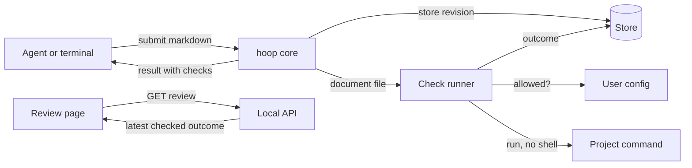

# CR-10: HLD

Status: approved · Revision: 4 · PRD: approved (revision 4)

This document covers components and how they interact. The code-level design goes in the LLD.

## Context

An agent submits a markdown document through an agent tool or a terminal command. The server stores
it as a new revision, as today. With this change, hoop then runs the project's check command on the
document, if the user allows it. It returns the findings with the submit result. The review page
shows the findings of the latest checked revision.

## Components

| Component | Responsibility | Talks to (how) |
|---|---|---|
| Check runner (new) | It reads the repository's command and the user's allow list, runs an allowed command, and turns its output into findings. | The core calls it after storing a markdown revision. It starts the command as a child process. |
| Markdown parser (changed) | It gives each source line of a markdown document its item line, so a finding can be placed. | The core asks it for the places of the raw markdown at submit time. |
| Operations (changed) | The markdown submit tool and command pass the raw markdown to the core. Their inputs don't change. | They call the core, as today. |
| Core (changed) | Its markdown submit receives the raw markdown from the submit operation. It stores the revision, asks the check runner for an outcome, places the findings, stores the outcome and returns it. | It calls the check runner, the markdown parser and the store, in the server process. |
| Store (changed) | It keeps each revision's check outcome beside the revision. | The core writes it, and the local API reads it. |
| Local API (changed) | A review's view gains the latest checked outcome and the revision it belongs to. | The page reads it over HTTP. |
| Review page (changed) | A panel lists the findings and places each one beside its line. It says when the latest revision wasn't checked. | It uses the line renderer and the frame from CR-9. |
| Audit log (changed) | It records each check's outcome. | `hoop audit` reads it for the success metrics. |

## Key interactions

### An agent submits a document

1. The core stores the revision, as today.
2. The check runner reads the folder stored with the review, by its real path. It looks for a
   command in that folder's `hoop.config.json`, and for a matching entry in the user's
   `~/.hoop/config.json`. Without both, it returns an outcome that says why nothing ran.
3. It writes the raw markdown, as the agent sent it, to a temporary file. Then it starts the
   command with an argument list.
4. It reads the exit code and the finding lines. The core asks the markdown parser to place each
   finding on an item line of the raw markdown.
5. The core stores the outcome with its places, logs it to the audit log, and returns it in
   `checks`.

Failure: a command that can't start, exits with another code or runs past ten seconds gives an
outcome that says the check didn't run. The revision is stored either way.

### A reviewer opens a review

1. The local API returns the latest checked outcome and its revision number.
2. The page shows the panel. When a newer revision has no outcome, the panel says so.

## Cross-cutting concerns

- Security and trust boundaries: a repository's config can't run anything by itself. The user's
  own config must allow that exact command for that folder. The command runs without a shell, so a
  document's text never becomes part of the command.
- Who allows a command: only the user adds an allow entry. When a check isn't allowed, the result
  tells the agent to ask the user, and shows the entry to add. hoop can't stop an agent that can
  write the user's files, so devloop's rules forbid agents to edit hoop's config. That rule
  shipped in devloop 0.28.3.
- Commands across machines: a repository names a command that every machine has, such as a script
  kept in the repository. The script can then find a checker that sits in a different place on
  each machine.
- Responsiveness: the command runs as a child process that hoop awaits, so the server keeps
  answering page requests while a check runs.
- Privacy: the document stays on the machine. The command is the project's own.
- Observability: the audit log records each outcome, so `hoop audit` can measure the metrics.
- Compatibility: reviews stored before this change have no outcome, and their page shows no panel.
  The submit result gains one field, and the interface snapshot is updated for it.
- Testing strategy: unit tests cover the runner's rules with small fake commands. An integration
  test submits through the agent tool. A browser test covers the panel.

## Alternatives considered

- Rules inside hoop: hoop would copy devloop's rules, and the two would drift apart.
- Checks only in the agent, as today: reviewers never see the findings, and agents forget to run
  them.
- A shell command string: a document's path or text could change what runs.
- Allowing a whole folder: a later pull could change the command without the user knowing.

## Decisions

- D-1 (2026-10-14): The project's command holds the rules, and hoop only runs it and reads its
  output. Context: one set of rules for agents and reviewers. Consequences: hoop works with any
  checker that prints `path:line: message` lines.
- D-2 (2026-10-14): The user allows a command for a folder in their own config, bound to the exact
  command. Context: a cloned repository must not run code on submit. Consequences: a changed
  command needs a new allow entry.
- D-3 (2026-10-14): A check never blocks a submission. Context: devloop's document review is the
  strict layer. Consequences: the outcome says when a check didn't run.

## Requirements traceability

| Requirement | Components |
|---|---|
| FR-1, FR-2 | Check runner |
| FR-3 | Core, markdown parser, store |
| FR-4, FR-5 | Check runner |
| FR-6 | Local API, review page |
| FR-7 | Core |
| NFR-1 | Check runner |
| NFR-2 | Core, check runner |

## Risks

- A finding's source line can't be placed on an item line, such as a line inside a code block's
  fence. The panel then lists it without a place.
- A slow checker adds up to ten seconds to each submit. The audit log shows how long each check took.
- An allow entry binds the command, not the scripts it runs. A pull can change a script that the
  allowed command names. The user trusts the repository's scripts, as the PRD assumes.
