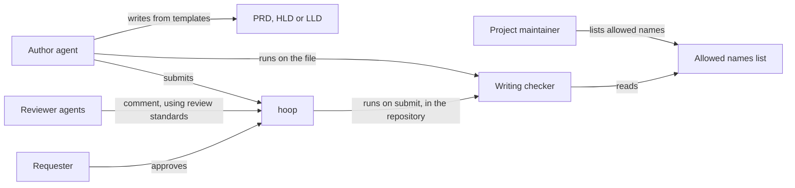
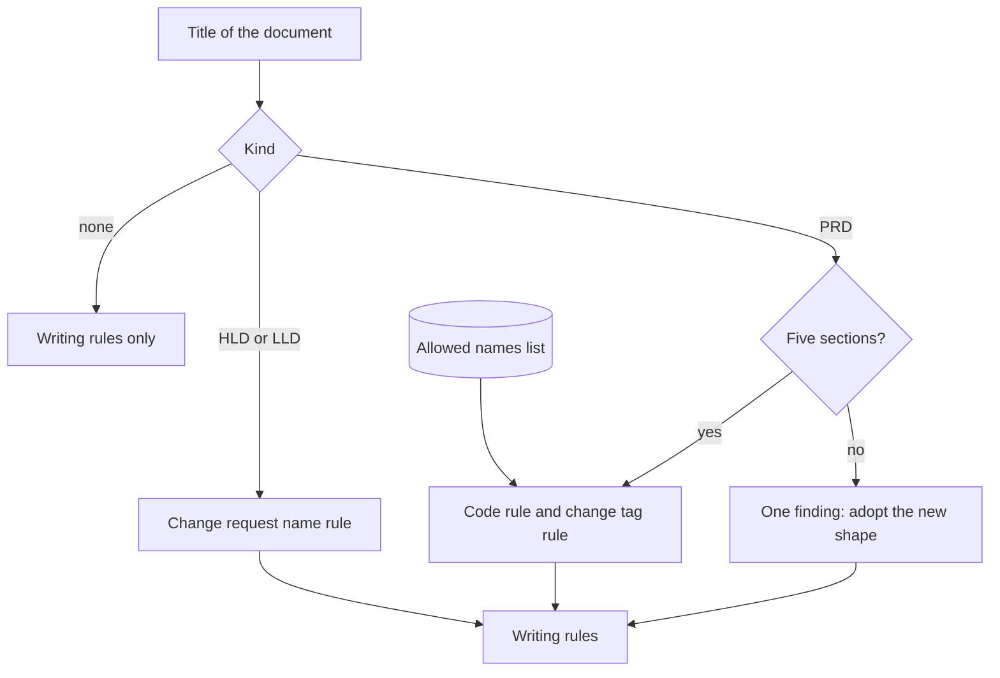
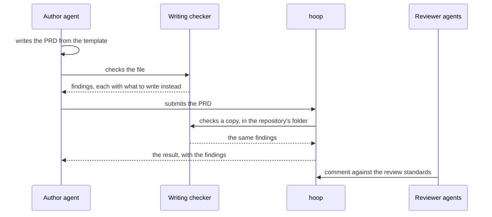
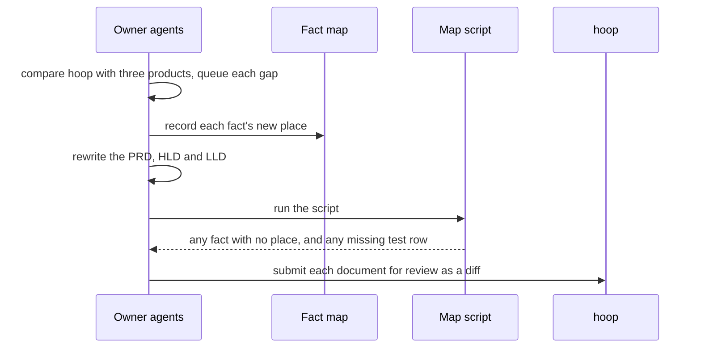

# CR-30 HLD: PRDs that hold no code, and design documents that point only to requirements

Status: approved · Revision: 2 · PRD: revision 3

This document shows the parts that change and how they work together. Code-level detail belongs in
the LLD. Diagrams are written in Mermaid.

## Context and scope

The change touches devloop's document rules, its writing checker, and hoop's own design documents.
No part of hoop's product changes. The goals and the scope are the PRD's sections 1 and 5.

## Assumptions and constraints

- Every PRD, HLD and LLD names its kind in its title, as the templates show. A document whose
  title names no kind is checked as a plain document.
- On submit, hoop gives the checker a temporary copy of the document and runs it in the repository's folder.
  So the checker learns the kind from the text, and finds the project's list from that folder.
- The checker stays one standalone script that runs with python3 alone. It ships inside devloop
  and must run in any project that uses devloop.
- The code of hoop doesn't change. Its check panel already shows any finding the checker reports.
- Approved documents of past changes stay as they are.

## Architecture

| Component | Responsibility | Talks to (how) |
|---|---|---|
| Document templates | They give the shape of a PRD, an HLD and an LLD, with the PRD's five sections and what each holds and never holds. | Authors read them as files in devloop. |
| Review standards | They hold the rules reviewers apply, including the ten things a PRD never holds and the allowed names. | Reviewer agents load them as skills. |
| Persona agents | The owner and reviewer agents carry each document's altitude. | They follow the templates and standards. |
| Scoping and fold steps | They tell an author where requirements start and how a merged change lands in the project documents. | Authors follow them as skills. |
| Writing checker | It finds the document's kind from its title and applies the rules for that kind. | It reads the document and the allowed names list as files, and prints findings. |
| Allowed names list | It lists the names a project's users type that look like code. | The checker reads it from the project's docs folder. |
| Project documents | They are hoop's own PRD, HLD and LLD, rewritten to the rules. | They are reviewed in hoop like any change. |
| Fact map and script | The map records where each fact of an old document lands, and the script checks it. Both ship in devloop, for any project that moves its documents to the new rules. | The script reads the map and the new documents as files. |
| Comparison | It compares hoop with three review products and turns each gap into a queued change. | It feeds new change requests through intake. |

## Key interactions

### An author writes and submits a PRD

Failure: if the checker can't run, hoop says the check didn't run, as it does today. A check never
stops a submit.

### A change folds into the project documents

The fold steps move each requirement into the project PRD with its change tag. They move the design
text into the project HLD and LLD with no change request names. The tests each requirement names land in
the project LLD's test plan. The fold's documents go through the checker like any other.

### hoop's own documents are rewritten

Failure: the script names each fact that has no place, and the rewrite isn't submitted until it
reports nothing.

## Data and interfaces

- Data: the templates, standards, agents and checker belong to devloop. The allowed names list, the
  fact map and the project documents belong to the project.
- External interfaces: the checker keeps its command line. It takes document paths and prints one
  line for each finding, with the path, the line and the message. It exits 0 with no findings and 1
  with findings. hoop reads that output unchanged.
- Internal interfaces: none are new. Agents read skills and templates as files.

## Cross-cutting concerns

- Security and privacy: the checker reads only the document and the allowed names list, and runs
  nothing else. hoop's check rules, such as running without a shell, still hold.
- Performance and reliability: the new rules are one more pass over the text. The check stays well
  under NFR-3's one second. Today it takes about 40 milliseconds on the project PRD.
- Observability: hoop already records each check's time and findings in its audit log, which
  measures NFR-3 and the new PRD metric.
- Testing: the checker's own tests cover each rule, with a sample document for each kind of
  finding. The map script proves NFR-1. The project documents passing the checker proves NFR-2.
- Deployment and operation: devloop ships a new version. Other projects get the rules when they
  update the plugin. A project adds its allowed names list when its PRD first flags a name its
  users type.

## Alternatives and decisions

- Alternative: do nothing, and rely on reviewers. This loses, because the review standard already
  forbade code and the project PRD still holds 126 code spans.
- Alternative: hoop passes the document's file name to the checker. This loses, because it changes
  hoop, which the PRD puts out of scope, and a title already names the kind.
- Alternative: flag every code span in a PRD. This loses, because code spans also hold literal text
  and names users type, so it would give false findings.
- Alternative: one summary finding for a design document full of change request names. This loses,
  because each finding sits on the line to fix.
- D-33 (2026-10-20): The checker learns a document's kind from its title. Context: hoop checks a
  temporary copy whose name says nothing. Consequences: every template's title names its kind.
- D-34 (2026-10-20): The code rule flags only what text shows reliably. Those are file paths, source
  and test file names, function calls and web routes. Context: plain words that name code can't be
  told from product words. Consequences: the review standards cover the rest.
- D-35 (2026-10-20): A PRD in today's shape gets one finding until it moves to the five sections.
  Context: other projects would otherwise see dozens of findings at once. Consequences: the code
  and tag rules apply only to a PRD in the new shape.
- D-36 (2026-10-20): A design document's title and status line may name a change request. Context:
  they identify the document, and the rule is about its design text. Consequences: the rule skips
  those two lines.
- D-37 (2026-10-20): The fact map's format and its script ship in devloop, and the fold steps use
  them. Context: every project with documents under today's rules must move them once, and NFR-1
  needs the same proof there. Consequences: hoop's own map is the first one, kept in the change's
  folder.
- D-38 (2026-10-20): The comparison runs before the rewrite, and its gaps go through intake.
  Context: the PRD's open questions must name each gap's change request. Consequences: intake
  checks each new request against the queue for overlaps.
- D-39 (2026-10-20): A change's requirements take the next free project IDs when it is scoped.
  A change to an existing requirement uses its project ID. Context: a fold used to renumber them,
  so an ID in a change's design text would mean another requirement once no change is named.
  Consequences: the scoping step reads the project PRD and every queued change's PRD for the next
  free ID. A fold checks that no ID clashes. This change's own IDs predate the rule, so its fold
  renumbers them once.
- D-40 (2026-10-20): A fold into a project PRD in today's shape first moves that PRD to the five
  sections, with a fact map. Context: a fold must place requirements in sections the old PRD
  lacks. Consequences: a project moves its PRD once, at its next fold, and D-37's script proves
  nothing was lost. Its HLD and LLD lose their change request names in the same fold.
- D-41 (2026-10-20): An author runs the check the project configures for hoop, when there is one,
  and the checker from devloop otherwise. Context: FR-19 needs the same findings from the file and
  from a submit. Consequences: the writing style skill says so.
- D-42 (2026-10-20): A file named for its kind, whose title doesn't name that kind, gets one
  finding. Context: without it, a missing kind turns off the new rules with no sign. Consequences:
  on submit, hoop's copy has no such name, so this finding shows only on the author's run.
- D-43 (2026-10-20): The checker looks for the allowed names list from the document's folder
  upward, and then from its working folder upward. Context: an author checks the file in the
  project, and hoop checks a copy from the project's folder. Consequences: both runs find the
  same list.

### Where the moved requirements land

| Requirement | Where it lands |
|---|---|
| NFR-10 | Its text becomes a project HLD decision that protects FR-31 and NFR-4, and its test plan row moves to those two. |
| NFR-13 | Running without a shell moves to the project HLD's security concerns. The outcome stays in the PRD. |
| NFR-14 | Its mechanism stays in the project HLD's D-30, which points to NFR-14's outcome. |
| NFR-16 | The restart timer's cost moves to the project HLD's performance concerns. The page load target stays in the PRD. |

## Traceability and risks

| Requirement | Components |
|---|---|
| FR-1, FR-2, FR-3 | Document templates. |
| FR-4, FR-5, FR-6 | Review standards, persona agents. |
| FR-7 | Document templates, review standards, writing checker. |
| FR-8 | Document templates, review standards, persona agents. |
| FR-9 | Document templates, project documents. |
| FR-10, FR-11 | Writing checker. |
| FR-12 | Scoping and fold steps, fact map and script. |
| FR-13, FR-14 | Project documents, fact map and script. |
| FR-15 | Comparison. |
| FR-16 | Writing checker, through hoop's existing check panel. |
| FR-17, FR-19 | Writing checker. |
| FR-18 | Allowed names list, writing checker. |
| NFR-1 | Fact map and script. |
| NFR-2 | Writing checker, project documents, document templates. |
| NFR-3 | Writing checker. |

- Risk: the code rule flags a name users type, in a project with no list. It is mitigated by the
  finding's message, which says to add the name to the allowed names list.
- Risk: the PRD rewrite loses a fact. It is mitigated by the fact map and its script, and by review
  as a diff in hoop.
- Risk: the rewrite and its review are large. It is mitigated by splitting it into pull requests by
  document.
- Risk: other projects see new findings after they update devloop. It is mitigated by D-35's single
  finding for an old PRD, D-40's move at the next fold, and the version notes. An old HLD or LLD
  gets one finding for each change request name, as the PRD's FR-11 settles.

## Glossary

- Kind: whether a document is a PRD, an HLD or an LLD, as its title names it.
- Change tag: the closing part of a requirement that names the change requests that changed it.
- Fact map: the table of each fact in the old project documents and its new place.
