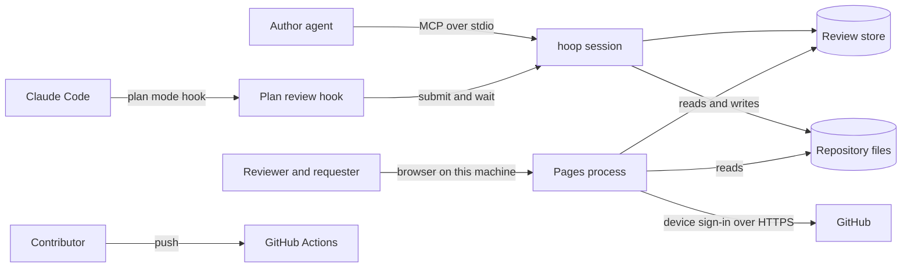
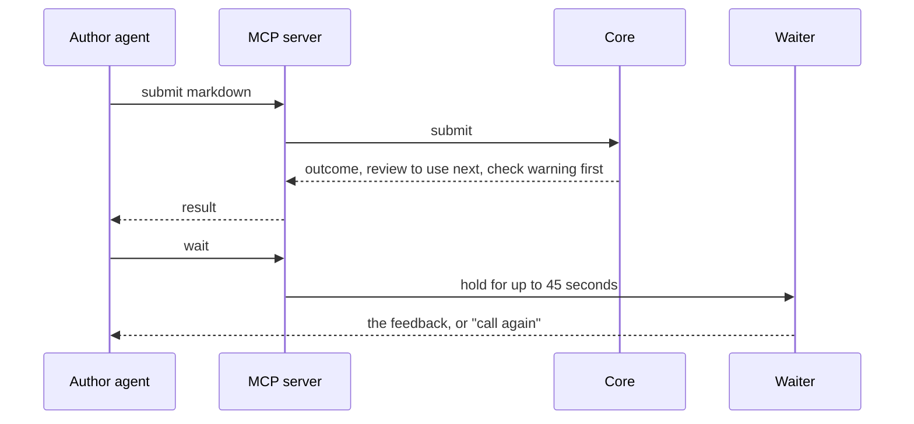
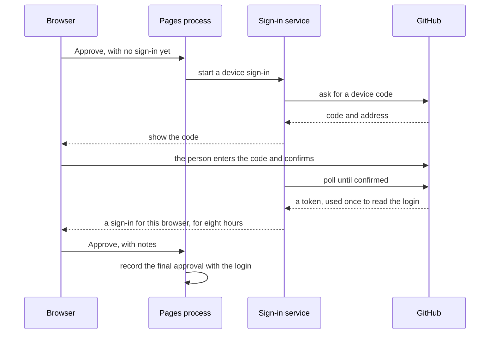
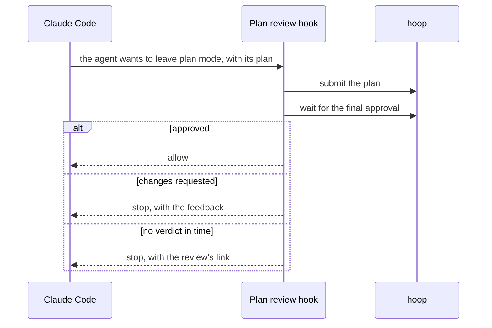

# CR-31 HLD: Every queued change, built as one

Status: approved · Revision: 2 · PRD: revision 3

This document shows the components that change and how they work together. Code-level detail
belongs in the LLD. Diagrams are written in Mermaid. The document rules of FR-99 follow the approved
HLD that FR-99 adopts, and its decisions D-33 to D-43 hold here unchanged.

## Context and scope

The system keeps its shape: an MCP process for each agent session, one background pages process for the
browser, and JSON files on the machine. This change adds three outside parties. GitHub signs a person
in for the final approval. Claude Code runs a hook when an agent leaves plan mode. GitHub Actions runs
the checks on every pull request. The goals and the scope are the PRD's sections 1 and 5.

## Assumptions and constraints

- Node 18.18 stays the floor, and hoop adds no native module.
- The pages still fetch nothing from another host. Every file a page loads comes from the pages
  process.
- The system can't tell an agent's request from a person's by the request alone. Both reach the same
  local address. So only a GitHub sign-in held by the browser marks a person.
- The project registers one GitHub OAuth App with the device flow on. The device flow needs only
  its public client ID, which ships with hoop.
- MCP clients end a call after 60 seconds, so a tool that waits returns before that.
- Claude Code lets a hook stop a tool call and give the agent a reason. The plan hook uses that.
- Stored reviews and repositories made by today's hoop must keep working.

## Architecture

| Component | Responsibility | Talks to (how) |
|---|---|---|
| Operations | It defines every operation once, and now marks each one as core or devloop. It holds the old names as aliases. | The MCP server and the CLI read it. |
| MCP server | It lists the core tools, and the devloop tools when the project has devloop. | The agent over stdio, and the core in process. |
| Project settings | It decides whether a project has devloop, from the project's config or its change folders. | The MCP server reads it when the session starts. |
| Core | It still receives every operation. It now resolves quotes to lines and states each submit's outcome. | Every component below, in process. |
| Quote resolver | It finds the one line that holds quoted words, or names every place they occur. | The core, in process. |
| Waiter | It holds a call until a review arrives or 45 seconds pass. | The store, by reading files. |
| Review rules | They still decide whether a review can change. They now decide whose verdict a verdict is. | The core and the sign-in service. |
| Sign-in service | It runs GitHub's device sign-in, keeps each browser's sign-in for eight hours, and names the login. | GitHub over HTTPS, and the browser through a cookie. |
| Audit trail view | It shows every comment, agent approval and final approval of a review, with who and when. | It reads the review's stored events. |
| Section matcher | It keeps a section's ID across revisions, by heading and then by place. | The markdown parser, in process. |
| Line renderer | It still draws each line. It now nests sections, draws tables, and hands diagrams to the diagram frame. | The page modules in the browser. |
| Diagram frame | It draws one diagram inside a sandboxed frame that can't touch the page. | The pages process for the diagram library. |
| Check runner | It still runs the project's check. Its result now leads with a warning when the check didn't run. | The project's command, as today. |
| Check allow command | It shows a repository's check command, asks the person to confirm, and writes their allow entry. | The person in a terminal, and the person's settings file. |
| Plan review hook | It submits a plan when an agent leaves plan mode, waits, and lets the agent go on or stops it. | Claude Code through its hook interface, and hoop's commands. |
| Review sequencer | It still orders a change's documents. It no longer writes change rows into the tracker. | The change registry and repository files. |
| Change registry | It still keeps each change. It now records its kind, project, history of checks and size choice. | Repository files. |
| Change request page | It lists every change by status and project, with its links, history and size flag. | The pages process's API. |
| Tracker service | It still reads and writes trackers. It now reads each item's block and project. | Repository files. |
| Tracker page | It shows an item's block, its checklist count and missing blocks, and filters by project. | The pages process's API. |
| Schema publisher | It writes the review and feedback formats as JSON Schema, and the README's field tables, from the contract. | The contract, at build time. |
| Repository tooling | Commit hooks, the linter and formatter, the comment guard and CI. | Git and GitHub Actions. |
| Practices skill | A devloop skill that checks a repository for these practices. | An agent reads it as a skill. |
| Writing checker | It applies the document rules that FR-99 adopts, unchanged. | As the adopted HLD says. |

## Key interactions

### An agent submits and waits

Failure: a wait that ends without a review says to call again. A superseded review's feedback names
the review that replaced it.

### A person gives the final approval

Failure: an expired, denied or unreachable sign-in records nothing, and the page says why. A verdict
that arrives without the browser's sign-in is an agent's. An approve becomes an agent approval, and
a request for changes becomes a comment.

### An agent leaves plan mode

### A reviewer reads a structured document

The parser gives each section its heading level, as today. The section matcher keeps each section's
ID across revisions, first by heading and then by place. The page nests sections by level, groups a
run of table lines into one table, and sends each diagram to its own sandboxed frame.

### A team tracks changes

Each change keeps its kind, project, history and size choice in its own record in the repository.
The change request page reads every record and shows it. The tracker no longer holds change rows.
Its root items name their change.

## Data and interfaces

- Data: reviews, revisions and feedback stay in the review store. Feedback gains each comment's
  scope, approval notes, whether a verdict is an agent's or a person's, and the signed-in login.
  These are added fields, so stored reviews still load and the format keeps its version.
- Data: a sign-in lives only in the pages process's memory, keyed by a random value in the browser.
  No token is kept. A restart of the pages process asks for a new sign-in.
- Data: a change's record gains its kind, project, history and size choice. A tracker gains a
  project for each item.
- External interfaces: GitHub's device sign-in over HTTPS, Claude Code's hook interface, and GitHub
  Actions. The agent's MCP tools and the commands change as the PRD lists.
- Internal interfaces: the pages API gains sign-in, audit trail and change request routes, all on
  this machine only, with today's Host, Origin and content checks.

## Cross-cutting concerns

- Security and privacy: a final approval proves that a person confirmed a GitHub login on GitHub.
  It stops an agent that uses only hoop's tools and pages. It can't stop an agent with a shell that
  works against the person. Such an agent could start a sign-in and ask the person to confirm it.
  It could also edit the person's settings, or change hoop's own code in a contributor's clone. devloop's rules
  forbid each of these, as they forbid editing the settings today. The page names who is signed in,
  and the audit log records each sign-in. A diagram draws in a sandboxed frame with no access to the
  page, and the page still loads nothing from another host. The plan hook fails closed. Turning the
  sign-in off marks each approval unverified.
- Performance and reliability: the diagram library loads only on a page that has a diagram, which
  keeps NFR-19. A wait holds at most 45 seconds. The pages process restarts as today.
- Observability: the audit log gains sign-in, agent approval, wait and quote refusal events.
  `hoop audit` reports the share of refused edits, which the PRD's metric uses.
- Testing: unit tests cover each new rule, and browser tests cover every new page state and a
  hostile diagram. The page checks of NFR-11 run on every new page. CI runs them on each supported Node version.
- Deployment and operation: hoop ships as today, from source. A contributor's install sets up the
  commit hooks. The plan hook ships as a plugin in this repository's marketplace, which a person
  turns on.

## Alternatives and decisions

- Alternative: tell agents from people by a header or a token on the machine. This loses, because
  any agent with a shell can read or send it.
- Alternative: a passkey in the browser. The requester chose a GitHub identity instead.
- Alternative: draw diagrams in the page itself with the library's strict mode. This loses, because
  one escape in the library would run inside the page that approves.
- Alternative: keep the old tool names unlisted. This loses, because an agent can only call a tool
  the server lists.
- Alternative: keep change rows in the tracker and add the page beside it. This loses, because the
  requester asked for change requests to leave the tracker.
- D-44 (2026-10-20): Each operation is marked core or devloop, and the MCP server lists devloop
  tools only in a project with devloop. A project has devloop when its config says so or it holds
  change requests. Context: FR-58, FR-59 and FR-141. Consequences: the terminal keeps every command.
- D-45 (2026-10-20): `hoop_submit` takes markdown and also accepts a decision document by its
  shape, for the next two minor versions. The old names are aliases in the operations table.
  Context: FR-61 and FR-62. Consequences: the recorded interface changes once, and the changelog
  says the aliases go after two minor versions.
- D-46 (2026-10-20): Waiting is a core operation that holds for at most 45 seconds and returns.
  Context: FR-66 and the client's 60 second limit. Consequences: background waiting stays as it
  is.
- D-47 (2026-10-20): A quote resolves to a line, and a range inside it, before the feedback is
  stored. Context: FR-71. Consequences: stored feedback keeps line anchors, so both channels and
  stored reviews work unchanged.
- D-48 (2026-10-20): Only a browser sign-in marks a person. A verdict without it counts as an
  agent's. Context: FR-81 to FR-84 and FR-143. Consequences: the page posts verdicts with the
  browser's sign-in, and agents keep posting comments as today.
- D-49 (2026-10-20): A sign-in lives only in the pages process's memory, for eight hours, and the
  GitHub token is dropped after reading the login. Context: NFR-5 and FR-143. Consequences: a
  restart of the pages process asks the person to sign in again.
- D-50 (2026-10-20): A person's own settings can turn the sign-in off or name their own OAuth App,
  and no repository setting can. Context: FR-84 and FR-144. Consequences: approvals without a
  sign-in carry an unverified mark everywhere.
- D-51 (2026-10-20): A section keeps its ID by heading first. A section left unmatched keeps the ID
  of the old section at the same level, under the same parent, in the same place. Context: FR-78
  and FR-142. Consequences: the settled rule that IDs follow headings widens, and stored reviews
  keep their IDs. Section IDs stay flat as sections nest. A section matched by place shows that its
  heading was renamed, so a reviewer sees its comments moved.
- D-52 (2026-10-20): Each table line stays one commentable line, and the page groups a run of them
  into one table. Context: FR-79. Consequences: anchors and edits on table rows work as today.
- D-53 (2026-10-20): Each diagram draws in a sandboxed frame with no same origin access, from a
  copy of the library that the pages process serves. Context: FR-80 and NFR-20. The frame's content policy allows only the library's own file, and no popups, forms or navigation.
  Consequences: a diagram can't run script in the page or make a request, and pages without
  diagrams load no library.
- D-54 (2026-10-20): The plan review hook ships as its own plugin, which uses hoop's commands and
  fails closed. Context: FR-87 and FR-145. Consequences: a person turns it on by installing it.
- D-55 (2026-10-20): Allowing a check is a terminal command that needs a person at a terminal, and
  isn't an agent tool. Context: FR-70 and FR-140. Consequences: an agent can't allow a check
  through hoop, and devloop's rule against editing the settings stays.
- D-56 (2026-10-20): A change's record in the repository holds its kind, project, history and size
  choice. Context: FR-94 to FR-98. Consequences: the change request page only reads, and every
  change to a record goes through a devloop operation.
- D-57 (2026-10-20): The tracker keeps work items only, and a root item names its change. Context:
  FR-93. Consequences: the sequencer stops writing change rows, and this change removes the
  existing ones.
- D-58 (2026-10-20): The contract is the one source for the JSON Schema files and the README's
  field tables, and a test fails when they drift. Context: FR-127. Consequences: a field change
  regenerates both.
- D-59 (2026-10-20): Commit hooks are plain git hooks kept in the repository, set up only in a
  contributor's clone, and Biome lints and formats. Context: FR-119 to FR-122. Consequences:
  installing hoop as a tool sets up nothing.

- D-60 (2026-10-20): An agent approval is stored as a comment verdict with an agent approval
  mark. Context: older readers treat a stored approval as final. Consequences: an older hoop, the
  GitHub status rule and devloop's agents never mistake it for a final approval.
- D-61 (2026-10-20): The plan hook keeps one review for each session's plan. A retry finds it,
  revises it when the plan changed, and goes on when its latest revision is approved. A plan review
  writes no decision files. Context: FR-87 and FR-145. Consequences: a person who approves late
  approves once, and the stop message says to approve and then ask the agent to go on.
- D-62 (2026-10-20): hoop stops writing change rows, and still reads trackers that hold them. The
  tracker page shows such rows apart, and devloop's fold step removes them. Context: FR-93 in
  repositories other than this one. Consequences: an older hoop that writes a change row is
  harmless, and the row shows apart.
- D-63 (2026-10-20): A restart of the pages process drops every sign-in, and the person signs in
  again. Context: handing sign-ins to the new process would need them outside memory, where an
  agent could read them. Consequences: a person signs in again after an update.
- D-64 (2026-10-20): A session reads whether its project has devloop when it starts. devloop's setup
  says to start a new session. Context: an MCP tool list is fixed for a session. Consequences:
  turning devloop on takes effect in the next session.
- D-65 (2026-10-20): A project is a label on changes and tracker items inside a repository. It
  defaults to the repository's name. A review takes its change's project, or its repository's.
  Context: FR-96 and FR-97. Consequences: filters work the same for reviews, changes and items.
- D-66 (2026-10-20): An unverified final approval unlocks what any final approval unlocks, and
  carries its mark into every place that shows it. Context: FR-84. Consequences: devloop reports
  an unverified approval when it reaches a gate.

### Settled decisions this design changes

| Decision | How it changes |
|---|---|
| D-4 | Background waiting stays, and a bounded wait tool joins it under D-46. |
| D-10 | Sections keep IDs by heading, and then by place, under D-51. |
| D-16 | Commands still mirror tools, plus old names as aliases under D-45, and a terminal only command under D-55. |
| D-25 | Its rule against agents editing the settings now also covers the sign-in opt out and starting a sign-in. |

## Traceability and risks

| Requirement | Components |
|---|---|
| FR-58, FR-59, FR-60, FR-141 | Operations, MCP server, project settings. |
| FR-61, FR-62, FR-63, FR-64, FR-65 | Operations, core, review page. |
| FR-66, FR-67, FR-139 | Waiter. |
| FR-68, FR-69 | Check runner, review page. |
| FR-70, FR-140 | Check allow command. |
| FR-71, FR-72, FR-136 | Quote resolver, core. |
| FR-73 | Operations, core. |
| FR-74, FR-75 | Line renderer, review page. |
| FR-76, FR-77 | Line renderer, review rules. |
| FR-78, FR-142 | Section matcher. |
| FR-79 | Line renderer. |
| FR-80, FR-134, FR-138, NFR-19, NFR-20 | Diagram frame, line renderer. |
| FR-81, FR-82, FR-83, FR-84, FR-85, FR-143, FR-144 | Review rules, sign-in service. |
| FR-86 | Audit trail view. |
| FR-87, FR-145 | Plan review hook, waiter. |
| FR-133, FR-137 | Sign-in service, review page. |
| FR-88, FR-89, FR-90, FR-91, FR-135 | Tracker service, tracker page. |
| FR-92, FR-93, FR-94, FR-95, FR-132 | Change registry, review sequencer, change request page, tracker service. |
| FR-96, FR-97, FR-98 | Change registry, tracker service, both pages. |
| FR-99 | Writing checker, document templates and the other components of the adopted HLD. |
| FR-118, FR-119, FR-120, FR-121, FR-122, NFR-21 | Repository tooling. |
| FR-123, FR-124 | Repository tooling, practices skill. |
| FR-125, FR-126, FR-127, FR-128, FR-129, FR-130, FR-131 | Schema publisher, README. |
| NFR-17, NFR-18 | Every component, through today's acceptance runs and page checks. |

- Risk: one pull request this large hides defects from review. It is mitigated by tests for each
  requirement, the acceptance runs, and a fresh review of the whole branch before merging.
- Risk: an agent reads the browser's sign-in from the browser's own files. It is mitigated by
  keeping the sign-in in memory with an eight hour limit, and the risk is named in the security
  policy.
- Risk: the OAuth App isn't set up when the change merges. It is mitigated by a check that names
  the missing app on the sign-in page, and the setup step in the contributing guide.
- Risk: the diagram library is large. It is mitigated by loading it only on pages with a diagram.
- Risk: matching a renamed heading by place picks the wrong section when sections move and are
  renamed at once. It is mitigated by matching by heading first, and by tests for moves.

## Glossary

- Agent approval: an approval that records an agent's view and never freezes a review.
- Final approval: the approval that freezes a review, made in a signed-in browser.
- Sign-in: a browser's proof, for eight hours, that a person confirmed a GitHub login.
- Devloop layer: the change request and tracker tools that a project turns on.
- Project: a label on changes and tracker items inside a repository.
