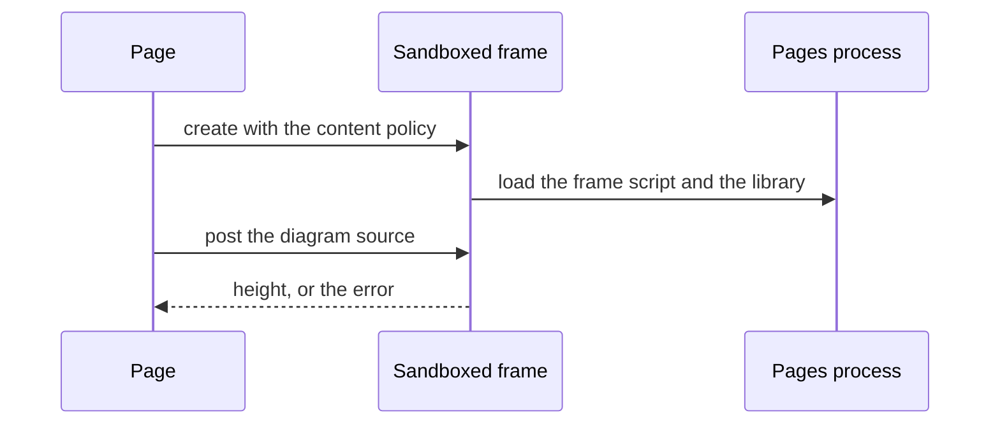
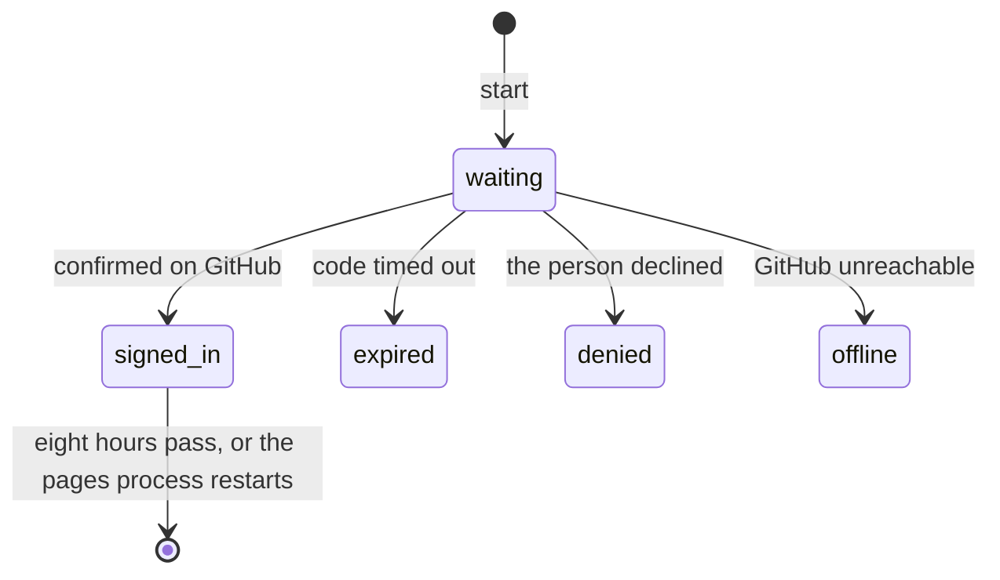

# CR-31 LLD: Every queued change, built as one

Status: approved · Revision: 2 · PRD: revision 3 · HLD: revision 2

This document says how each HLD component is built. Code-level detail is limited to new files,
design patterns and the interfaces between layers. Logic inside a file is left to code review.
Diagrams are in Mermaid. The document rules of FR-99 are built as the adopted HLD says, and their
part below names only what that HLD leaves to the LLD.

## Operations, project settings and the MCP server

- Responsibility: list the right tools for a project, under the right names (FR-58 to FR-62,
  FR-141, D-44, D-45, D-64).
- New files: `src/project.ts` holds `projectSettings(repo)`, which returns `{ devloop }`. It is true
  when `hoop.config.json` holds `"devloop": true`, or when `docs/changes/` holds a change folder.
- Design pattern: the operations table stays the one registry. Each `Op` gains `layer: "core" |
  "devloop"` and an optional `old` mark with the new name. `createServer(hoop, settings)` registers
  core operations, and devloop ones only when `settings.devloop` is true. Without devloop, it drops
  the `change` field from the submit tools' input.
- Names: each `Op` may hold `old: { tools?, commands? }`, the old names it still answers to. The
  server registers each old tool name with the same input, and the CLI maps each old command to
  the operation. Every use of an old name adds `notice` to the result, which names the new one.
- The operation `submit` takes markdown, with the command `hoop submit`. Its input also accepts
  `document`, a decision document, so old callers keep working. Its old tool name is
  `submit_markdown`. The operation `submit_decision` takes `document`, with the command
  `hoop submit-decision` and the old command `hoop submit-json`.
- `cli` becomes optional on `Op`, for an operation with no command of its own.
- `hoop help` prints two groups, core and devloop, from `layer`. Every command runs whatever the
  setting, so the CLI never reads it.
- The interface snapshot in `test/interface.test.ts` records two tool lists, without devloop and
  with it, so every schema stays recorded.
- Tool count: there are eight core tools and seven devloop tools, which make fifteen. The change
  history and the project move use the existing `cr_step` and `cr_classify`, as the change
  registry section says.

## Waiting

- Responsibility: wait for a review through MCP (FR-66, FR-67, FR-139, D-46).
- A cursor names what a caller has seen. It is the latest revision and the count of feedback on
  it, written as `"<revision>.<count>"`. Results of `submit`, `feedback` and `wait` carry `cursor`.
- The operation `wait` (core) takes `{ review_id, after?, seconds? }`, with at most 45 seconds. It
  has no command. `waitForReview` gains the option `after`. With it, feedback beyond the cursor, or
  a newer revision's feedback, returns at once. So a review that lands between two calls is never
  missed. Without it, the wait counts from its start, as today.
- On a timeout it returns `{ status: "pending", again: true, cursor, message }`, and the message
  says to call again with that cursor.
- `hoop wait` keeps its own command, its timeout and its behavior.
- Audit events: `wait`, with the outcome `reviewed` or `pending`.

## Submit outcomes and superseded reviews

- Responsibility: say what a submit did, and where to go next (FR-63 to FR-65).
- `Hoop.submitAny` returns `outcome`: `created`, `revised` or `superseded`, and `next_review_id`.
- `ReviewMeta` gains `superseded_by`, set on the old review when a submit supersedes it.
  `Hoop.feedback` returns `superseded_by` when it is set.
- `decision_files` already reaches the view through `meta`, as absolute paths for local reviews
  and relative names for GitHub ones. An approval now stores names relative to the repository. The
  view turns any older absolute path under the review's repository into a relative name. The page
  lists them in the approved banner, and the command prints them. The local acceptance run joins
  them to its repository before it reads them.

## Checks: warnings and allowing

- Responsibility: make a skipped check loud, and allowing it one step (FR-68 to FR-70, FR-140,
  D-55).
- A submit result gains `warnings`, a list placed first in the result, when its check didn't run.
  The `not_allowed` warning names `hoop allow-check`.
- The page message for `not_allowed` names `hoop allow-check` and no folder.
- `src/util.ts` gains `hoopConfig(home)`, the one reader of the hoop folder's `config.json`, and
  `updateHoopConfig(home, change)`, which writes it atomically and keeps every other key. The
  checks, the sign-in and the allow command use them.
- New files: `src/allow.ts` holds `allowCheck(repo, home, ask)`. It takes the command from
  `repoCommand`, and returns at once when `isAllowed` says so. Otherwise it shows the command, asks
  through `ask`, and adds the entry with `updateHoopConfig`.
- The CLI runs it as `hoop allow-check`, with a prompt on the terminal. Without a terminal on
  standard input, it refuses and says to run it in one. It is a command only, not an operation.

## Quotes, scopes and edit rules

- Responsibility: anchor by words, state scopes, and name every edit rule (FR-71 to FR-73,
  FR-136, D-47).
- New files: `src/quote.ts` holds `resolveQuote(doc, { item?, quote })`. It returns `{ item, line,
  range }`, or throws a `HoopError` that lists every place the words occur, or says they occur
  nowhere. It searches each line's text as `itemLines` gives it, and the title and the TL;DR.
- Input only: a comment or a reply sent to `Hoop.review` may hold `words` in place of `line`, and
  `item` is then optional. `Hoop.review` resolves `words` into `{ item, line, range }` before it
  validates. The contract's `Comment` keeps `line` required, so the stored and published feedback
  format doesn't change. The name `words` keeps it apart from `range.quote`.
- A proposed edit may leave out `item` and `line`, and its `find` then picks the line in the same
  way.
- `Hoop.feedback` adds `scope` to each comment: `line`, `section` with the covered item IDs, or
  `document`.
- `src/edit.ts` gains `RULES`, one table of every edit rule with its name and its sentence. The
  propose tool's description is built from it, so it lists every rule.
- Each refusal names its rule. `EditError` gains `rule`, and the checks in `Materializer` and in
  the apply path use the same names. The rules are these.
  - `line_exists`: the item and line exist.
  - `find_given`: the words to replace are given.
  - `found`: the words occur in the line.
  - `once_in_line`: the words occur once in the line.
  - `changes_text`: the replacement differs from the words.
  - `no_line_breaks`: the replacement holds no line break.
  - `not_tldr`: the TL;DR isn't edited, since it repeats the first paragraph.
  - `not_empty`: a line keeps some text.
  - `option_label`: an option keeps its letter and marker.
  - `editable_in_place`: the line is text that can be edited in place.
  - `keeps_markup`: the line keeps its markdown structure.
  - `in_scope`: an edit stays on its comment's line or section.
  - `no_overlap`: two edits don't touch the same text.
  - `line_unchanged`: the line reads as it did when the edit was made.
- A large rewrite stays a mark on the proposal, not a refusal.
- Audit events: `quote_refused`, and `edit_refused` with its rule. `hoop audit` reports the share
  of proposed edits refused, by rule.

## Reviewer delete and edit in place

- Responsibility: a delete or an in-place edit as a suggestion (FR-74, FR-75).
- `web/review.js` gains two actions. Delete appears on a selection inside a line, and makes a
  pending comment whose suggestion is the line without the selected text. Edit appears on every
  line, and opens the composer with the line's source text as the suggestion. Both use today's
  suggestion and Apply. Deleting a whole line stays refused by the edit engine.

## Nested sections and their scope

- Responsibility: nest sections up to five levels, and widen a heading's scope (FR-76, FR-77).
- New files: `web/outline.js` builds the outline tree from each item's `level`. The title is level
  one, and levels two to six nest as depths one to five. Each node expands and collapses, and the
  state stays in memory for the page.
- Each item renders with its depth, and the CSS indents by depth. Section IDs stay flat.
- `src/contract.ts` gains `sectionItems(doc, item)`, the item and every later item with a deeper
  level, up to the next heading at its level or above. `inScope` takes the document and uses it
  for a section scope, so the materializer's edit scope widens with it.

## Section matcher

- Responsibility: keep a renamed section's ID (FR-78, FR-142, D-51).
- `keepIds(prior, next)` runs in two passes. The first matches by heading, as today. The second
  gives each new section left unmatched the ID of an unmatched old section. The old one must have
  the same level, the same parent ID after the first pass, and the same place among its siblings.
- The revision's stored record gains `renamed`, a map from each item matched by place to its old
  heading. The view passes it to the page, which marks such a section as renamed. The contract's
  `Item` doesn't change, so the format agents submit stays the same.
- Stored revisions keep their IDs, because matching runs only when a new revision arrives.

## Tables

- Responsibility: show a markdown table as a table (FR-79, D-52).
- `splitRow` moves to `web/blocks.js`, beside `TABLE_DELIM`, and returns each cell with its source
  offsets. `src/util.ts` re-exports it, and the tracker keeps using the cell text.
- `web/inline.js` gains `renderTableRow(text, decorations)`. It splits the row with `splitRow` and
  keeps each cell's offsets, so selection and highlights still map to source.
- `web/app.js` groups a run of lines whose block kind is `table` into one `table` element. Each row
  is a `tr` with the line's gutter and number. The delimiter row renders as a thin row, so every
  line keeps its number. The first row is the header. Tracker tables keep their tree.

## Diagrams

- Responsibility: draw diagrams safely and offline (FR-80, FR-134, FR-138, NFR-19, NFR-20, D-53).
- The library is a pinned copy of mermaid's minified file, `web/vendor/mermaid.min.js`, not a
  package dependency. `web/vendor/mermaid.json` holds its version and its SHA-256 hash.
  `scripts/vendor-mermaid.mjs` fetches a named version from the npm registry and writes both.
  A test checks the file against the hash.
- The pages process serves it at `/vendor/mermaid.min.js`. It reads the file on the first request
  and keeps it, rather than at start.
- New files: `web/diagram.js` finds a code line whose fence names `mermaid`. It renders an `iframe`
  with `sandbox="allow-scripts"` and a `srcdoc` that loads `/diagram-frame.js` and the library.
- The `srcdoc` sets a content policy: `default-src 'none'`, scripts from those two files only,
  inline styles, and images from `data:` only.
- `web/diagram-frame.js` receives the source by `postMessage`, draws with the library's strict
  level, and posts back the height or the error.
- A sandboxed frame can still navigate itself. So the page removes a frame that fires a second
  `load`, and shows the source with the reason.
- States: a placeholder until the frame answers, the drawing, or the source with the reason. A page
  without a diagram line loads neither file.
- `STATIC` in `src/web.ts` gains `outline.js`, `diagram.js`, `diagram-frame.js`, `trail.js` and
  `changes.js`. The library has its own route, outside `STATIC`, so it isn't read at start.
- The frame's own requests carry the origin `null`, and the server already refuses writes from it.

## Sign-in and whose verdict it is

- Responsibility: GitHub device sign-in, browser sign-ins and the verdict rule (FR-81 to FR-85,
  FR-133, FR-137, FR-143, FR-144, NFR-5, D-48 to D-50, D-60, D-63, D-66).
- New files: `src/signin.ts` holds `SignIns`, which lives in the pages process. It uses the global
  `fetch` and takes a fetch function for tests.
  - `start()` asks GitHub for a device code with the client ID. It returns `{ flow, user_code,
    verification_uri, expires_at }` and polls GitHub in the background at GitHub's interval.
  - On a token, it reads the login from GitHub's user endpoint and drops the token. It stores
    `{ login, expires }` under a random 32 byte ID, for eight hours.
  - `status(flow)` gives `waiting`, `signed_in`, `expired`, `denied` or `offline`.
  - `who(id)` gives the login of a live sign-in, or nothing.
- The client ID is a constant in `src/signin.ts`. The hoop folder's `config.json` may set
  `github_client_id`, `signin: false`, and `github_url` and `github_api_url` for a fake GitHub.
  Only the person's own settings hold these, never a repository's.
- Without a client ID, the page says sign-in isn't set up, and names the person's own app and the
  opt out. The offline and denied states name both too.
- The sign-in ID lives in the page's own storage, not in a cookie. Browsers share cookies across
  ports on one host, so a cookie would reach any other local server. Storage belongs to one origin,
  which includes the port.
- Routes: `POST /api/signin` starts a flow. `GET /api/signin/<flow>` gives its state, and hands
  over the ID once, when signed in. The page keeps the ID in `localStorage` and sends it in the
  `x-hoop-signin` header. `GET /api/whoami` reads the header and gives the login or nothing.
- Each route keeps today's guards. A custom header from another origin needs a preflight, which
  the server never grants.
- `src/rules.ts` gains `verdictFor(verdict, login, settings)`. With a login, the verdict stays and
  the feedback gains `signed_in: { login }`. With the sign-in off, it stays and gains `unverified:
  true`. Otherwise `approved` becomes `comment` with `agent_approval: true`, and `changes_requested`
  becomes `comment` with `changes_requested_by_agent: true`. The result says so.
- The contract's `Feedback` gains those four optional fields. Without them, validation would drop
  them. The published schema gains them too, and older readers ignore them.
- The feedback route takes the login from the header and passes it to `Hoop.review`, which applies
  `verdictFor`. Only a final approval
  freezes the review and writes the decision. The decision record gains `approved.login`,
  `approved.notes` from the summary, and `approved.unverified`.
- The page asks for a sign-in when the reviewer picks Approve or Request changes. It shows each
  state with its next step, and the frame names who is signed in. The finish panel's summary field is
  labeled as notes for an approval.
- Audit events: `signin_start`, `signin_done`, `signin_failed` and `agent_approval`.
- A restart of the pages process empties `SignIns`. That includes a restart after a file change in
  a contributor's clone.
- `tempHome()` in `test/helpers.ts` writes `{ "signin": false }`. Tests that set checks use
  `updateHoopConfig`, so they keep it. The acceptance scripts write the same into their own hoop
  folders.
- The sign-in tests and the local acceptance run start a small fake GitHub server. They point the
  pages process at it through `github_url` and `github_api_url` in the temporary hoop folder.

## Audit trail

- Responsibility: show every event on a review (FR-86).
- The view gains `trail`. It is built from stored feedback, replies, applied edits and decided
  proposals.
  Each entry holds `{ at, who, signed_in, what, revision }`. The `what` is a comment, an agent
  approval, a final approval with its login or unverified mark, a reply, an apply or an edit
  decision.
- A signed in entry shows the GitHub login. Every other entry shows its name marked as self named,
  since any poster can set that name.
- `web/trail.js` renders it as a collapsed section under the document.

## Plan review hook

- Responsibility: review a plan before the agent leaves plan mode (FR-87, FR-145, D-54, D-61).
- New files: `plugins/hoop-plan/.claude-plugin/plugin.json`, `plugins/hoop-plan/hooks/hooks.json`
  and `plugins/hoop-plan/hooks/plan-review.sh`. The hook runs before the tool `ExitPlanMode`, with a
  ten minute timeout. The repository's marketplace lists the plugin.
- Claude Code lets a tool call go ahead when its hook crashes, times out, or exits with any
  code but 2. So the hook runs the wrapper, which runs `hoop plan-review` under its own alarm of
  nine and a half minutes.
- The wrapper turns every failure into a deny. A missing `hoop`, a crash, output that isn't valid,
  or its own alarm each print the reason and exit 2. Only Claude Code's own timeout is left, and
  the alarm ends first.
- `src/plan.ts` holds `planReview(hookInput, hoop)`, which the command `hoop plan-review` runs. It
  reads the plan and the session ID from standard input. The hoop folder's `plans/<session>.json`
  keeps the session's review ID and its cursor, so a retry sees a verdict given in between.
  - With no review yet, it submits the plan as a document that writes no decision files.
  - When the plan changed, it submits a revision of the same review.
  - When the latest revision has a final approval, it allows the tool call.
  - Otherwise it waits until thirty seconds before the hook's timeout.
- Answers follow Claude Code's hook output. Allow on a final approval. Deny with the comments on
  changes requested or comments. Deny with the link, and the advice to approve and then ask the
  agent to go on, when no verdict came.
- `ReviewMeta` gains `decisions: false` for plan reviews, and `writeDecision` honors it.

## Tracker items, blocks and projects

- Responsibility: blocks on the tracker page, and projects on items (FR-88 to FR-91, FR-96,
  FR-97, FR-135).
- `readTracker` gains `blocks`, keyed by item ID. Each holds the block's text, its definition of
  done points, how many are checked, and its line. It reads the `### <ID>: <title>` blocks under
  `## Items`.
- Every list item under "Definition of done" is a point. A point counts as met when it is a checked
  task list item. The tracker template writes its points as task list items, `- [ ]`.
- `tracker_set` adds an item when its ID is new and the cells hold `Type` and `Title`. It then
  calls `addItem`, which appends a block stub with the four headings of the template. Every item
  that hoop adds comes with its block.
- The `Project` and `Change` columns are optional. A tracker without them reads them as empty, and
  `tracker_set` adds a column when it first sets one, as it does today.
- Each item's project is its `Project` cell, or the repository's name when the cell is empty.
- `web/tree.js` opens a row into its block, shows the count, flags a row with no block or no
  definition of done, and filters by project.
- Rows whose ID names a change show apart, under a heading for legacy rows (D-62).

## Change registry and the change request page

- Responsibility: the record of each change and its page (FR-92 to FR-98, FR-132, D-56, D-57,
  D-62, D-65).
- `change.json` gains `kind`, `project`, `history` and `size_choice`. A history entry holds `{ at,
  by, event, verdict?, note?, ref? }`. The events are `capture`, `pickup`, `merge`, `split`, `drop`
  and `size`. Records without the fields read with defaults: kind `functional`, the repository's
  name as project, and an empty history.
- No new operations. `cr_step` takes either a step or an event, with an optional verdict and
  note, and records the event in the history: `hoop cr step <CR> --event <e> [--verdict <v>]
  [--note <t>]`. `cr_create` and `cr_classify` take `kind` and `project`. `cr_classify` refuses a
  new project after the intake step.
- The sequencer stops writing change rows into the tracker. `trackChange` is removed. The change
  acceptance run reads the change from `hoop cr get` and the changes page, where it read the
  tracker. The intake skill says the change shows on the changes page.
- Size: a `Size` cell reads as `<n> files, <m> lines`. The registry sums the cells of the change's
  own tracker. Over 50 files or 2,500 lines, the change is flagged.
- A cell in another form counts as unknown. The page names the items of unknown size beside the
  total, so a missing estimate shows.
- A `size` history entry with the verdict `keep` records the requester's choice.
- Routes: `GET /changes` serves the page, and `GET /api/changes?repo=<key>` lists each change with
  its links and no folder paths. Links name the request and the documents by path in the repository,
  the reviews by ID and status, and the pull requests by number.
- New files: `web/changes.js` renders the groups queued, in progress, done and closed, the history,
  the size flag, the project filter and the empty state. The frame gains a link to it.
- The review list's project filter uses each review's change's project, or its repository's name.

## Schemas and the README

- Responsibility: publish the formats and keep the README's tables true (FR-125 to FR-131, D-58).
- New files: `scripts/schemas.ts` writes `schemas/review.schema.json` and
  `schemas/feedback.schema.json` with zod's JSON Schema export. It also writes the README's field
  tables between marker comments. `test/schemas.test.ts` fails when either differs from the
  committed files. The package's files list includes `schemas`.
- The README is rewritten in the PRD's order. It holds the glossary, the channel table, the side
  effects and the devloop reference. It ends with the stability section and a setup for one other
  agent.

## Repository tooling

- Responsibility: hooks, linting, CI and a self-contained repository (FR-118 to FR-122, NFR-21,
  D-59).
- New files:
  - `biome.json` sets the formatter to today's style: two spaces, double quotes and a line width
    of 160. `@biomejs/biome` is a pinned development dependency.
  - `.githooks/pre-commit` runs the type check, Biome on staged files, the writing check on staged
    documents under `docs/`, and the comment guard. `.githooks/pre-push` runs the tests.
  - `scripts/setup-hooks.mjs` runs from `prepare`, after the build in the same script. It sets
    `core.hooksPath` only when the package folder is a git checkout and is the folder where the
    install ran.
  - `scripts/comment-guard.ts` refuses a code comment that names a change request or a tracker
    item. The existing comments that do are rewritten.
  - `.github/workflows/ci.yml` runs on each pull request. One job runs the type check, Biome and
    the tests on Node 18, 20 and 22. One job runs the browser tests on Node 22 with Chrome and
    `HOOP_REQUIRE_BROWSER=1`.
- The acceptance script for changes uses a local bare repository as its remote. The GitHub run
  reads its repository from `HOOP_E2E_REPO` and stops with a message without it.
- Biome's first format of the code base lands as its own commit, so review can skip it. It and the
  hooks come first, so every later commit is checked as it lands.

## devloop's skills and agents

- Responsibility: devloop's side of the tools, approvals and changes (FR-59, FR-81, FR-84, D-64,
  D-66).
- Setup: the project docs skill's bootstrap writes `"devloop": true` into the project's
  `hoop.config.json`. It then says to start a new session, so the tools show.
- Gates: a step that waits for an approval reads `unverified` on the final approval and reports it
  to the requester. It treats an agent approval as a comment, and never as a gate's approval.
- Agents: the persona agents read `agent_approval` as another reviewer's comment.
- Changes: the intake and fold steps record each event with `hoop cr step --event`, and the fold
  removes legacy change rows from the tracker.

## Open source files and the practices skill

- Responsibility: the contributor files and the devloop skill that checks them (FR-123, FR-124).
- New files: `CONTRIBUTING.md`, `CODE_OF_CONDUCT.md` (Contributor Covenant 2.1), and `SECURITY.md`
  with the sign-in's limits. `CHANGELOG.md` follows the Keep a Changelog form. `.editorconfig`,
  `.github/CODEOWNERS`, `.github/dependabot.yml`, `.github/pull_request_template.md` and two issue
  forms complete them.
- New files: `plugins/devloop/skills/oss-practices/SKILL.md` and its `scripts/check_practices.py`,
  which lists each missing practice and exits 1 when one is missing. devloop's version is bumped.

## Document rules

- Responsibility: what the adopted HLD leaves to the LLD (FR-99).
- `check_writing.py` gains a kind from the title, the PRD shape check, the code rule, the change
  tag rule and the change name rule. It looks for `docs/allowed-names.txt` from the document's
  folder upward, then from its working folder. Its tests in `test_check_writing.py` cover each
  rule with a sample document.
- The templates, the review skills, the persona agents, the scoping step and the fold steps change
  as the adopted PRD says. The tracker template's root item becomes an epic that names its change,
  in a new `Change` column, since change requests leave the tracker.
- New files: `plugins/devloop/skills/project-docs/scripts/check_map.py` checks a fact map, and the
  fold steps use it. The map for this repository's own documents lives in this change's folder.
- This repository's `docs/allowed-names.txt` lists the files and settings its users edit.

## Rollout and rollback

- The change ships as one pull request. The first commit holds the change's documents. Biome's
  first format comes next, then the repository tooling. Each other section above is one commit, in
  this document's order.
- Stored reviews and repositories need no migration. New fields have defaults, and old trackers
  still read. This repository's tracker loses its change rows and gains blocks in a content
  commit.
- Rollback is a revert of the merge. A review with an agent approval stays readable by an older
  hoop, because the verdict is stored as a comment.
- Before the merge, the maintainer creates the OAuth App and its client ID goes into
  `src/signin.ts`. Until then the sign-in page says it isn't set up.

## Test plan

| Requirement | What the test proves | Level |
|---|---|---|
| FR-58, FR-59, FR-141 | A session lists eight tools without devloop, and fifteen with the setting or with change folders. | Integration over stdio. |
| FR-59 | The bootstrap writes the setting, and a gate reports an unverified approval. | Skill check. |
| FR-60 | Help shows two groups, and every devloop command runs without the setting. | CLI subprocess. |
| FR-61, FR-62 | Each new name takes its format, and each old name works and returns a notice. | Integration over stdio and CLI. |
| FR-63, FR-64, FR-65 | Each outcome is stated, a superseded review points ahead, and approved files show. | Unit, browser. |
| FR-66, FR-67, FR-139 | A wait returns a review, or "call again" within 45 seconds, and the old wait passes. A review posted between two calls returns at once with the cursor. | Integration. |
| FR-68, FR-69 | The warning leads the result, and the page names the command and no folder. | Integration over HTTP, browser. |
| FR-70, FR-140 | A confirmed allow lets the next check run, and no terminal means a refusal. | CLI subprocess. |
| FR-71, FR-72, FR-136 | A quote lands on its line, scopes show, and an ambiguous quote lists its places. | Unit. |
| FR-73 | Each refusal names its rule, and the description lists every rule in `RULES`. | Unit. |
| FR-74, FR-75 | Delete and in-place edit make suggestions that Apply applies. | Browser. |
| FR-76, FR-77 | Five nested levels show, and a heading comment covers its nested sections. | Unit, browser. |
| FR-78, FR-142 | A renamed section keeps its comments, and a stored review keeps every comment. | Unit. |
| FR-79 | A table shows a header row, and a comment on a row stays on it. | Browser. |
| FR-80, FR-134, FR-138 | A diagram draws offline, shows a placeholder first, and a broken one shows its source. | Browser. |
| NFR-19 | A review without diagrams requests no diagram file, and the library loads only on demand. | Browser with request log. |
| NFR-20 | A hostile diagram runs no script in the page and makes no request, and a frame that navigates is removed. | Browser with request log. |
| FR-81, FR-82 | A verdict without a sign-in becomes an agent's, and the review stays open. | Integration over HTTP. |
| FR-83, FR-143, FR-133, FR-137 | The fake GitHub flow signs in, each state shows, and a request without the page's header, or from another port, can't use the sign-in. | Unit, integration, browser. |
| FR-84, FR-144 | The opt out marks approvals unverified, and a person's own app is used. | Unit. |
| FR-85, FR-86 | Notes reach the decision record, and the trail lists every event. | Unit, browser. |
| FR-87, FR-145 | The hook allows after approval, denies with feedback, and stops with the link in time. A missing command and a crash each deny. | CLI subprocess with hook input. |
| FR-88, FR-89, FR-90, FR-135 | Blocks show with counts, missing ones are flagged, and a row added through `tracker_set` gets a stub. | Unit, browser. |
| FR-91 | The tracker page flags nothing on this repository's tracker. | Integration. |
| FR-92, FR-93, FR-94, FR-132 | The page lists every change with links and history, and no change rows are written. | Unit, integration, browser. |
| FR-95 | A change over the size limit is flagged, a cell of unknown size is named, and a keep choice shows. | Unit. |
| FR-96, FR-97, FR-98 | Defaults fill projects, filters work on three pages, and a late move is refused. | Unit, browser. |
| FR-99 | Each adopted rule passes its own test in the writing checker's suite. | Unit in Python. |
| FR-118 | A clean clone installs and passes the tests in CI. | CI. |
| FR-119, FR-120, FR-121 | The hooks refuse a type error, a named change in a comment, and a failing test. | Script tests. |
| FR-122, NFR-21 | CI runs each check, within its time limit. | CI. |
| FR-123, FR-124 | Each file exists, and the practices script reports a missing one. | Unit in Python. |
| FR-125 to FR-131 | The schemas and field tables match the contract, and the README holds each part. | Unit. |
| NFR-17 | Every acceptance run passes, with old names. | Acceptance. |
| NFR-18 | Every new page passes the page checks. | Browser. |

The acceptance runs are the five existing scripts. The local run gains steps for the sign-in with a
fake GitHub, the wait tool and quotes. It also covers the change request page and the plan hook.
The diagram library's hash test and the interface snapshot run in the unit suite.

## Pull requests

1. One pull request, at the requester's choice, with one commit per section above. Each commit
   builds and passes its tests.
