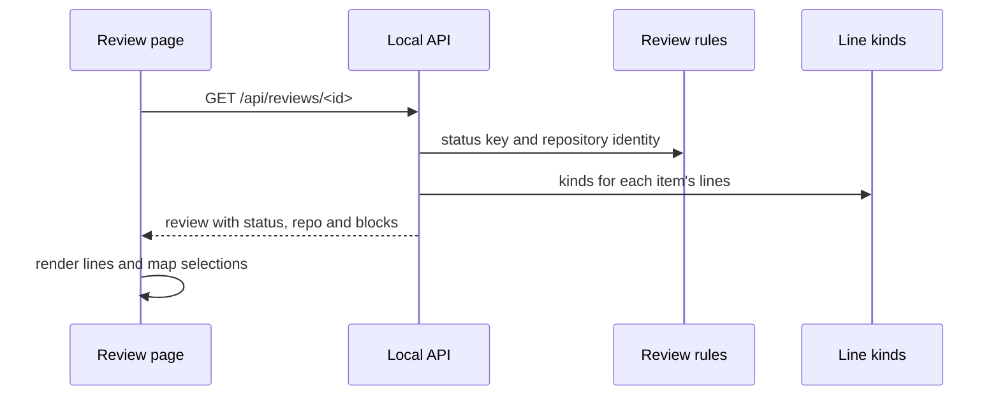

# CR-9: LLD

Status: approved · Revision: 7 · PRD: approved (revision 2) · HLD: approved (revision 3)

This document says how each HLD component is built, at the level the team needs to agree on before
coding. Code-level detail is limited to new files, design patterns and the public interfaces
between layers and packages. Logic inside a file is left to code review.

## Line kinds (server and pages)

- Responsibility: one place decides each line's kind and indent, for the server and the pages
  (HLD D-5).
- New files: `web/blocks.js`, a module with no page or server dependencies, and its type
  declaration `web/blocks.d.ts`.
- Design pattern: a shared pure module. The markdown parser, the line splitter in the contract and
  the edit engine import it, and so do the pages. So the rules can't drift apart.
- Input: the stored, untrimmed body lines of an item, so indents are known. The output stays
  parallel to the lines that `itemLines` returns, which skips blank lines as today. Question choices
  and a `Check:` line are paragraphs.
- The edit engine's structure check uses `pieceMarker`, which gives exactly the results of today's
  rule. So the agent tools refuse the same edits as before, and no more.
- Errors: none. A line it can't classify is a paragraph.

## Status keys and repository identity (server)

- Responsibility: the review rules in `src/rules.ts` give each review a status key, and a helper in
  `src/util.ts` gives each folder a repository identity (HLD D-6).
- Design pattern: the server owns the rule, and the pages only map keys to labels and icons.
- Status keys: `awaiting_review`, `commented`, `changes_requested`, `approved` and `closed`. An
  approved but unmerged GitHub review is `awaiting_review`, and its `status_note` says "Approved on
  GitHub, waiting for merge".
- Errors: a missing or unreadable folder gives no identity. Then `repo` is left out of the
  response, and the request still succeeds.

## Shared page modules

- New files: `web/esc.js` holds escaping, and `web/status.js` holds each status key's label, tone
  and icon. `web/icons.js` holds the icons, `web/frame.js` the page frame and `web/inline.js` the
  line renderer. Each module that a test imports gets a `.d.ts` declaration.
- Design pattern: small modules with no page side effects, imported by the existing pages. They
  import each other by relative path, so unit tests can load them in Node. Each one is added to the
  server's list of page files.
- `web/status.js` covers review status keys, tracker item statuses (queued, todo, in progress, in
  review, blocked, done, dropped and closed) and change steps. Tracker values match without regard
  to case, and an unknown value shows as a neutral chip with its own text.

## Line renderer and comment tools (pages)

- Responsibility: show each line as formatted text, and map every selection back to the source
  text, so comments anchor exactly as before.
- Design pattern: the renderer owns the map from what is shown to source positions. The comment
  tools only supply decorations (highlights and tracked changes) and read positions from the map.
- States: a selection inside a formatted run widens to the whole run, so quotes keep whole markers.
- Trust boundary: markup comes only from escaped text and a fixed set of tags. A link opens only an
  http or https address, and any other link shows only its text.
- Errors: a line that fails to render shows as plain text, and the page still loads. A kind the
  renderer doesn't know shows as written. A suggestion that would change a line's structure is
  stopped on the page, which calls `pieceMarker` for the same check as the server.

## Pages

- The review list groups reviews by status key, with counts. It has no tracker link of its own,
  because the frame holds it.
- The review page renders every line through the renderer, and shows the frame, the badge and the
  revision. When `/api/info` fails, the frame shows no repository name.
- The tracker page sits inside the frame, and formats only item text, never description blocks or
  other tables.

## Public interfaces between layers

The server and the pages meet only at the local API. These are the changes to it.

- `GET /api/reviews`: each review gains `status_key`, `status_note` when there is one, and `repo`. A
  repo is `{ name, key }`: a display name and an opaque key. The existing `status` field keeps its
  meaning, because the pages use it to freeze approved reviews.
- `GET /api/reviews/<id>`: the response gains `status_key`, `status_note` and `repo` next to
  `meta`. Each item in the current and previous revisions gains `blocks`, parallel to its `lines`.
- A block is `{ kind, indent }`. The kinds are paragraph, list item, quote, code block, break and
  table row. Later changes may add kinds, so the pages show an unknown kind as written.
- The response gains `history_blocks`, a map from revision to a map from item ID to blocks. It sits
  beside `history`, so it can never clash with an item ID.
- `GET /api/info` (new): the served folder's repository identity.
- Nothing else in the API, the agent tools, the commands or the stored files changes.

Inside the pages, the existing page modules call the new modules through these public functions:

- `renderLine(text, decorations, block, range)` and `shownText(text, block)` in `web/inline.js`.
- `widen(text, block, start, end)` in `web/inline.js`, for selections.
- `statusBadge(key)` and `statusChip(value)` in `web/status.js`, and `frame(current, body, repo)`
  in `web/frame.js`.

Inside the server, the contract, the markdown parser and the edit engine call
`blockKinds(rawLines)` and `pieceMarker(piece)` in `web/blocks.js`. The review page calls
`pieceMarker(piece)` too, for its suggestion check.

## Rollout and rollback

- The new fields are added to read responses only, and stored reviews don't change. Reviews stored
  before this change get their kinds when they are read. Rolling back is reverting the pull
  requests.

## Test plan

| Requirement | What the test proves | Level |
|---|---|---|
| FR-1, FR-3 | Every page shows the same frame, and the list is grouped by status. | browser, integration |
| FR-2 | Every status key gets one label, color and icon on every page. | unit, browser |
| FR-4 | A sample document shows no markdown characters. | unit, browser |
| FR-5, FR-5a | Selections and typed words inside formatted text store the right source quote. | unit, browser |
| FR-6 to FR-9 | The gutter, hidden IDs, labels, the automatic TL;DR and badges behave as the PRD says. | browser |
| NFR-1 to NFR-3 | The pages work in both themes, at 400 pixels, from the keyboard, offline and without serious accessibility problems. | browser |
| Trust boundary | Only escaped text and the fixed tags reach the page, and only http and https links open. | unit |
| Speed | A 1000-line document renders in under 200 milliseconds. | browser |
| No regressions | The line kinds match the parser on every file in `docs/`, and the comment anchors on stored reviews don't move. | unit |
| Same refusals | `pieceMarker` refuses exactly the edits that today's rule refuses, on every line in `docs/`. | unit |

## Pull requests

1. Status keys and icons: the status key, `web/esc.js`, `web/status.js` and `web/icons.js`.
2. Frame and list: repository identity, `/api/info`, `web/frame.js` and the grouped list.
3. Line kinds, renderer and selections: `web/blocks.js`, the `blocks` field, `web/inline.js` and
   the selection mapping, together so a selection never points at the wrong words.
4. Comment tools and review page: typed words, quotes, suggestions, labels and the page details.
5. Page checks: themes, phone width, keyboard use, accessibility, blocked requests and speed.

Each pull request adds its new page modules to the server's list of page files. It lists the
existing assertions it changes on purpose, and why. It records one browser test run with
`HOOP_REQUIRE_BROWSER=1` set, so a skipped browser can't hide a failure.
